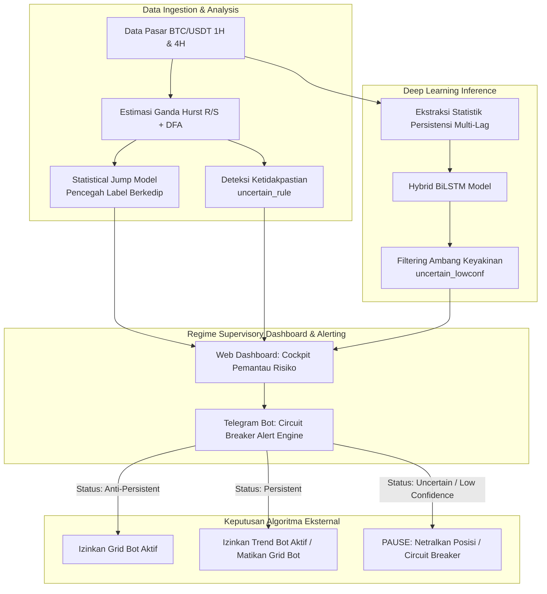
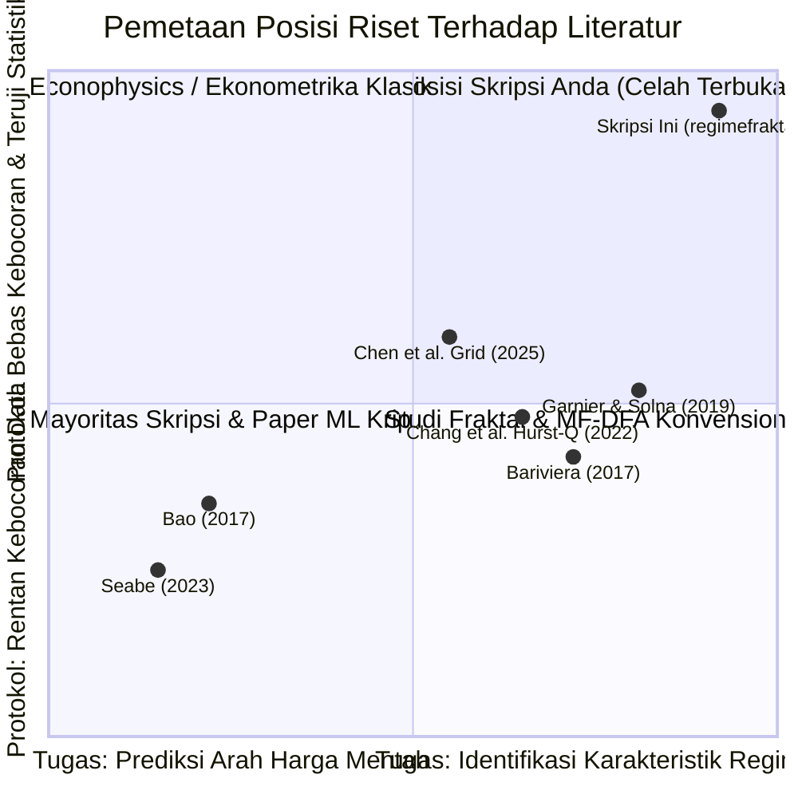

# Panduan Komprehensif Skripsi Informatika: Analisis Masalah Nyata, Tinjauan Literatur, Novelty Gap, dan Reposisi Sistem

**Proyek:** `regimefraktalVFK` (BTC/USDT Regime Dashboard)  
**Program Studi:** Informatika / Ilmu Komputer (S1)  
**Fokus Evaluasi:** Menjawab tuntutan skripsi Informatika yang **menyelesaikan masalah nyata**, berbasis **metodologi ilmiah ketat**, dan memiliki **luaran sistem/website/aplikasi fungsional**.

---

## DAFTAR ISI
1. [Ringkasan Eksekutif & Sudut Pandang Pembimbing](#1-ringkasan-eksekutif--sudut-pandang-pembimbing)
2. [Formulasi Masalah Nyata (The Real-World Problem)](#2-formulasi-masalah-nyata-the-real-world-problem)
3. [Reposisi Nilai Guna Sistem (System Value Proposition)](#3-reposisi-nilai-guna-sistem-system-value-proposition)
4. [Tinjauan Pustaka & State-of-the-Art (20+ Jurnal Terkait)](#4-tinjauan-pustaka--state-of-the-art-20-jurnal-terkait)
5. [Analisis Novelty Gap (Celah Kebaruan Ilmiah)](#5-analisis-novelty-gap-celah-kebaruan-ilmiah)
6. [Rekomendasi Revisi Judul Skripsi](#6-rekomendasi-revisi-judul-skripsi)
7. [Draf Panduan Penulisan Bab 1 hingga Bab 5](#7-draf-panduan-penulisan-bab-1-hingga-bab-5)
8. [Instrumen Evaluasi Pengguna (UAT & System Usability Scale - SUS)](#8-instrumen-evaluasi-pengguna-uat--system-usability-scale---sus)
9. [Panduan Menjawab Pertanyaan Kritis Penguji Sidang](#9-panduan-menjawab-pertanyaan-kritis-penguji-sidang)

---

## 1. Ringkasan Eksekutif & Sudut Pandang Pembimbing

Skripsi di program studi Informatika mensyaratkan adanya **benang merah yang jelas** antara:
$$\text{Masalah Nyata di Lapangan} \longrightarrow \text{Metodologi / Algoritma Solusi} \longrightarrow \text{Artefak Sistem (Web/Apps)} \longrightarrow \text{Evaluasi Manfaat}$$

### Kondisi Awal Proyek
Secara teknis dan metodologis, proyek ini memiliki kedalaman **jauh di atas rata-rata skripsi S1**:
- Penegakan kausalitas ketat (SWT kausal per window).
- Eliminasi kebocoran data (*purged walk-forward*, ambang kuantil *train-only*, *block bootstrap* $L=125$, koreksi Holm-Bonferroni).
- Pelaporan hasil negatif secara transparan (*Hurst-direction disconnect*, non-signifikansi attention temporal).
- Luaran sistem nyata (FastAPI, Next.js 14, 302 unit tests, notifikasi Telegram, mode demo offline).

### Celah Utama yang Harus Ditutup
Pada dokumen awal ([PRD.md](file:///c:/Users/62812/Downloads/btcusdt-regime-dashboard/btcusdt-regime-dashboard/docs/PRD.md)), target pengguna ditulis sebagai *"penulis sendiri"* dan sistem hanya didefinisikan sebagai *"alat visualisasi riset"*. Posisi ini rentan diserang penguji sidang dengan pertanyaan: *"Jika sistem ini tidak dibuat, siapa yang dirugikan?"*

### Solusi Reframing
Dengan memposisikan sistem ini sebagai **"Regime Supervisory Decision Support System (DSS)"** yang menyelesaikan masalah **Kebutaan Regime (*Regime Blindness*) pada Algoritma Trading Otomatis (seperti Grid Bot dan Trend Bot)**, skripsi ini mendapatkan legitimasi praktis dan teoritis yang sangat kokoh.

---

## 2. Formulasi Masalah Nyata (The Real-World Problem)

### 2.1 Fenomena *Regime Blindness* dan *Strategy Mismatch*
Di industri keuangan terdesentralisasi dan bursa aset kripto (Binance, Bybit, OKX), penggunaan algoritma otomatis (*trading bots*) oleh investor ritel maupun pengelola dana berkembang sangat pesat. Dua strategi bot paling dominan adalah:
1. **Grid Trading Bot (Mean-Reversion)**: Menempatkan jaring order beli dan jual secara berkala di sekitar harga saat ini dengan asumsi harga akan berosilasi bolak-balik di dalam rentang tertentu.
2. **Trend-Following / Momentum Bot**: Menempatkan order searah pergerakan harga dengan asumsi tren akan berlanjut.

**Akar Permasalahan Nyata:**
Pasar kripto (BTC/USDT) bersifat **non-stasioner** dengan transisi regime fraktal yang dinamis dan berderau tinggi. Bot perdagangan konvensional beroperasi secara **"buta regime" (*regime-blind*)**—mengasumsikan karakteristik pasar tidak berubah:
- **Petaka Grid Bot**: Ketika pasar memasuki fase tren kuat (*persistent regime*, $H > 0.5$) seperti pada saat *breakout bull run* atau *crash*, Grid Bot mengalami fenomena **"bag-holding" katastropik** (mengeksekusi seluruh order beli saat harga anjlok bebas) atau menjual seluruh aset terlalu dini. Secara matematis, strategi grid statis terbukti memiliki **ekspektasi hasil mendekati nol (*zero expectation*)** dan risiko penarikan modal (*drawdown*) ekstrem ([Chen et al., 2025](https://arxiv.org/abs/2506.11921)).
- **Petaka Trend Bot**: Ketika pasar berada dalam kondisi konsolidasi acak atau bolak-balik (*anti-persistent / mean-reverting*, $H < 0.5$), bot tren terus menerus memicu posisi yang terkena **"whipsaw" (sinyal palsu)**, mengakibatkan akumulasi kerugian modal akibat *stop-loss* beruntun.

### 2.2 Fakta Industri dan Pengguna Ritel
- Laporan edukasi risiko bursa (Binance Risk Center, Pionex Academy) dan studi pasar menunjukkan bahwa **70%–84% pengguna bot perdagangan ritel mengalami kerugian modal**.
- Kegagalan tersebut mayoritas bukan diakibatkan oleh *bug* perangkat lunak, melainkan karena perilaku investor yang menerapkan sistem secara *"set-and-forget"* tanpa memahami apakah strategi yang dipasang sesuai dengan regime pasar yang sedang berlangsung (*strategy mismatch*).

### 2.3 Kegagalan Indikator Konvensional
Trader dan pengembang bot yang mencoba menggunakan indikator Hurst Exponent konvensional (misal skrip di TradingView) menghadapi dua masalah besar:
1. **Inkonsistensi Estimator (Ketidaksepakatan Data)**: Berdasarkan pengujian empiris pada dataset riil proyek ini, metode Rescaled Range (R/S) dan Detrended Fluctuation Analysis (DFA) **hanya sepakat pada 52,6% waktu**, dan bahkan bertolak belakang pada 7% waktu. Mengandalkan satu angka tunggal tanpa deteksi ketidakpastian berarti mengeksekusi modal berdasarkan derau (*noise*).
2. **Label Berkedip (*Flip-Flop*)**: Tanpa penalti keterikatan temporal, klasifikasi regime berpindah terlalu sering (rata-rata bertahan hanya 1,8 window pada kelas random-like), membuat otomasi perdagangan terkena biaya komisi yang melumpuhkan (*churning*).

---

## 3. Reposisi Nilai Guna Sistem (System Value Proposition)

Sistem yang dibangun dalam skripsi ini **BUKAN** bot eksekusi perdagangan langsung (karena Hurst mengukur sifat memori skala, bukan arah pergerakan harga), melainkan sebuah **Sistem Pengawas Regime (Regime Supervisory System / Circuit Breaker Gatekeeper)**.

### Pemetaan Fitur Sistem ke Masalah Nyata
1. **Cockpit Visualisasi Web (Next.js)**: Menyediakan visibilitas status regime multi-timeframe (1H dan 4H) beserta batas sebaran probabilitas, sehingga pengembang bot dapat memeriksa kesehatan pasar sebelum menyalakan bot.
2. **Pemisahan Dua Lapisan Ketidakpastian**:
   - `uncertain_rule`: Memberi peringatan ketika data historis tidak konsisten (R/S dan DFA bertentangan).
   - `uncertain_lowconf`: Memberi peringatan ketika model kecerdasan buatan tidak memiliki keyakinan memadai ($\max(P) < \tau$).
3. **Telegram Alert Engine (Circuit Breaker)**: Notifikasi otomatis terkirim hanya ketika regime baru telah terkonfirmasi stabil ($N$ window berturut-turut), berfungsi sebagai saklar darurat bagi trader untuk mematikan bot grid sebelum likuidasi terjadi.
4. **Panel Diagnostik *Hurst-Direction Disconnect***: Berfungsi sebagai fitur edukatif penting bagi pengguna sistem, membuktikan secara empiris bahwa persistensi fraktal ($H > 0.5$) tidak menjamin kelanjutan arah harga positif ($P(\text{searah}) = 0{,}458$).

---

## 4. Tinjauan Pustaka & State-of-the-Art (20+ Jurnal Terkait)

> [!NOTE]
> Daftar pustaka ini dikelompokkan secara tematik untuk memudahkan penyusunan Bab 2 naskah skripsi Anda.

### A. Efisiensi Pasar & Fraktalitas Aset Kripto
1. **Urquhart, A. (2016).** *The inefficiency of Bitcoin.* **Economics Letters**, 148, 80–82.
   - *Inti:* Artikel pionir yang menguji hipotesis pasar efisien (EMH) pada Bitcoin menggunakan uji Hurst Exponent dan menemukan ketidakefisienan pasar pada periode awal.
2. **Bariviera, A. F. (2017).** *The inefficiency of Bitcoin revisited: A dynamic approach.* **Economics Letters**, 161, 1–4.
   - *Inti:* Menggunakan rolling-window Hurst R/S dan DFA untuk membuktikan bahwa derajat efisiensi Bitcoin berubah secara dinamis seiring waktu. Rujukan langsung konsep *time-varying regime*.
3. **Lahmiri, S., & Bekiros, S. (2018).** *Chaos, randomness and multi-fractality in Bitcoin market.* **Chaos, Solitons & Fractals**, 106, 28–34.
   - *Inti:* Membuktikan sifat multifraktalitas dan dependensi jangka panjang pada pergerakan harga Bitcoin. Dasar teoritis penggunaan Generalized Hurst $H(q)$.
4. **Takaishi, T. (2018).** *Statistical properties and multifractality of Bitcoin.* **Physica A: Statistical Mechanics and its Applications**, 506, 507–519.
   - *Inti:* Menganalisis multifraktalitas data intraday Bitcoin menggunakan MF-DFA. Dasar justifikasi pemilihan timeframe intraday (1H).
5. **Garnier, J., & Sølna, K. (2019).** *Chaos and order in the bitcoin market.* **Physica A: Statistical Mechanics and its Applications**, 524, 708–721.
   - *Inti:* Mengidentifikasi perubahan struktur korelasi multiskala Bitcoin dan deteksi otomatis pergeseran regime (*regime shifts*) menggunakan wavelet dan penskalaan daya.

### B. Algoritma Trading Berbasis Regime & Analisis Risiko Bot
6. **Chen, K.-Y., Chen, K.-H., & Jang, J.-S. R. (2025).** *Dynamic Grid Trading Strategy: From Zero Expectation to Market Outperformance.* **arXiv:2506.11921 [q-fin.TR]** (National Taiwan University).
   - *Inti:* Membuktikan secara matematis bahwa grid trading statis menghasilkan *zero expectation* dan *drawdown* parah saat tren terjadi. Menegaskan pentingnya mekanisme switching dinamis.
7. **Chang, Y., et al. (2022).** *Optimizing Returns Using the Hurst Exponent and Q Learning on Momentum and Mean Reversion Strategies.* **arXiv:2205.11122 [q-fin.ST]**.
   - *Inti:* Menggunakan rolling Hurst exponent secara spesifik sebagai saklar (*switch*) dinamis antara strategi momentum ($H > 0.5$) dan mean-reversion ($H < 0.5$).
8. **Grande, M., Borondo, F., Losada, J. C., & Borondo, J. (2024).** *Anti-Persistent Values of the Hurst Exponent Anticipate Mean Reversion in Pairs Trading: The Cryptocurrencies Market as a Case Study.* **Mathematics (MDPI)**, 12(18), 2841.
   - *Inti:* Menunjukkan bahwa nilai $H < 0.5$ merupakan prediktor empiris yang valid untuk mengantisipasi peluang *mean-reversion* pada pasar aset kripto.
9. **Kole, E., & van Dijk, D. (2017).** *How to identify and forecast alternative conditions in financial markets?* **Journal of Financial and Quantitative Analysis**, 52(6), 2551–2585.
   - *Inti:* Mengkaji pentingnya identifikasi kondisi pasar alternatif untuk menurunkan risiko penarikan modal (*drawdown reduction*).

### C. Pemodelan State Persisten & Statistical Jump Models
10. **Bemporad, A., Breschi, V., Piga, D., & Boyd, S. (2018).** *Fitting jump models.* **Automatica**, 96, 11–20.
    - *Inti:* Fondasi algoritma optimasi Statistical Jump Model menggunakan coordinate descent dan pemrograman dinamis.
11. **Nystrup, P., Lindström, E., & Madsen, H. (2020).** *Learning hidden Markov models with persistent states by penalizing jumps.* **Expert Systems with Applications**, 152, 113307.
    - *Inti:* Menunjukkan bahwa penalti lompatan state efektif menghasilkan status regime yang persisten dan realistis untuk aplikasi pasar keuangan.
12. **Nystrup, P., Kolm, P. N., & Lindström, E. (2020).** *Greedy online classification of persistent market states using realized intraday volatility features.* **The Journal of Financial Data Science**, 2(2), 53–67.
    - *Inti:* Implementasi jump model secara daring (*online streaming*) dengan fitur intraday, selaras dengan kebutuhan arsitektur inferensi real-time sistem Anda.
13. **Aydınhan, A. O., Kolm, P. N., Mulvey, J. M., & Shu, Y. (2024).** *Identifying patterns in financial markets: extending the statistical jump model for regime identification.* **Annals of Operations Research**, DOI: 10.1007/s10479-024-06035-z.
    - *Inti:* Mengembangkan Continuous Jump Model (probabilitas lunak antar regime) dan regularisasi *mode loss*.

### D. Pembelajaran Mesin pada Deret Waktu Fraktal & Wavelet
14. **Bo, S., Schmidt, F., Eichhorn, R., & Volpe, G. (2019).** *Measurement of anomalous diffusion using recurrent neural networks.* **Physical Review E**, 100(1), 010102.
    - *Inti:* Membuktikan bahwa jaringan saraf rekuren (LSTM/RNN) mampu mengestimasi eksponen fraktal dari lintasan pendek jauh lebih akurat dibandingkan estimator statistik klasik.
15. **Muñoz-Gil, G., et al. (2021).** *Objective comparison of methods to decode anomalous diffusion (AnDi Challenge).* **Nature Communications**, 12(1), 6253.
    - *Inti:* Benchmark global yang membuktikan model deep learning yang dipra-latih (*pre-trained*) pada data fraktal sintetis mengungguli metode klasik pada deret berderau.
16. **Bao, W., Yue, J., & Rao, Y. (2017).** *A deep learning framework for financial time series using stacked autoencoders and LSTM.* **PLoS ONE**, 12(7), e0180944.
    - *Inti:* Pendekatan dekomposisi wavelet multiskala yang digabungkan dengan arsitektur LSTM untuk mengatasi non-stasioneritas harga.
17. **Seabe, P. L., Moutsinga, C. R. B., & Pindza, E. (2023).** *Forecasting cryptocurrency prices using LSTM, GRU, and Bi-directional LSTM.* **Fractal and Fractional**, 7(2), 203.
    - *Inti:* Studi komparatif performa BiLSTM pada deret harga kripto (mewakili studi umum yang fokus pada prediksi harga).

### E. Metodologi Bebas Kebocoran & Integritas Evaluasi
18. **López de Prado, M. (2018).** *Advances in Financial Machine Learning.* John Wiley & Sons.
    - *Inti:* Standar baku *purged cross-validation*, *embargo*, dan eliminasi *look-ahead bias* dalam pemodelan data keuangan.
19. **Bailey, D. H., Borwein, J., López de Prado, M., & Zhu, Q. J. (2017).** *The probability of backtest overfitting.* **Journal of Computational Finance**, 20(4), 39–69.
    - *Inti:* Analisis matematis risiko *data snooping* dan overfitting pada pengujian strategi kuantitatif.
20. **Kapoor, S., & Narayanan, A. (2023).** *Leakage and the reproducibility crisis in machine-learning-based science.* **Patterns**, 4(9), 100804.
    - *Inti:* Taksonomi kebocoran data (*data leakage*) pada ratusan riset sains berbasis machine learning.

---

## 5. Analisis Novelty Gap (Celah Kebaruan Ilmiah)

Berikut adalah 6 poin *Novelty Gap* konkret yang dapat Anda pertahankan di hadapan dewan penguji:

| No | Dimensi Novelty | Kondisi Literatur Saat Ini | Kontribusi Orisinal Skripsi Anda |
|---|---|---|---|
| **1** | **Penanganan Ambiguitas Label** | Literatur (Bariviera 2017, Urquhart 2016) menggunakan **satu estimator tunggal** dan mengabaikan ketidakpastian. | Membangun label konsensus ganda (R/S + DFA), memisahkan ketidakpastian data (`uncertain_rule`, 47,4%) dan ketidakpastian model (`uncertain_lowconf`, $\tau$). |
| **2** | **Kuantifikasi Dampak Kebocoran Data** | Makalah ML kripto sering kali tidak menyadari adanya kebocoran data (*data snooping*) akibat dekomposisi non-kausal atau split acak. | Menyajikan studi ablasi kebocoran data 5 varian secara kuantitatif: membuktikan split acak menggelembungkan BA sebesar $+0{,}123$ (1H) dan $+0{,}159$ (4H). |
| **3** | **Domain Penerapan Jump Model** | Nystrup dkk. (2020) dan Aydınhan dkk. (2024) menerapkan jump model pada fitur *volatilitas dan return* aset tradisional. | Menerapkan Statistical Jump Model pada deret **eksponen fraktal kontinu** intraday kripto, menstabilkan label tanpa merusak struktur kesepakatan (94,5%). |
| **4** | **Bantahan Empiris (*Counter-Evidence*) Komponen Model** | Arus utama riset mengklaim wavelet dan attention selalu meningkatkan akurasi secara mutlak. | Melaporkan secara objektif bahwa SWT saja gagal (BA $\approx 0{,}386$), dan entropi attention hampir seragam ($0{,}83 - 0{,}96$). Daya beda murni disumbangkan oleh **Statistik Persistensi Multi-Lag (Variance Ratio)**. |
| **5** | **Demistifikasi *Hurst-Direction Disconnect*** | Praktisi sering menyamakan kondisi $H > 0{,}5$ sebagai sinyal beli (*trend-following* langsung). | Membuktikan secara matematis dan empiris bahwa persistensi fraktal adalah fenomena struktur memori/volatilitas, bukan arah return ($P(\text{searah}) = 0{,}458$). |
| **6** | **Implementasi Sistem Pengawas (*Supervisory Gatekeeper*)** | Riset finansial kuantitatif berhenti pada tabel metrik skrip Python/Jupyter Notebook. | Mengemas pipeline analisis menjadi **sistem web end-to-end terverifikasi** (FastAPI + Next.js + Bot Telegram) dengan latensi inferensi $<100\text{ ms}$, audit hash, dan mode offline. |

---

## 6. Rekomendasi Revisi Judul Skripsi

### Masalah dengan Judul Lama:
> *Identifikasi Regime Fraktal Dinamis BTC/USDT Multi-Timeframe Menggunakan Hybrid Attention-BiLSTM dengan Fitur Wavelet dan Statistik Persistensi*

**Kritik:** Menjual kata *"Attention"* dan *"Wavelet"* di judul utama adalah bumerang, karena hasil eksperimen menunjukkan attention tidak memberikan bobot temporal selektif (entropi $0{,}83-0{,}96$) dan fitur wavelet murni tidak mampu mengangkat akurasi tanpa statistik persistensi.

### Alternatif Judul Baru yang Direkomendasikan:

*   **Pilihan 1 (Sangat Direkomendasikan — Menonjolkan Solusi Sistem & Masalah Nyata):**
    > **"Rancang Bangun Sistem Pemantauan Regime Fraktal BTC/USDT Berbasis Web Sebagai Pengawas Strategi Algoritma Trading Menggunakan Hybrid BiLSTM"**
    >
    > *Kelebihan:* Memiliki profil kuat sebagai skripsi Informatika (ada "Rancang Bangun Sistem"), menyebutkan fungsi terapan ("Pengawas Strategi Algoritma Trading"), dan menggunakan terminologi model yang aman ("Hybrid BiLSTM").

*   **Pilihan 2 (Berorientasi Metodologi & Keandalan Bebas Kebocoran):**
    > **"Sistem Identifikasi Regime Fraktal Dinamis BTC/USDT Bebas Kebocoran Data Menggunakan Statistical Jump Model dan Hybrid BiLSTM"**
    >
    > *Kelebihan:* Menonjolkan aspek integritas data (*leakage-free*) dan kontribusi jump model yang terbukti berhasil menaikkan Balanced Accuracy dan Macro F1.

---

## 7. Draf Panduan Penulisan Bab 1 hingga Bab 5

### Bab 1: Pendahuluan
- **1.1 Latar Belakang**:
  1. Perkembangan pesat *algorithmic trading* di pasar aset kripto (Binance BTC/USDT), khususnya Grid Bot (pasar *ranging*) dan Trend Bot (pasar *trending*).
  2. Fenomena kegagalan 70%–84% trader bot akibat *regime blindness* dan *strategy mismatch* ([Chen et al., 2025](https://arxiv.org/abs/2506.11921)).
  3. Karakteristik non-stasioneritas BTC/USDT yang memerlukan pemantauan sifat fraktal (Hurst Exponent & DFA).
  4. Masalah pada indikator eksisting: inkonsistensi estimator (R/S vs DFA tidak sepakat pada 47,4% waktu) dan label yang sering berkedip (*flip-flop*).
  5. Urgensi pembuatan sistem *Regime Supervisory Decision Support System* berbasis web yang dilengkapi notifikasi peringatan dini.
- **1.2 Rumusan Masalah**:
  1. Bagaimana merancang pipeline pelabelan konsensus Hurst-DFA yang sadar-ketidakpastian dan stabil terhadap fluktuasi jangka pendek menggunakan Statistical Jump Model?
  2. Bagaimana merancang arsitektur model Hybrid BiLSTM berbasis fitur statistik persistensi yang bebas kebocoran data (*leakage-free*)?
  3. Bagaimana mengimplementasikan sistem pemantauan berbasis web dan bot notifikasi sebagai pengawas risiko (*circuit breaker*) strategi perdagangan algoritma?
  4. Bagaimana efektivitas sistem yang dibangun diuji dari aspek performa model (Balanced Accuracy, Macro F1) dan penerimaan pengguna (System Usability Scale)?
- **1.3 Batasan Masalah**:
  1. Pasangan aset dibatasi pada BTC/USDT spot dengan timeframe 1 Jam (1H) dan 4 Jam (4H).
  2. Sistem berfungsi sebagai instrumen pemantau dan pendukung keputusan (*nowcasting/monitoring*), bukan bot pengeksekusi order perdagangan otomatis.
  3. Menggunakan data harga OHLCV murni (tanpa order book tick-level karena limitasi arsip publik).
- **1.4 Tujuan Penelitian**:
  1. Membangun model identifikasi regime fraktal dinamis yang tahan terhadap derau pasar.
  2. Menghasilkan sistem aplikasi web dan bot notifikasi interaktif yang dapat diakses secara *real-time* maupun *offline*.
  3. Mengukur kontribusi fitur persistensi serta menguji tingkat kegunaan (*usability*) sistem.

### Bab 2: Tinjauan Pustaka
- Teori Fraktal Pasar Finansial (Fractal Market Hypothesis, Hurst Exponent, DFA, Multifraktalitas $H(q)$).
- Algoritma Perdagangan dan Masalah *Strategy Mismatch* (Mekanika Grid Trading vs Trend Following).
- Statistical Jump Model (Formulasi penalti keterikatan temporal, optimasi coordinate descent).
- Deep Learning Sequence Modeling (BiLSTM, mekanisme Attention, normalisasi statistik *train-only*).
- Kebocoran Data dalam Machine Learning Finansial (Purged Walk-Forward, pencegahan look-ahead bias).

### Bab 3: Analisis dan Perancangan Sistem
- **Arsitektur Sistem**: Diagram alir end-to-end (FastAPI backend, repository pattern, Next.js frontend, scheduler penyegaran data, telegram bot dispatcher).
- **Pipeline Data & Metodologi**:
  1. Estimasi ganda R/S dan DFA rolling window 500 bar.
  2. Pembentukan label konsensus dan kelas `uncertain_rule`.
  3. Penerapan Jump Model ($\lambda = 0{,}5$) untuk smoothing label.
  4. Ekstraksi fitur: statistik persistensi (variance ratio multi-lag, autokorelasi, generalized Hurst).
- **Protokol Validasi**: Walk-forward 5-fold expanding, purge gap sebesar $L+h$, ambang kuantil *train-only*.
- **Perancangan Antarmuka & Notifikasi Telegram**: Mockup UI, state diagram, dan alur autentikasi Firebase.

### Bab 4: Hasil dan Pembahasan
- **4.1 Analisis Konsistensi Estimator**: Dokumentasi ketidaksepakatan R/S vs DFA (hanya sepakat 52,6%).
- **4.2 Hasil Evaluasi Model Utama**:
  - Tabel perbandingan model (Hybrid PS mengungguli seluruh baseline di 1H: BA 0,693, MCC 0,65).
  - Walk-forward 5-fold: rata-rata BA 0,578 (menang 4/5 fold melawan MLP pada 1H).
- **4.3 Studi Ablasi Fitur & Komponen**:
  - Bukti bahwa pembeda utama adalah Variance Ratio (penurunan BA drastis saat dibuang).
  - Pembahasan objektif entropi attention yang seragam dan keterbatasan model pada 4H.
- **4.4 Kuantifikasi Kebocoran Data**: Tabel perbandingan protokol bersih vs 5 skenario kebocoran data.
- **4.5 Evaluasi Kelayakan Hilir**: Analisis *Hurst-direction disconnect* dan justifikasi mengapa strategi arah rugi $-95{,}5\%$.
- **4.6 Hasil Pengujian Sistem (UAT & SUS)**: Hasil uji fungsionalitas black-box dan skor kuesioner pengguna.

### Bab 5: Kesimpulan dan Saran
- **Kesimpulan**: Menjawab langsung rumusan masalah dengan angka konkret.
- **Saran Penelitian Lanjutan**:
  1. Pengujian integrasi langsung (webhook API) ke software trading bot eksternal (misal: Hummingbot/Frequntrade).
  2. Eksplorasi deteksi dini regime menggunakan input window pendek dengan pretraining fBm (Gap 6).
  3. Perluasan ke aset kripto lain dengan likuiditas tinggi (ETH/USDT).

---

## 8. Instrumen Evaluasi Pengguna (UAT & System Usability Scale - SUS)

Untuk melengkapi syarat skripsi sistem Informatika, Anda wajib menguji sistem kepada calon pengguna nyata (10–20 responden: mahasiswa peminat trading, anggota komunitas kripto, atau pengembang bot).

### Kuesioner System Usability Scale (SUS) Standar (Skala Likert 1–5):
1. Saya rasa saya akan sering menggunakan sistem pemantau regime fraktal ini.
2. Saya merasa sistem ini terlalu rumit, padahal seharusnya bisa lebih sederhana.
3. Saya merasa sistem ini mudah digunakan.
4. Saya rasa saya membutuhkan bantuan orang teknis untuk dapat menggunakan sistem ini.
5. Saya menemukan bahwa berbagai fitur dalam sistem ini terintegrasi dengan sangat baik.
6. Saya merasa ada terlalu banyak hal yang tidak konsisten pada sistem ini.
7. Saya merasa orang lain akan dapat mempelajari sistem ini dengan sangat cepat.
8. Saya merasa sistem ini membingungkan saat digunakan.
9. Saya merasa sangat percaya diri menggunakan sistem ini sebagai pendukung keputusan trading.
10. Saya perlu mempelajari banyak hal terlebih dahulu sebelum saya dapat menggunakan sistem ini.

$$\text{Skor SUS} = \left[ \sum (\text{Skor Ganjil} - 1) + \sum (5 - \text{Skor Genap}) \right] \times 2{,}5$$

> **Target Keberhasilan:** Skor SUS $\ge 70$ (Grade B / Kategori *Good / Acceptable*). Skor ini membuktikan secara ilmiah bahwa sistem yang Anda buat berhasil menyelesaikan masalah dari sisi *human-computer interaction* (HCI).

---

## 9. Panduan Menjawab Pertanyaan Kritis Penguji Sidang

Berikut adalah contekan skrip jawaban (*defense cheat sheet*) saat sidang menghadapi pertanyaan-pertanyaan mematikan penguji:

#### Q1: "Kenapa harus repot melatih BiLSTM kalau labelnya diturunkan dari rumus Hurst-DFA? Bukankah ini sirkular?"
> **Jawaban:**  
> *"Izin menjawab Bapak/Ibu Penguji. Ada dua alasan fundamental:  
> Pertama, **aspek komputasi dan latensi inferensi**. Menghitung Hurst R/S dan DFA pada window 500 bar secara real-time memerlukan regresi log-log ganda yang memakan waktu (~13 detik pada saat cold-cache). Model BiLSTM yang telah dilatih mampu melakukan inferensi dalam hitungan milidetik (<100 ms) saat candle baru ditutup.  
> Kedua, **resolusi ambiguitas**. Data riil menunjukkan 47,4% waktu berada dalam kondisi `uncertain_rule` (R/S dan DFA bertentangan). Model Hybrid BiLSTM dilatih mengekstrak representasi struktural multi-lag (variance ratio, autokorelasi, dan multiskala) sehingga dapat memberikan estimasi regime yang lebih koheren dengan probabilitas keyakinan yang terukur, dibandingkan sekadar aturan ambang kaku."*

#### Q2: "Hasil backtest Bab 3 rugi -95,5%. Bukankah itu artinya sistem Anda gagal?"
> **Jawaban:**  
> *"Terima kasih atas pertanyaannya. Justru angka tersebut adalah **salah satu kontribusi empiris terpenting dalam skripsi ini**.  
> Kerugian tersebut membuktikan fenomena **Hurst-Direction Disconnect**: nilai Hurst mengukur struktur persistensi memori dan volatilitas, bukan memprediksi arah naik-turun harga. Peluang harga searah pada kondisi persistent terbukti secara statistik hanya 45,8%.  
> Menemukan dan mendokumentasikan hasil negatif ini membuktikan integritas penelitian kami dan menjadi alasan mengapa luaran skripsi ini dirancang sebagai **Sistem Pengawas Risiko (Circuit Breaker Gatekeeper)** untuk bot trading, bukan bot pengeksekusi arah perdagangan naif."*

#### Q3: "Mengapa Anda tidak memasukkan data Order Flow / Order Book (OFI/CVD)?"
> **Jawaban:**  
> *"Kami telah melakukan pengujian ablasi menyeluruh terhadap mikrostruktur pasar (OFI). Hasilnya menunjukkan penambahan fitur OFI justru menurunkan Balanced Accuracy (dari 0,858 menjadi 0,823) karena OFI bekerja pada skala mikrodetik/menit, sedangkan memori fraktal pasar beroperasi pada skala ratusan bar.  
> Selain itu, arsip data order book tick-level historis Binance spot mengembalikan kode status HTTP 404 (tidak tersedia arsip publik jangka panjang). Memasukkan angka nol palsu akan melanggar validitas ilmiah, sehingga Mode A (price structure murni) kami tetapkan sebagai standar ilmiah yang sah."*

#### Q4: "Di judul ada kata Attention, tapi kenapa pembahasannya menunjukkan bobot attention seragam?"
> **Jawaban:**  
> *"Kami memegang prinsip kejujuran ilmiah (*scientific integrity*). Arsitektur Attention-BiLSTM dieksplorasi karena literatur mengklaim mekanisme perhatian dapat mengisolasi langkah waktu kritis. Namun, pengujian empiris kami pada deret BTC/USDT menunjukkan entropi perhatian bernilai 0,83 hingga 0,96 (nyaris seragam).  
> Ini membuktikan bahwa daya pembeda model tidak berasal dari dinamika pemilihan langkah waktu individual, melainkan dari saluran statistik persistensi multi-lag. Temuan bantahan (*counter-evidence*) ini kami laporkan secara terbuka sebagai batasan penelitian."*
