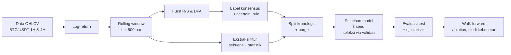
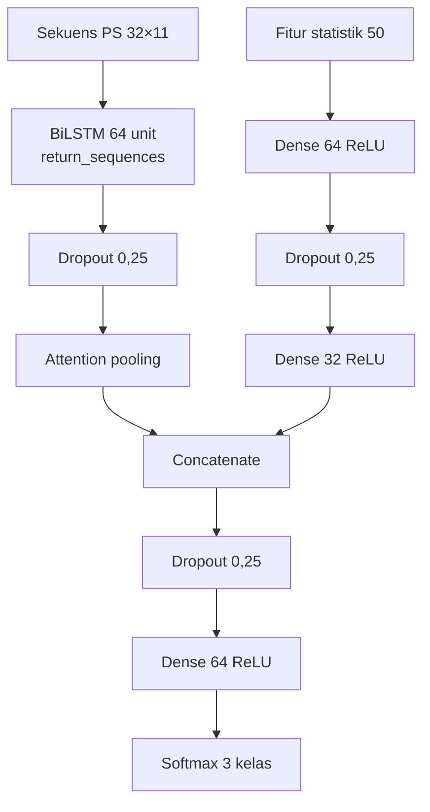

# BAB III METODOLOGI PENELITIAN

> Draf. Setiap parameter dirujuk ke berkas kode/konfigurasi agar dapat
> diverifikasi. Model usulan (Hybrid PS) ditetapkan lewat seleksi validasi
> sesuai praregistrasi `docs/praregistrasi_persistence_sequence.md`.

## 3.1 Kerangka Penelitian

Penelitian ini merupakan penelitian kuantitatif eksperimental di bidang
klasifikasi deret waktu. Alur penelitian:

Hurst R/S dan DFA hanya dipakai untuk membentuk **label**. Keduanya tidak
pernah dipakai sebagai **input** model, karena label dibentuk dari keduanya
melalui aturan ambang; memakainya sebagai input menghasilkan label sirkular
(model cukup menyalin aturan ambang).

## 3.2 Data

| Aspek | Nilai | Sumber |
|---|---|---|
| Aset | BTC/USDT spot, Binance | `config.yaml: data.symbol` |
| Timeframe | 1 jam (1H) dan 4 jam (4H) | `config.yaml: data.timeframes` |
| Rentang | 1 Januari 2019 – Oktober 2026 | `config.yaml: data.start` |
| Jumlah bar | 67.927 (1H), 16.992 (4H) | `data/processed/ohlcv_btcusdt_{tf}.parquet` |
| Kolom | open time (UTC), open, high, low, close, volume | `app/services/data_ingestion.py` |

Data diambil dari mirror resmi Binance (`data-api.binance.vision`). Bar yang
belum tutup (sedang berjalan) selalu dibuang (`source.drop_open_bar: true`)
karena nilainya masih berubah dan akan membuat label window terakhir tidak
stabil.

Harga diubah menjadi log-return

$$r_t = \ln P_t - \ln P_{t-1}$$

karena harga level memiliki akar unit: estimasi eksponen Hurst pada harga
level selalu mendekati 1 sehingga seluruh window akan terklasifikasi
persistent (`analysis.input: log_return`).

## 3.3 Pelabelan Regime

### 3.3.1 Rolling window

Untuk setiap titik akhir $t$, window berisi $L = 500$ log-return terakhir
$\{r_{t-L+1}, \dots, r_t\}$. Window digeser setiap $s = 4$ bar
(`analysis.L`, `analysis.stride_bars`), menghasilkan 16.857 window (1H) dan
4.123 window (4H).

### 3.3.2 Eksponen Hurst (Rescaled Range)

Window dibagi menjadi segmen berukuran $n$. Untuk tiap segmen dihitung
rentang deviasi kumulatif $R(n)$ dibagi simpangan baku $S(n)$, lalu
dirata-ratakan:

$$\mathbb{E}\left[\frac{R(n)}{S(n)}\right] \propto n^{H}$$

$H$ adalah kemiringan regresi $\log \mathbb{E}[R/S]$ terhadap $\log n$ pada
12 skala ter-spasi logaritmik antara 8 dan $L/4$
(`app/services/hurst_dfa.py: hurst_rs`).

### 3.3.3 Detrended Fluctuation Analysis (DFA)

Profil kumulatif $Y(k) = \sum_{i=1}^{k} (r_i - \bar r)$ dibagi menjadi
segmen berukuran $n$; pada tiap segmen dihapus tren linear (DFA-1) dan
dihitung fluktuasi RMS $F(n)$:

$$F(n) \propto n^{\alpha}$$

$\alpha$ adalah kemiringan regresi $\log F(n)$ terhadap $\log n$ pada skala
yang sama (`hurst_dfa.py: dfa_alpha`).

### 3.3.4 Ambang dan label konsensus

R/S dan DFA memiliki bias sampel-terbatas ke arah berbeda; pada BTC/USDT,
$H$ hampir tidak pernah di bawah 0,45 sementara $\alpha$ sering di bawahnya.
Karena itu ambang ditetapkan per estimator dari kuantil distribusinya sendiri
(1/3 dan 2/3; `analysis.threshold_mode: quantile`):

| Estimator | Ambang bawah | Ambang atas |
|---|---|---|
| Hurst R/S | 0,5719 | 0,5995 |
| DFA $\alpha$ | 0,4727 | 0,5181 |

Masing-masing estimator memetakan window ke satu kelas:

$$
\text{kelas}(x) =
\begin{cases}
\text{anti-persistent} & x < \text{bawah} \\
\text{random-like} & \text{bawah} \le x \le \text{atas} \\
\text{persistent} & x > \text{atas}
\end{cases}
$$

Label akhir adalah **konsensus**: bila kelas menurut $H$ sama dengan kelas
menurut $\alpha$, label = kelas tersebut; bila berbeda, label =
`uncertain_rule` (`app/services/regime_labeling.py: label_from_exponents`).
Window `uncertain_rule` tidak dipaksa masuk salah satu kelas dan dikeluarkan
dari pelatihan serta evaluasi, tetapi tetap dilaporkan (masalah khusus 1).

Untuk memastikan kebebasan dari kebocoran informasi distribusi (*distributional lookahead*),
sistem mendukung dua mode kalibrasi kuantil (`threshold_source`):
1. `full_history` (konfigurasi utama): ambang kuantil dihitung dari keseluruhan observasi.
2. `train_only` (studi sensitivitas): ambang kuantil dihitung *hanya* dari data latih ($< \text{train\_end}$), kemudian dibekukan untuk melabeli partisi validasi dan uji.

## 3.4 Ekstraksi Fitur

Seluruh fitur pada window bertitik akhir $t$ hanya memakai $r_{\le t}$
(kausal).

Cabang sekuens model diuji dengan dua jenis input: sekuens koefisien SWT
(§3.4.1) dan Sekuens Statistik Persistensi (§3.4.2). Input yang dipakai model
usulan dipilih lewat seleksi validasi (§3.6.4); hasilnya adalah PS.

### 3.4.1 Sekuens koefisien SWT (pembanding)

Stationary Wavelet Transform (SWT) dengan wavelet Daubechies-4 (`db4`) dan
level dekomposisi $J = 4$ (`analysis.J`). Koefisien pada indeks $t$ dihitung
**hanya** dari segmen $r_{t-L+1..t}$ (`app/services/swt.py: causal_swt_at`),
sehingga tidak ada filter wavelet yang menyentuh sampel setelah $t$. Satu
langkah sekuens berisi 5 kanal ($D_1, D_2, D_3, D_4, A_4$); sekuens terdiri
atas $T = 32$ langkah berurutan $t-31, \dots, t$
(`app/services/feature_builder.py`). Sekuens ini hanya mencakup 32 bar
terakhir dari window label 500 bar.

### 3.4.2 Sekuens Statistik Persistensi (PS) — input model usulan

Regime fraktal adalah sifat bagaimana persistensi berperilaku di sepanjang
window, sehingga cabang sekuens diberi deret statistik persistensi yang
membentang di seluruh window label. Untuk sampel bertitik akhir $t$:

- sub-window $W = 128$ bar, panjang sekuens $T = 32$;
- jarak antar langkah $s = (L - W)/(T - 1) = (500 - 128)/31 = 12$ bar;
- langkah ke-$k$ ($k = 0, \dots, 31$) berakhir di $e_k = t - (31 - k)\,s$ dan
  dihitung atas $r_{e_k - W + 1..e_k}$.

Langkah pertama dimulai tepat di $t - L + 1$ dan langkah terakhir berakhir di
$t$, sehingga seluruh sekuens berada di dalam window label dan purge $L$ bar
tetap cukup. Setiap langkah memuat 11 kanal:

| Kanal | Rumus / keterangan |
|---|---|
| $VR(2), VR(4), VR(8), VR(16)$ | variance ratio atas sub-window |
| $\rho_1, \rho_2, \rho_3, \rho_5$ | autokorelasi return pada lag 1, 2, 3, 5 |
| $\rho^{\lvert r \rvert}_1$ | autokorelasi $\lvert r \rvert$ lag 1 (volatility clustering) |
| laju pergantian tanda | $\frac{1}{W-1}\sum \mathbb{1}[r_i r_{i-1} < 0]$ |
| log volatilitas | $\ln \sigma_W$ |

Hurst dan DFA tidak dipakai. Seluruh kanal dihitung secara vektor dengan
jumlah kumulatif; kesetaraannya dengan perhitungan per segmen, batas window,
dan sifat kausalnya diverifikasi dengan unit test
(`app/services/persistence_sequence.py`,
`backend/tests/test_persistence_sequence.py`).

### 3.4.3 Fitur statistik window (50 dimensi)

Dihitung atas seluruh window $L$ (`app/services/structural_features.py`,
`app/services/multifractal.py`):

| Kelompok | Jumlah | Keterangan |
|---|---|---|
| Autokorelasi return | 11 | lag 1, 2, 3, 4, 5, 8, 10, 15, 20, 30, 50 |
| Autokorelasi $\lvert r \rvert$ | 5 | lag 1, 2, 5, 10, 20 (volatility clustering) |
| Variance ratio | 10 + 1 | $q$ = 2, 3, 4, 6, 8, 12, 16, 24, 32, 48 dan kemiringannya terhadap $\log q$ |
| Energi SWT antar-skala | 12 | 4 level × 3 ukuran sub-window (100%, 50%, 25% $L$) |
| Statistik sebaran | 5 | laju pergantian tanda, kurtosis, skewness, MAD/std, rasio volatilitas paruh akhir/awal |
| Generalized Hurst $H(q)$ | 6 | $H(1), H(2), H(4)$, lebar spektrum, kemiringan, kelengkungan $\tau(q)$ |

Variance ratio (Lo & MacKinlay, 1988):

$$VR(q) = \frac{\operatorname{Var}\left(\sum_{i=1}^{q} r_{t-i+1}\right)}{q \cdot \operatorname{Var}(r_t)}$$

$VR > 1$ menandakan persistensi, $VR < 1$ pembalikan, $VR \approx 1$
menyerupai random walk.

$H(q)$ dihitung lewat fungsi struktur
$K_q(\tau) = \langle |Y(t+\tau) - Y(t)|^q \rangle \propto \tau^{qH(q)}$
— estimator yang berbeda dari R/S maupun DFA. Seberapa besar model bergantung
pada fitur yang secara teoretis berkerabat dengan eksponen Hurst (VR,
autokorelasi, $H(q)$) diuji secara eksplisit melalui ablation (§3.7.3).

## 3.5 Arsitektur Model

### 3.5.1 Attention pooling

Lapisan attention aditif (Bahdanau) atas keluaran BiLSTM
$h_1, \dots, h_T$:

$$e_t = v^\top \tanh(W h_t + b), \quad \alpha_t = \frac{\exp(e_t)}{\sum_k \exp(e_k)}, \quad c = \sum_{t=1}^{T} \alpha_t h_t$$

(`ml/src/model_architecture.py: AttentionPooling`). Bobot $\alpha_t$
disimpan untuk analisis.

### 3.5.2 Model usulan: Hybrid Attention-BiLSTM (Hybrid PS)

Input cabang sekuens adalah PS berukuran $32 \times 11$; input cabang fitur
adalah 50 fitur statistik window. Arsitektur yang sama dengan input sekuens
SWT ($32 \times 5$) disebut Hybrid SWT dan dipakai sebagai pembanding.

Fitur statistik digabung **setelah** attention pooling karena berupa
ringkasan satu window tanpa dimensi waktu; menyisipkannya ke setiap langkah
hanya mengulang nilai yang sama (`model_architecture.py:
build_hybrid_attention_bilstm`).

### 3.5.3 Model pembanding

| Model | Input | Struktur |
|---|---|---|
| Kelas mayoritas | – | selalu menebak kelas terbanyak di data latih |
| Acak proporsional | – | menebak acak sesuai proporsi kelas data latih |
| MLP fitur statistik | 50 fitur | Dense 128 → Dropout → Dense 64 → Dropout → Softmax |
| SWT + BiLSTM | sekuens SWT | BiLSTM 64 → Dropout → BiLSTM 32 → Dropout → Softmax |
| SWT + Attention-BiLSTM | sekuens SWT | BiLSTM 64 → Dropout → Attention → Dropout → Softmax |
| Hybrid SWT | sekuens SWT + 50 fitur | arsitektur §3.5.2 |
| PS + BiLSTM | sekuens PS | sama dengan SWT + BiLSTM (tanpa attention) |
| PS + Attention-BiLSTM | sekuens PS | sama dengan SWT + Attention-BiLSTM |
| PS + Attention-BiLSTM, urutan diacak | sekuens PS, urutan 32 langkah diacak per sampel | sama |

Dua baseline sederhana menjadi batas bawah: model yang tidak melampauinya
tidak mempelajari apa pun. MLP mengukur kontribusi fitur statistik tanpa
jalur sekuens. Pasangan SWT vs PS mengukur pengaruh jenis input sekuens;
pasangan dengan vs tanpa attention mengukur kontribusi attention; varian
urutan diacak mengukur apakah urutan waktu persistensi membawa informasi.

### 3.5.4 Pelatihan

| Hyperparameter | Nilai |
|---|---|
| Optimizer | Adam, learning rate 0,001 |
| Loss | categorical cross-entropy |
| Bobot kelas | $w_c = N / (K \cdot N_c)$, berbanding terbalik dengan frekuensi |
| Batch | 64, data latih diacak antar-epoch |
| Epoch | maksimum 80 |
| Early stopping | `val_loss`, patience 12, bobot terbaik dipulihkan |
| Reduce LR on plateau | `val_loss`, faktor 0,5, patience 6, minimum $10^{-5}$ |
| Seed | 42, 43, 44 (setiap model dilatih 3 kali) |

Jumlah epoch tidak ditetapkan tetap; early stopping menghentikan pelatihan
ketika loss validasi berhenti membaik. Kurva pembelajaran dilaporkan pada
Bab IV sebagai bukti.

## 3.6 Protokol Evaluasi

### 3.6.1 Pembagian data kronologis dengan purge

Window diurutkan menurut waktu dan dibagi 70% latih, 15% validasi, 15% uji
(`config.yaml: split.ratios`) tanpa pengacakan. Window yang bertetangga
berbagi hingga $L$ bar; karena itu disisipkan **purge gap** sebesar $L =
500$ bar (125 baris window) di antara latih–validasi dan validasi–uji
(`app/services/splitting.py: split_indices`), sehingga tidak ada satu bar
pun yang dipakai bersama lintas batas.

| TF | Latih | Validasi | Uji |
|---|---|---|---|
| 1H | 5.847 | 1.216 | 1.619 |
| 4H | 1.473 | 340 | 257 |

(jumlah window berlabel setelah `uncertain_rule` dikeluarkan)

### 3.6.2 Normalisasi

Mean dan simpangan baku setiap kanal sekuens dan setiap fitur statistik
dihitung **hanya dari data latih**, lalu diterapkan ke validasi dan uji.

### 3.6.3 Metrik

Karena kelas tidak seimbang, metrik utama adalah **balanced accuracy**
(rata-rata recall per kelas) dan **Macro F1**. Dilaporkan juga accuracy,
precision dan recall makro, Cohen's kappa, Matthews correlation coefficient
(MCC), recall per kelas, dan confusion matrix. Setiap metrik dilaporkan
sebagai rata-rata ± simpangan baku atas 3 seed.

### 3.6.4 Uji signifikansi dan seleksi model

Perbedaan dua model diuji pada sampel uji yang sama dengan:

1. **Moving-Block Bootstrap dengan Sampel Efektif Eksplisit:**
   Window selebar $L = 500$ bar yang digeser dengan langkah $s = 4$ bar menghasilkan observasi yang bertumpang tindih secara temporal. Ukuran sampel efektif yang sebenarnya adalah:
   $$N_{\text{eff}} \approx \frac{(N_{\text{window}} - 1) \times s + L}{L} \approx \frac{\text{total bar}}{500}$$
   sehingga $N_{\text{eff}} \approx 14$ pada 1H ($N=1.619$) dan $N_{\text{eff}} \approx 3$ pada 4H ($N=257$).
   
   Untuk mencakup rentang ketergantungan serial, panjang blok minimum teoretis ditetapkan sebesar:
   $$L_{\text{block, min}} = \left\lceil \frac{L}{s} \right\rceil = \left\lceil \frac{500}{4} \right\rceil = 125 \text{ window}$$
   Uji sensitivitas dilakukan pada tiga skala panjang blok: $0{,}5 \times L_{\text{min}}$ (62/63 window), $1{,}0 \times L_{\text{min}}$ (125 window), dan $2{,}0 \times L_{\text{min}}$ (250 window) dengan 2.000 iterasi resampling.

2. **Agregasi Ensemble 3 Seed:**
   Evaluasi statistik dilakukan atas prediksi ensemble rata-rata probabilitas softmax dari 3 seed acak (42, 43, 44), menggantikan kriteria ad-hoc ("unggul di $\ge 2$ dari 3 seed").

3. **Koreksi Perbandingan Ganda (Holm-Bonferroni):**
   Untuk mengendalikan *Family-Wise Error Rate* (FWER) pada keluarga 6 hipotesis (H1–H6) per timeframe, diterapkan prosedur step-down Holm-Bonferroni dengan taraf signifikansi $\alpha = 0{,}05$.

4. **Uji McNemar** dengan koreksi kontinuitas dilaporkan sebagai uji komparatif non-parametrik komplementer.

Model dinyatakan lebih baik (TERBUKTI) bila batas bawah CI95 > 0 dan p-value Holm < 0,05; berlawanan bila batas atas CI95 < 0; dan selain itu setara.

Rancangan input PS, enam hipotesis (H1–H6), kriteria di atas, dan aturan
seleksi model ditulis **sebelum** eksperimen dijalankan
(`docs/praregistrasi_persistence_sequence.md`). Model usulan dipilih di
antara Hybrid SWT, Hybrid PS, dan PS + Attention-BiLSTM berdasarkan rata-rata
balanced accuracy **validasi** — bukan uji — agar data uji tidak ikut
menentukan model:

| Kandidat | BA validasi 1H | BA validasi 4H |
|---|---|---|
| Hybrid SWT | 0,529 | 0,565 |
| **Hybrid PS** | **0,538** | **0,604** |
| PS + Attention-BiLSTM | 0,512 | 0,578 |

Hybrid PS terpilih pada kedua timeframe. Klaim "lebih baik dari MLP" hanya
diizinkan bila H5 terbukti dan model unggul di ≥ 3 dari 5 fold walk-forward;
syarat ini dinilai per timeframe.

## 3.7 Eksperimen Pendukung

### 3.7.1 Konsistensi label (masalah khusus 1)

Tabel silang kelas menurut $H$ dan menurut $\alpha$, korelasi Pearson dan
Spearman antara keduanya, porsi window yang disepakati, porsi yang
berlawanan arah (persistent vs anti-persistent), distribusi label, durasi
rata-rata regime, dan porsi `uncertain_rule` per tahun
(`ml/src/label_consistency.py`).

### 3.7.2 Walk-forward (masalah khusus 4)

Skema *expanding window* dengan 5 fold kronologis
(`app/services/walk_forward.py: generate_folds`). Pada setiap fold, 15%
akhir rentang latih dipakai sebagai validasi untuk early stopping; purge $L$
bar disisipkan di kedua batas; normalisasi dihitung ulang dari data latih
fold tersebut; model dilatih ulang dengan 3 seed
(`ml/src/walk_forward_neural.py`). Model yang diuji: MLP, Hybrid SWT, Hybrid
PS, dan PS + Attention-BiLSTM. Yang dilaporkan: balanced accuracy per fold,
rata-rata dan simpangan baku antar fold, metrik agregat, dan jumlah fold di
mana tiap model mengungguli MLP.

### 3.7.3 Ablation fitur (masalah khusus 2)

Hybrid SWT dilatih ulang dengan protokol bersih yang identik, tetapi
kelompok fitur dibuang bertahap: tanpa $H(q)$; tanpa variance ratio; tanpa
variance ratio dan autokorelasi; tanpa ketiganya
(`ml/src/leakage_study.py`, varian `no_*`). Penurunan performa menunjukkan
sinyal mana yang membuat regime dapat dikenali.

### 3.7.4 Studi kebocoran evaluasi (masalah khusus 5)

Arsitektur, hyperparameter, dan seed dibuat identik; yang diubah hanya
protokol data:

| Varian | Perubahan dari protokol bersih |
|---|---|
| Tanpa purge | purge gap dihapus |
| Scaler global | normalisasi dihitung dari seluruh data |
| SWT non-kausal | SWT dihitung atas seluruh deret sekaligus |
| Split acak | window dibagi acak (ukuran tiap bagian sama dengan protokol bersih) |
| Semua bocor | ketiga kebocoran terakhir sekaligus |

Selisih metrik terhadap protokol bersih adalah besarnya penggelembungan
akibat kebocoran (`ml/src/leakage_study.py`).

### 3.7.5 Evaluasi Kelayakan Hilir (Setup Engine Mode A)

Sebagai studi kelayakan aplikasi praktis (*downstream feasibility*), sinyal identifikasi regime diuji pada sistem eksekusi perdagangan mekanikal berbasis struktur harga (Setup Engine) pada 14 jendela *out-of-sample* (OOS):
1. **Mode A Standar:** Menggunakan struktur harga multi-timeframe (1H bias, 30M struktur, 5M eksekusi) tanpa konfirmasi orderflow palsu (OFI/CVD dinonaktifkan).
2. **Model Biaya Realistis:** Menerapkan struktur biaya Binance VIP 0 spot (fee taker 0,075% per sisi, slippage 1 tick = 0,01 USDT):
   $$\text{biaya} = (P_{\text{entry}} + P_{\text{exit}}) \times 0{,}00075 + 2 \times 0{,}01$$
   $$R_{\text{net}} = \frac{(P_{\text{exit}} - P_{\text{entry}}) \times \text{direction} - \text{biaya}}{\text{risk\_distance}}$$
3. **Analisis Sensitivitas Grid:** 6 sel parameter (`max_setup_wait_bars` $\in \{6, 12, 18\}$ dan `bias_allowed_contexts` $\in \{\text{SUPPORTIVE}, \text{SUPPORTIVE+NEUTRAL}\}$) dijalankan untuk mengevaluasi tradeoff antara selektivitas dan keterwakilan ukuran sampel ($N$).

## 3.8 Lingkungan dan Reproduksi

| Komponen | Versi |
|---|---|
| Python | 3.12 |
| TensorFlow / Keras | 2.19.0 |
| NumPy / pandas | 1.26.4 / 2.2.3 |
| PyWavelets / SciPy / scikit-learn | 1.8.0 / 1.17.1 / 1.6.1 |

Seluruh parameter berasal dari `config.yaml`; hash SHA-256 konfigurasi
(`7a3bddc67d72…`) disimpan di setiap artefak hasil. Urutan perintah untuk
mereproduksi seluruh hasil tercantum di `docs/kerangka_skripsi.md`.
