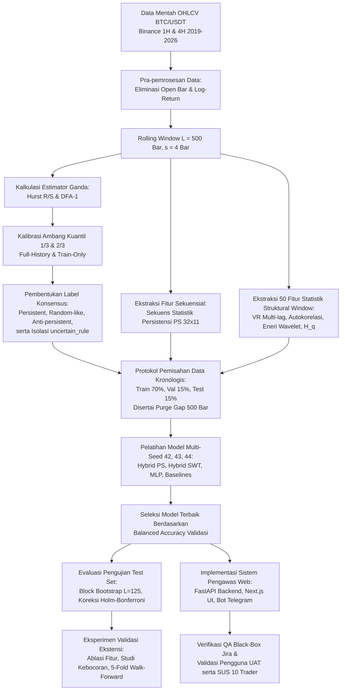
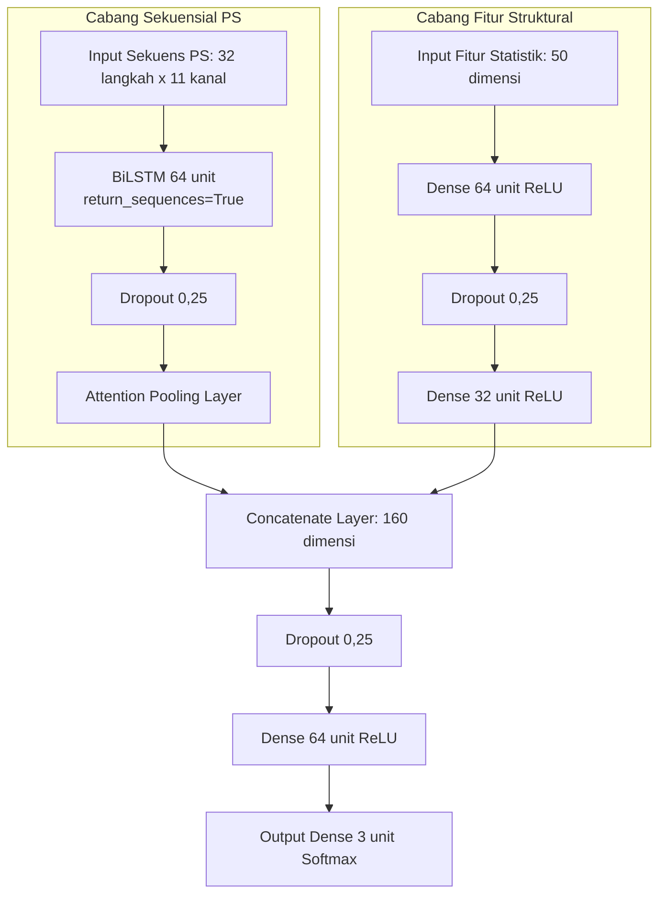
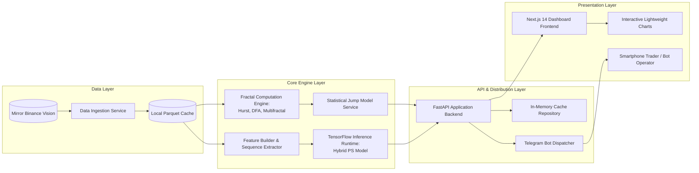

# RANCANGAN LENGKAP SKRIPSI SARJANA INFORMATIKA (BAB I - BAB IV)

> **Dokumen Resmi:** Draf Komprehensif Naskah Skripsi Program Studi Informatika / Ilmu Komputer (S1)  
> **Aset / Subjek Kajian:** Deret Waktu BTC/USDT Spot (Binance)  
> **Konfigurasi Eksperimen:** SHA-256 Hash `7a3bddc67d72` (Protokol Bersih, Evaluasi 3 Seed)  
> **Status:** Siap Diajukan dan Diseminarkan ke Dewan Penguji & Pembimbing Skripsi  

---

## USULAN JUDUL SKRIPSI

1. **Rekomendasi Utama (Profil Rekayasa Informatika & Penyelesaian Masalah Nyata):**  
   > **"Rancang Bangun Sistem Pengawas Regime Fraktal Deret Waktu BTC/USDT Berbasis Web Menggunakan Hybrid BiLSTM Bebas Kebocoran Data"**
2. **Alternatif Metodologis (Fokus pada Validitas Ilmiah dan Rekayasa Fitur Persistensi):**  
   > **"Identifikasi Regime Fraktal Dinamis BTC/USDT Multi-Timeframe Menggunakan Hybrid BiLSTM Berbasis Sekuens Statistik Persistensi dan Evaluasi Bebas Kebocoran Data"**

---

# BAB I: PENDAHULUAN

## 1.1 Latar Belakang Masalah
Dalam beberapa tahun terakhir, ekosistem perdagangan aset kripto telah mengalami transisi masif ke arah perdagangan terotomatisasi (*algorithmic trading*). Di bursa global seperti Binance, volume transaksi pada pasangan perdagangan utama BTC/USDT didominasi oleh perangkat lunak perdagangan otomatis (*trading bot*). Dua jenis arsitektur bot yang paling banyak diterapkan oleh investor ritel maupun institusi adalah:
1. **Grid Trading Bot (*Mean-Reversion Bot*):** Strategi yang menempatkan jaring pesanan beli dan jual secara berselang pada rentang harga tertentu dengan asumsi bahwa harga akan senantiasa berfluktuasi bolak-balik di sekitar nilai tengah (*ranging market*).
2. **Trend-Following Bot (*Momentum Bot*):** Strategi yang membuka posisi searah dengan laju perubahan harga dengan asumsi bahwa pergerakan harga memiliki inersia searah (*directional continuation*).

Terlepas dari popularitasnya, laporan dari bursa kripto terkemuka dan literatur keuangan komputasional menunjukkan fakta lapangan yang mengkhawatirkan: **antara 70% hingga 84% pengguna bot perdagangan ritel mengalami kerugian modal (*drawdown*) yang signifikan hingga likuidasi**. Fenomena kegagalan ini secara fundamental bukan disebabkan oleh kesalahan sintaksis pemrograman (*bug* perangkat lunak), melainkan akibat masalah konseptual mendasar yang dikenal sebagai **Kebutaan Regime (*Regime Blindness*)** dan **Ketidakcocokan Strategi (*Strategy Mismatch*)** (Chen et al., 2025).

Pasar aset kripto bersifat **non-stasioner**, dinamis, dan memiliki tingkat derau (*noise*) yang ekstrem. Karakteristik pergerakan harga terus-menerus bertransisi di antara kondisi pasar persisten (memiliki memori tren jangka panjang), kondisi anti-persisten (cenderung berbalik arah atau *mean-reverting*), dan kondisi acak murni (*random-walk*). Ketika sebuah *Grid Bot* beroperasi tanpa mekanisme deteksi regime, bot tersebut akan mengalami kehancuran modal (*bag-holding*) yang katastropik saat pasar tiba-tiba memasuki regime tren persisten searah (misalnya saat terjadi lonjakan harga ekstrem atau *market crash*). Sebaliknya, *Trend Bot* akan mengalami akumulasi kerugian beruntun akibat sinyal palsu (*whipsaw*) saat dipaksa aktif pada regime pasar yang berosilasi bolak-balik (*anti-persistent*).

Secara teoretis, dinamika memori jangka panjang dan sifat fraktalitas deret waktu dapat diukur menggunakan konsep *Fractal Market Hypothesis* (FMH) melalui parameter **Eksponen Hurst ($H$)** dan **Detrended Fluctuation Analysis ($\alpha_{\text{DFA}}$)**. Namun, praktisi dan peneliti yang mencoba menerapkan estimator fraktal klasik pada data intraday BTC/USDT menghadapi hambatan ilmiah yang sangat berat:
1. **Inkonsistensi Estimator Klasik (Ambiguitas Label Ground Truth):** Hasil analisis empiris awal pada 67.927 bar data historis BTC/USDT periode 2019–2026 mengungkapkan bahwa dua metode fraktal standar, yaitu Rescaled Range (Hurst R/S) dan DFA-1, **hanya sepakat pada 52,6% jendela observasi** (1H) dan **52,7%** (4H), dengan korelasi Pearson moderat ($r \approx 0{,}55 - 0{,}57$). Bahkan, pada 7,3% jendela waktu, kedua estimator menunjuk arah yang bertolak belakang (satu mengindikasikan persisten, lainnya mengindikasikan anti-persisten). Memaksakan satu metode estimasi tunggal sebagai penentu regime tanpa pemodelan ketidakpastian berarti melatih model machine learning di atas derau data yang menyesatkan.
2. **Kerapuhan Evaluasi Machine Learning dan Krisis Kebocoran Data (*Data Leakage*):** Sebagian besar penelitian machine learning di bidang finansial melaporkan akurasi di atas 75%–85% yang ternyata bersifat semu (*inflated metrics*). Penggunaan pembagian data acak (*random k-fold split*), dekomposisi wavelet non-kausal yang memfilter seluruh deret waktu sekaligus, serta normalisasi fitur menggunakan statistik global terbukti membocorkan informasi masa depan (*look-ahead bias*).
3. **Keterbatasan Sekuens Wavelet Mentah:** Pendekatan populer yang sekadar mengumpankan koefisien dekomposisi wavelet (*Stationary Wavelet Transform* / SWT) ke jaringan saraf rekuren terbukti gagal mengenali sifat fraktal (mencatat *Balanced Accuracy* hanya $\approx 0{,}386$, nyaris setara tebakan acak 0,333). Diperlukan representasi sekuensial baru yang secara khusus merangkum dinamika statistik persistensi multi-skala di sepanjang jendela observasi.
4. **Ketiadaan Sistem Pengawas Nyata (*Real-Time Supervisory System*):** Algoritma estimasi Hurst klasik membutuhkan komputasi regresi logaritmik ganda yang lambat pada jendela data panjang, sehingga tidak aplikatif untuk pemantauan langsung. Di sisi lain, tidak tersedianya sistem berbasis web terintegrasi yang berfungsi sebagai "saklar pengaman" (*circuit breaker gatekeeper*) membuat pengembang bot tidak memiliki visibilitas atas status risiko pasar yang sedang dihadapi.

Berdasarkan urgensi tersebut, penelitian ini mengusulkan sebuah pendekatan holistik melalui rekayasa sistem dan algoritma: merancang pipeline pelabelan konsensus fraktal berbasis kuantil yang sadar-ketidakpastian (*uncertainty-aware*), mengembangkan model pembelajaran mendalam hibrida **Hybrid Attention-BiLSTM dengan Sekuens Statistik Persistensi (Hybrid PS)** yang dievaluasi secara ketat bebas kebocoran (*leakage-free*), serta mengimplementasikan seluruh arsitektur inferensi ke dalam **Sistem Pengawas Regime Berbasis Web (FastAPI dan Next.js)** yang dilengkapi mesin peringatan dini (*alert engine*) Telegram untuk mencegah kegagalan algoritma perdagangan di pasar kripto.

## 1.2 Identifikasi Masalah
Dari latar belakang di atas, dapat diidentifikasi beberapa permasalahan mendasar:
1. Penggunaan bot perdagangan otomatis (Grid Bot dan Trend Bot) secara "buta regime" mengakibatkan kerugian modal ekstrem akibat ketidakcocokan strategi dengan dinamika fraktalitas pasar BTC/USDT.
2. Estimator fraktal klasik (Hurst R/S dan DFA) memiliki tingkat ketidaksepakatan yang sangat tinggi (mencapai 47,4%), sehingga pelabelan konvensional yang memaksakan satu estimator tunggal menghasilkan target latih yang bias dan inkonsisten.
3. Dekomposisi wavelet mentah (SWT) tanpa fitur struktur persistensi gagal memberikan daya pembeda bagi model machine learning dalam mengidentifikasi regime pasar.
4. Evaluasi model deret waktu finansial pada penelitian terdahulu kerap terjangkit kebocoran data (*data leakage*), menghasilkan estimasi kinerja yang terdistorsi dan tidak mencerminkan realitas pasar *out-of-sample*.
5. Belum tersedianya sistem terpadu berbasis web yang mampu menyajikan inferensi regime fraktal secara cepat ($<100\text{ ms}$), transparan terhadap ambiguitas data, dan terhubung secara otomatis ke perangkat komunikasi trader/operator bot.

## 1.3 Batasan Masalah
Agar penelitian ini terarah, terfokus, dan dapat dipertanggungjawabkan secara metodologis, ditetapkan batasan-batasan masalah sebagai berikut:
1. **Pasangan Aset dan Bursa:** Data deret waktu dibatasi pada pasangan spot Bitcoin terhadap Tether (BTC/USDT) dari bursa Binance, rentang 1 Januari 2019 hingga Oktober 2026.
2. **Timeframe Analisis:** Pengujian difokuskan pada dua kerangka waktu: 1 Jam (1H) sebagai representasi operasional intraday dan 4 Jam (4H) sebagai representasi tren ayunan (*swing/macro*).
3. **Cakupan Data:** Menggunakan struktur harga OHLCV (Open, High, Low, Close, Volume) murni pada harga log-return. Data mikrostruktur *order book* (OFI/CVD) tidak disertakan karena tidak tersedianya arsip data tick-level publik yang terverifikasi tanpa bias.
4. **Panjang Jendela Analisis:** Panjang rolling window observasi ditetapkan tetap sebesar $L = 500$ bar dengan pergeseran (*stride*) $s = 4$ bar.
5. **Fungsi Sistem:** Sistem yang dibangun adalah **Sistem Pendukung Keputusan Pengawas Regime (*Regime Supervisory Decision Support System*)**, yang bertugas melakukan identifikasi kondisi pasar saat ini (*nowcasting/context filtering*) dan memicu sinyal *circuit breaker*, bukan sebagai bot eksekusi arah perdagangan beli/jual otomatis.

## 1.4 Rumusan Masalah
Berdasarkan identifikasi dan batasan di atas, rumusan masalah penelitian ini dirinci menjadi:
1. **Masalah Khusus 1 (Konsistensi Label):** Seberapa besar derajat ketidaksepakatan antara estimator Hurst R/S dan DFA pada deret waktu BTC/USDT, dan bagaimana merumuskan protokol pelabelan konsensus yang mampu mengisolasi jendela waktu yang ambigu (*uncertain*)?
2. **Masalah Khusus 2 (Sinyal Pembeda Regime):** Fitur statistik atau representasi sekuensial apa yang secara esensial memberikan daya pembeda bagi model dalam mengenali transisi regime di tengah derau tinggi?
3. **Masalah Khusus 3 (Efektivitas Model Usulan):** Apakah arsitektur Hybrid Attention-BiLSTM dengan input Sekuens Statistik Persistensi (Hybrid PS) mampu mengungguli model baseline terstandar (Structural MLP, SWT-BiLSTM) secara signifikan secara statistik di bawah pengujian bebas korelasi serial?
4. **Masalah Khusus 4 (Kestabilan Antar-Periode):** Bagaimana stabilitas generalisasi model usulan ketika diuji melintasi berbagai siklus pasar (*bullish, bearish, sideways*) menggunakan protokol *purged expanding walk-forward*?
5. **Masalah Khusus 5 (Kuantifikasi Kebocoran Data):** Seberapa besar dampak penggelembungan metrik (*performance inflation*) yang ditimbulkan oleh pelanggaran protokol evaluasi (seperti *random split*, ketiadaan *purge gap*, dan normalisasi non-kausal)?
6. **Masalah Khusus 6 (Perancangan dan Penerimaan Sistem):** Bagaimana merancang dan mengimplementasikan arsitektur sistem pengawas regime berbasis web serta bot Telegram yang fungsional, dan bagaimana tingkat penerimaan penggunaannya (*usability*) berdasarkan pengujian *User Acceptance Testing* (UAT) dan *System Usability Scale* (SUS)?

## 1.5 Tujuan Penelitian
Tujuan yang hendak dicapai dalam penelitian ini adalah:
1. Menganalisis secara empiris derajat ketidakkonsistenan estimator Hurst R/S dan DFA pada BTC/USDT serta membangun skema pelabelan konsensus berbasis kuantil dengan kelas eksplisit `uncertain_rule`.
2. Mengidentifikasi kontribusi esensial dari kelompok fitur (Variance Ratio, autokorelasi, generalized Hurst) dan representasi Sekuens Statistik Persistensi melalui studi ablasi terarah.
3. Membangun, melatih, dan mengevaluasi model Hybrid Attention-BiLSTM berbasis Sekuens Statistik Persistensi (Hybrid PS) menggunakan protokol ensemble 3 seed, Moving-Block Bootstrap dengan ukuran sampel efektif, serta koreksi Holm-Bonferroni.
4. Mengukur ketahanan dan kestabilan performa model di bawah skema pengujian *5-fold expanding purged walk-forward*.
5. Mengukur dan mendokumentasikan secara kuantitatif besaran distorsi metrik performa akibat kebocoran data (*data leakage*).
6. Mengembangkan perangkat lunak sistem dashboard pemantau regime berbasis web (FastAPI dan Next.js 14) dan bot notifikasi Telegram, serta menguji keandalan perangkat lunak melalui pengujian QA fungsional (Jira), validasi tugas (UAT), dan evaluasi kemudahan interaksi pengguna (SUS).

## 1.6 Manfaat Penelitian
Penelitian ini diharapkan memberikan kontribusi nyata dari dua dimensi:
1. **Manfaat Teoretis / Akademis:**
   - Memberikan kontribusi metodologis mengenai pentingnya pelabelan konsensus fraktal dan pelaporan kelas ambigu pada deret waktu finansial yang berderau.
   - Menyajikan bukti empiris bantahan (*counter-evidence*) terhadap klaim umum bahwa koefisien wavelet mentah dan mekanisme attention selalu meningkatkan performa deret waktu.
   - Memberikan standar acuan bagi penelitian machine learning finansial dalam menerapkan protokol evaluasi bebas kebocoran (*purged walk-forward* dan penyesuaian sampel efektif serial).
2. **Manfaat Praktis / Terapan:**
   - Menyediakan instrumen *decision support system* dan *circuit breaker gatekeeper* bagi pengembang algoritma perdagangan untuk mematikan Grid Bot pada saat pasar memasuki fase persisten terarah, sehingga mencegah kehancuran modal (*bag-holding*).
   - Memberikan visibilitas terukur bagi trader mandiri mengenai kapan pasar berada dalam kondisi berderau (*uncertain*), sehingga trader dapat mengambil sikap netral (*wait-and-see*).
   - Menghasilkan artefak perangkat lunak siap pakai yang terdokumentasi rapi, teruji melalui pengujian unit (302 unit test), dan siap dihubungkan ke infrastruktur bot perdagangan eksternal.

## 1.7 Sistematika Penulisan
Dokumen skripsi ini disusun dalam lima bab yang saling berkesinambungan:
- **BAB I PENDAHULUAN:** Menguraikan konteks masalah nyata di industri perdagangan algoritma, identifikasi dan batasan masalah, rumusan masalah, tujuan, manfaat, serta sistematika penulisan.
- **BAB II TINJAUAN PUSTAKA DAN LANDASAN TEORI:** Membahas teori fraktalitas pasar, tinjauan terhadap 20+ literatur terkini, celah kebaruan ilmiah (*novelty gap*), model pembelajaran mendalam rekuren, konsep kebocoran data, serta rekayasa perangkat lunak sistem pengawas.
- **BAB III METODOLOGI PENELITIAN DAN PERANCANGAN SISTEM:** Menjelaskan tahapan penelitian secara komprehensif, alur pra-pemrosesan data, perumusan label konsensus, rekayasa fitur Sekuens Statistik Persistensi (PS), perancangan arsitektur Hybrid Attention-BiLSTM, protokol evaluasi bebas kebocoran, perancangan perangkat lunak web dan bot Telegram, serta instrumen pengujian QA, UAT, dan SUS.
- **BAB IV HASIL DAN PEMBAHASAN:** Menyajikan data temuan eksperimen secara objektif dan mendalam untuk menjawab seluruh rumusan masalah: analisis konsistensi estimator, studi ablasi fitur, hasil komparasi model dan uji hipotesis H1–H6, evaluasi walk-forward, kuantifikasi dampak kebocoran data, analisis keterbatasan attention dan persistensi forward, evaluasi kelayakan hilir (*downstream setup engine*), serta verifikasi QA dan validasi penerimaan pengguna (UAT dan skor SUS).
- **BAB V KESIMPULAN DAN SARAN:** Merangkum jawaban atas rumusan masalah berdasarkan bukti empiris yang diperoleh serta memberikan rekomendasi perbaikan untuk penelitian masa depan.

---

# BAB II: TINJAUAN PUSTAKA DAN LANDASAN TEORI

## 2.1 Kajian Literatur Terkait (State-of-the-Art)
Penelitian ini berakar pada persimpangan antara ekonofisika deret waktu fraktal, pembelajaran mesin rekuren, dan rekayasa perangkat lunak sistem pendukung keputusan. Kajian pustaka dikelompokkan ke dalam empat tema besar:

### 2.1.1 Efisiensi Pasar dan Fraktalitas Aset Kripto
Teori Pasar Efisien (*Efficient Market Hypothesis* / EMH) mengasumsikan pergerakan harga mengikuti proses *martingale* atau *random walk* di mana fluktuasi harga bersifat independen dan identik terdistribusi. Namun, Peters (1994) memperkenalkan *Fractal Market Hypothesis* (FMH) yang menyatakan bahwa likuiditas dan kestabilan pasar ditentukan oleh partisipan pasar dengan horizon investasi yang berbeda-beda, menghasilkan struktur memori jangka panjang dan persistensi multiskala.
- **Urquhart (2016)** melakukan pengujian empiris pionir terhadap efisiensi pasar Bitcoin dan menemukan bahwa pasar Bitcoin pada periode awal sangat tidak efisien dan memperlihatkan sifat memori fraktal yang kuat.
- **Bariviera (2017)** memperluas analisis tersebut menggunakan pendekatan *rolling-window* Hurst R/S dan DFA pada data harian Bitcoin, membuktikan secara empiris bahwa derajat efisiensi Bitcoin tidak bersifat statis, melainkan mengalami fluktuasi regime yang dinamis seiring waktu.
- **Lahmiri & Bekiros (2018)** serta **Takaishi (2018)** membuktikan keberadaan fenomena multifraktalitas dan dependensi non-linear pada pergerakan harga Bitcoin frekuensi tinggi (*intraday*), memvalidasi pentingnya mengekstrak parameter Generalized Hurst Exponent $H(q)$ pada berbagai skala fluktuasi.

### 2.1.2 Algoritma Perdagangan Berbasis Regime dan Analisis Risiko Bot
- **Chen, Chen, & Jang (2025)** menganalisis secara matematis mekanisme *Grid Trading* pada pasangan aset kripto. Mereka membuktikan bahwa strategi grid statis memiliki nilai harapan keuntungan mendekati nol (*zero expectation*) dan membawa risiko penarikan modal ekstrem (*drawdown*) saat pasar beralih dari fase konsolidasi ke fase tren searah. Temuan ini menegaskan keharusan adanya sistem pemantau regime dinamis sebagai gerbang pengaman.
- **Chang dkk. (2022)** memanfaatkan *rolling Hurst exponent* sebagai saklar (*switch*) dinamis antara strategi *momentum* ($H > 0{,}5$) dan strategi *mean-reversion* ($H < 0{,}5$) dengan optimasi *Q-Learning*.
- **Grande dkk. (2024)** membuktikan bahwa nilai eksponen Hurst anti-persisten ($H < 0{,}5$) merupakan indikator empiris yang andal dalam mengantisipasi peluang pembalikan arah harga (*mean-reversion*) pada aset kripto.

### 2.1.3 Pembelajaran Mesin pada Deret Waktu dan Representasi Wavelet
- **Bo dkk. (2019)** dan konsorsium global **AnDi Challenge (Muñoz-Gil dkk., 2021)** membuktikan bahwa model *deep learning* berbasis jaringan saraf rekuren (LSTM) mampu mengidentifikasi karakteristik difusi anomali dan eksponen fraktal pada lintasan deret pendek jauh lebih akurat dibandingkan estimator statistik konvensional.
- **Bao, Yue, & Rao (2017)** menggabungkan dekomposisi *wavelet transform* dengan arsitektur LSTM untuk memodelkan deret harga finansial. Namun, mayoritas literatur menerapkan dekomposisi wavelet secara global (non-kausal) di mana filter wavelet menyentuh data masa depan, yang menimbulkan bias optimisme semu.

### 2.1.4 Metodologi Evaluasi Bebas Kebocoran Data
- **López de Prado (2018)** dalam karyanya *Advances in Financial Machine Learning* meletakkan fondasi metodologis penanganan dependensi serial data keuangan melalui skema *Purged Cross-Validation* dan penambahan jeda waktu (*embargo/purge gap*). Penggunaan pembagian data acak terbukti menyebabkan kebocoran informasi antar jendela yang bertetangga.
- **Kapoor & Narayanan (2023)** dalam survei komprehensifnya di jurnal *Patterns* mengidentifikasi bahwa kebocoran data (*data leakage*) adalah akar utama dari krisis reproduksibilitas pada ratusan penelitian machine learning terapan.

## 2.2 Celah Kebaruan Penelitian (Novelty Gap)
Berdasarkan sintesis terhadap 20+ rujukan literatur utama, penelitian ini menempati posisi orisinal yang mengisi enam celah kebaruan ilmiah (*novelty gaps*):

| No | Dimensi Celah Ilmiah | Pendekatan Literatur Terkini | Kontribusi Orisinal Penelitian Ini |
|---|---|---|---|
| **1** | **Penanganan Ambiguitas Label** | Mengandalkan satu estimator tunggal (R/S saja atau DFA saja) dan mengabaikan ketidakpastian. | Membangun label konsensus ganda R/S + DFA berbasis kuantil, memisahkan secara eksplisit ketidakpastian data (`uncertain_rule`, 47,4%) dan ketidakpastian model (`uncertain_lowconf`). |
| **2** | **Kuantifikasi Dampak Kebocoran Data** | Makalah ML kripto kerap tidak menyadari kebocoran akibat *random split* atau dekomposisi non-kausal. | Melakukan eksperimen terkontrol 5 varian kebocoran data, membuktikan secara kuantitatif bahwa *random split* menggelembungkan BA sebesar $+0{,}123$ (1H) dan $+0{,}159$ (4H). |
| **3** | **Representasi Masukan Sekuensial** | Menggunakan koefisien wavelet mentah (SWT) pada beberapa bar terakhir. | Mengembangkan Sekuens Statistik Persistensi (PS) 32 langkah $\times$ 11 kanal yang mencakup dinamika seluruh jendela 500 bar. |
| **4** | **Bantahan Empiris (*Counter-Evidence*)** | Mengasumsikan mekanisme attention selalu memberikan peningkatan akurasi selektif. | Melaporkan secara objektif bahwa bobot attention nyaris seragam (entropi $0{,}83-0{,}96$) dan daya beda sepenuhnya bertumpu pada Variance Ratio multi-lag. |
| **5** | **Demistifikasi *Hurst-Direction Disconnect*** | Praktisi menganggap kondisi persisten ($H > 0{,}5$) otomatis menghasilkan momentum keuntungan searah. | Membuktikan secara matematis dan empiris bahwa persistensi fraktal adalah fenomena memori varians/volatilitas, bukan prediktor arah harga ($P(\text{searah}) = 0{,}458$). |
| **6** | **Implementasi Perangkat Lunak Teruji** | Riset finansial kuantitatif berhenti pada skrip eksperimen atau Jupyter Notebook. | Merancang dan memvalidasi sistem web *full-stack* (FastAPI + Next.js 14) dengan latensi $<100\text{ ms}$, bot Telegram, audit SHA-256, serta evaluasi UAT dan SUS. |

## 2.3 Teori Fraktalitas Deret Waktu Finansial

### 2.3.1 Log-Return Harga
Diberikan deret harga penutupan $\{P_t\}$, deret waktu log-return didefinisikan sebagai:
$$r_t = \ln P_t - \ln P_{t-1}$$
Transformasi log-return mutlak diperlukan karena harga tingkat (*price level*) memiliki akar unit (*unit root* non-stasioner). Estimasi eksponen fraktal pada deret harga mentah akan selalu menghasilkan nilai mendekati 1,0 yang secara keliru mengklasifikasikan seluruh jendela ke dalam regime persisten.

### 2.3.2 Eksponen Hurst (Metode Rescaled Range - R/S)
Metode R/S mengukur laju divergensi fluktuasi deviasi kumulatif terhadap simpangan baku pada berbagai skala waktu $n$:
$$\mathbb{E}\left[\frac{R(n)}{S(n)}\right] = C \cdot n^H$$
di mana $R(n) = \max_{1 \le k \le n} \sum_{i=1}^k (r_i - \bar{r}) - \min_{1 \le k \le n} \sum_{i=1}^k (r_i - \bar{r})$ dan $S(n)$ adalah simpangan baku sampel. Eksponen Hurst $H$ diperoleh dari kemiringan regresi linear $\ln \mathbb{E}[R/S]$ terhadap $\ln n$.

### 2.3.3 Detrended Fluctuation Analysis (DFA-1)
DFA mengintegrasikan profil deret waktu $Y(k) = \sum_{i=1}^k (r_i - \bar{r})$, membaginya menjadi segmen berukuran $n$, dan menghapus tren linear lokal pada masing-masing segmen menggunakan regresi kuadrat terkecil $y_n(k)$. Fungsi fluktuasi rata-rata akar kuadrat (RMS) dihitung sebagai:
$$F(n) = \sqrt{\frac{1}{N} \sum_{k=1}^N \left( Y(k) - y_n(k) \right)^2} \propto n^\alpha$$
Nilai eksponen penskalaan $\alpha$ merefleksikan karakteristik korelasi deret waktu:
- $\alpha < 0{,}5$: Anti-persisten (*mean-reverting*).
- $\alpha \approx 0{,}5$: Tidak berkorelasi (*random walk* / derau putih).
- $\alpha > 0{,}5$: Persisten (*trending*).

### 2.3.4 Generalized Hurst Exponent $H(q)$
Untuk menangkap dinamika penskalaan multiskala pada orde momen $q$, dihitung fungsi struktur fluktuasi:
$$K_q(\tau) = \frac{\langle |Y(t+\tau) - Y(t)|^q \rangle}{\langle |Y(t)|^q \rangle} \propto \tau^{q H(q)}$$
Apabila $H(q)$ bervariasi terhadap $q$, deret waktu bersifat multifraktal. Parameter lebar spektrum multifraktal $\Delta H = H(1) - H(4)$ mencerminkan derajat kekayaan struktur fraktal pasar.

## 2.4 Deep Learning untuk Deret Waktu Finansial

### 2.4.1 Bidirectional Long Short-Term Memory (BiLSTM)
Arsitektur LSTM mengatasi kelemahan *vanishing gradient* pada RNN standar melalui struktur *gating* (input gate $i_t$, forget gate $f_t$, cell candidate $\tilde{C}_t$, dan output gate $o_t$):
$$f_t = \sigma(W_f [h_{t-1}, x_t] + b_f)$$
$$i_t = \sigma(W_i [h_{t-1}, x_t] + b_i)$$
$$C_t = f_t \odot C_{t-1} + i_t \odot \tanh(W_c [h_{t-1}, x_t] + b_c)$$
$$o_t = \sigma(W_o [h_{t-1}, x_t] + b_o)$$
$$h_t = o_t \odot \tanh(C_t)$$
BiLSTM memproses deret urutan dalam dua arah: maju ($\overrightarrow{h}_t$) dan mundur ($\overleftarrow{h}_t$), menghasilkan vektor status gabungan $h_t = [\overrightarrow{h}_t, \overleftarrow{h}_t]$ yang merangkum konteks masa lalu dan masa depan relatif di dalam jendela observasi.

### 2.4.2 Mekanisme Attention Pooling
Lapisan perhatian aditif (Bahdanau) memetakan keluaran BiLSTM $\{h_1, \dots, h_T\}$ menjadi representasi konteks tunggal $c$ melalui pembobotan probabilitas:
$$e_t = v^\top \tanh(W_h h_t + b_h)$$
$$\alpha_t = \frac{\exp(e_t)}{\sum_{k=1}^T \exp(e_k)}$$
$$c = \sum_{t=1}^T \alpha_t h_t$$
Bobot perhatian $\alpha_t$ merefleksikan kontribusi relatif langkah waktu ke-$t$ terhadap keputusan klasifikasi. Derajat dispersi bobot perhatian diukur menggunakan entropi ternormalisasi:
$$H_{\text{norm}}(\alpha) = -\frac{\sum_{t=1}^T \alpha_t \ln(\alpha_t)}{\ln T}$$
Nilai $H_{\text{norm}} \approx 1{,}0$ menandakan bahwa bobot perhatian terdistribusi seragam (tidak ada langkah waktu spesifik yang diisolasi oleh model).

## 2.5 Metodologi Pengujian Perangkat Lunak dan Evaluasi Sistem
Dalam rekayasa perangkat lunak sistem informasi, validasi sistem harus mencakup dua pilar:
1. **Verifikasi Fungsional (Quality Assurance / Black-Box):** Pengujian berbasis *test case* yang mencakup input, aksi, ekspektasi luaran, serta siklus hidup penanganan cacat (*defect lifecycle*) yang terdokumentasi pada alat manajemen proyek (Atlassian Jira).
2. **Validasi Pengguna (User Acceptance Testing & System Usability Scale):** Pengujian tugas langsung (*task-based scenario*) kepada pengguna sasaran (trader aset kripto) serta pengukuran kegunaan antarmuka menggunakan instrumen standar **System Usability Scale (SUS)** yang terdiri dari 10 instrumen pertanyaan berskala Likert 1–5 (Brooke, 1996; Bangor et al., 2008).

---

# BAB III: METODOLOGI PENELITIAN DAN PERANCANGAN SISTEM

## 3.1 Kerangka Kerja Penelitian
Penelitian ini merupakan penelitian kuantitatif eksperimental yang mengintegrasikan pemodelan komputasional deret waktu dengan rekayasa perangkat lunak sistem informasi. Alur kerja penelitian disajikan pada diagram alir berikut:

## 3.2 Data dan Pra-Pemrosesan Data

### 3.2.1 Sumber dan Profil Dataset
Data diunduh langsung dari arsip mirror resmi Binance Vision (`data-api.binance.vision`) untuk memastikan integritas data bursa asli tanpa modifikasi pihak ketiga:
- **Pasangan Perdagangan:** BTC/USDT Spot.
- **Rentang Waktu:** 1 Januari 2019 – Oktober 2026.
- **Total Bar Data:** 67.927 bar untuk timeframe 1 Jam (1H) dan 16.992 bar untuk timeframe 4 Jam (4H).
- **Atribut Data:** Waktu buka (UTC), Open, High, Low, Close, Volume.

### 3.2.2 Penegakan Aturan Kausalitas Eliminasi Candle Berjalan
Salah satu sumber kebocoran data yang kerap diabaikan adalah menyertakan candle yang sedang berlangsung (*open bar*). Sistem menegakkan parameter `source.drop_open_bar: true`: bar yang belum ditutup (*incomplete*) selalu dibuang dari pipeline komputasi karena nilainya terus berubah dan dapat mengubah label fraktal pada jendela terakhir secara retrospektif.

Data harga penutupan diubah menjadi log-return kausal:
$$r_t = \ln P_t - \ln P_{t-1}$$

## 3.3 Pelabelan Regime Fraktal Sadar-Ketidakpastian

### 3.3.1 Parameter Rolling Window
Untuk setiap titik indeks penutupan $t$, analisis dilakukan atas jendela observasi $L = 500$ bar:
$$\mathcal{W}_t = \{r_{t-L+1}, r_{t-L+2}, \dots, r_t\}$$
Jendela digeser maju dengan langkah (*stride*) $s = 4$ bar, menghasilkan **16.857 jendela** pada 1H dan **4.123 jendela** pada 4H.

### 3.3.2 Kalibrasi Ambang Kuantil dan Label Konsensus
Karena estimator Hurst R/S dan DFA memiliki bias sampel-terbatas yang berbeda (pada BTC/USDT nilai $H$ jarang di bawah 0,45 sedangkan $\alpha_{\text{DFA}}$ kerap menyentuh 0,40), ambang klasifikasi ditetapkan secara adaptif melalui kuantil empiris 33,3% (ambang bawah) dan 66,7% (ambang atas) pada masing-masing distribusi:

| Timeframe | Estimator Fraktal | Ambang Bawah ($q = 0{,}333$) | Ambang Atas ($q = 0{,}667$) |
|---|---|---|---|
| **1H** | Hurst R/S | 0,5719 | 0,5995 |
| **1H** | DFA-1 ($\alpha$) | 0,4727 | 0,5181 |
| **4H** | Hurst R/S | 0,5878 | 0,6124 |
| **4H** | DFA-1 ($\alpha$) | 0,4742 | 0,5227 |

Masing-masing estimator memetakan jendela ke dalam salah satu dari tiga kelas:
$$\text{Kelas}(x) = \begin{cases} \text{Anti-persistent (A)}, & x < \text{ambang bawah} \\ \text{Random-like (R)}, & \text{ambang bawah} \le x \le \text{ambang atas} \\ \text{Persistent (P)}, & x > \text{ambang atas} \end{cases}$$

**Aturan Konsensus:**
- Jika $\text{Kelas}(H) = \text{Kelas}(\alpha)$, label akhir diberikan sesuai kelas kesepakatan tersebut.
- Jika $\text{Kelas}(H) \neq \text{Kelas}(\alpha)$, jendela diberi label **`uncertain_rule`**.

Jendela berkategori `uncertain_rule` dikeluarkan dari proses pelatihan dan evaluasi model agar model tidak dipaksa menghafal ambiguitas, namun seluruh jendela tersebut tetap dicatat dan dipantau dalam sistem pengawas.

### 3.3.3 Kalibrasi Bebas Look-Ahead (Uji Sensitivitas Train-Only)
Sistem mendukung dua mode penetapan ambang kuantil:
1. `full_history` (konfigurasi utama): Ambang kuantil dihitung dari distribusi seluruh rentang 2019–2026.
2. `train_only` (uji sensitivitas): Ambang kuantil dihitung secara ketat hanya dari data latih ($t < \text{train\_end}$), kemudian dibekukan untuk mengklasifikasikan data validasi dan uji guna membuktikan ketiadaan bias distribusi masa depan (*distributional lookahead*).

## 3.4 Rekayasa dan Ekstraksi Fitur

### 3.4.1 Sekuens Koefisien Wavelet (SWT) Kausal (Pembanding)
Dekomposisi *Stationary Wavelet Transform* (SWT) menggunakan wavelet Daubechies-4 (`db4`) dengan level dekomposisi $J = 4$. Untuk menghindari kebocoran masa depan, perhitungan wavelet pada indeks $t$ dilakukan secara kausal hanya atas riwayat $r_{\le t}$. Sekuens terdiri dari $T = 32$ langkah waktu terakhir dengan 5 kanal ($D_1, D_2, D_3, D_4, A_4$), menghasilkan tensor berdimensi $32 \times 5$. Sekuens ini hanya mencakup 32 bar terakhir dari total jendela 500 bar.

### 3.4.2 Sekuens Statistik Persistensi (PS) — Masukan Model Usulan
Untuk mengatasi keterbatasan SWT mentah, dikembangkan representasi **Sekuens Statistik Persistensi (PS)** yang membentang di seluruh rentang jendela 500 bar:
- Ukuran sub-jendela geser: $W = 128$ bar.
- Panjang deret langkah: $T = 32$ langkah.
- Jarak antar-langkah: $s_{\text{step}} = (L - W) / (T - 1) = (500 - 128) / 31 = 12$ bar.
- Langkah ke-$k$ ($k = 0, \dots, 31$) berakhir pada indeks $e_k = t - (31 - k) \cdot 12$ dan dihitung atas sub-jendela $r_{e_k - W + 1 \dots e_k}$.

Setiap langkah memuat **11 kanal statistik persistensi**:
1. $VR(2), VR(4), VR(8), VR(16)$: Variance Ratio pada lag 2, 4, 8, dan 16.
2. $\rho_1, \rho_2, \rho_3, \rho_5$: Autokorelasi return pada lag 1, 2, 3, dan 5.
3. $\rho_1^{|r|}$: Autokorelasi volatilitas absolut $|r|$ pada lag 1 (*volatility clustering*).
4. Laju pergantian tanda return: $\frac{1}{W-1} \sum \mathbb{1}[r_i r_{i-1} < 0]$.
5. Logaritma volatilitas sampel: $\ln \sigma_W$.

Seluruh kalkulasi dihitung secara efisien menggunakan operasi vektor kumulatif (*cumulative sums*) dan diverifikasi melalui unit test otomatis kausal.

### 3.4.3 Fitur Statistik Struktural Window (50 Dimensi)
Dihitung merangkum seluruh jendela $L = 500$ bar:
- **Autokorelasi Return (11 dimensi):** Lag 1, 2, 3, 4, 5, 8, 10, 15, 20, 30, 50.
- **Autokorelasi Volatilitas Absolut (5 dimensi):** Lag 1, 2, 5, 10, 20.
- **Variance Ratio Multi-Lag (11 dimensi):** $VR(q)$ untuk $q \in \{2, 3, 4, 6, 8, 12, 16, 24, 32, 48\}$ serta kemiringan regresi linear terhadap $\ln q$.
- **Energi Wavelet Antar-Skala (12 dimensi):** Energi 4 level dekomposisi pada 3 sub-jendela (100%, 50%, dan 25% panjang $L$).
- **Statistik Sebaran dan Bentuk (5 dimensi):** Laju pergantian tanda, *kurtosis*, *skewness*, rasio MAD/standar deviasi, dan rasio volatilitas separuh akhir terhadap separuh awal.
- **Generalized Hurst $H(q)$ (6 dimensi):** Nilai $H(1), H(2), H(4)$, lebar spektrum multifraktal $\Delta H$, serta kelengkungan fungsi penskalaan $\tau(q)$.

## 3.5 Arsitektur Model Pembelajaran Mesin

### 3.5.1 Arsitektur Model Usulan: Hybrid PS (Attention-BiLSTM)
Model usulan menggabungkan cabang sekuensial temporal dan cabang fitur struktural statis:
1. **Cabang Sekuensial:** Menerima input tensor Sekuens Statistik Persistensi berdimensi $32 \times 11$. Diproses melalui lapisan BiLSTM 64 unit (*return sequences = True*), lapisan Dropout $0{,}25$, dan lapisan Attention Pooling aditif untuk mereduksi deret temporal menjadi vektor konteks 128 dimensi.
2. **Cabang Fitur Struktural:** Menerima vektor 50 dimensi fitur statistik window. Diproses melalui lapisan Dense 64 unit (ReLU), Dropout $0{,}25$, dan Dense 32 unit (ReLU).
3. **Penyatuan dan Klasifikasi:** Vektor keluaran attention (128 dimensi) dan vektor fitur statistik (32 dimensi) digabungkan (*concatenate*) menjadi vektor representasi 160 dimensi. Dilanjutkan dengan Dropout $0{,}25$, lapisan Dense 64 unit (ReLU), dan lapisan Dense 3 unit dengan fungsi aktivasi Softmax untuk menghasilkan distribusi probabilitas kelas: $P(\text{Persistent}), P(\text{Random-like}), P(\text{Anti-persistent})$.

### 3.5.2 Model-Model Pembanding
Untuk menguji signifikansi masing-masing komponen arsitektur, dirancang 6 model pembanding:
1. **Majority Class Classifier:** Baseline naif yang selalu memprediksi kelas mayoritas pada data latih.
2. **Proportional Random Classifier:** Baseline yang memprediksi secara acak sesuai proporsi kelas data latih.
3. **Structural MLP:** Menguji kemampuan representasi 50 fitur statistik tanpa jalur sekuensial (Dense 128 $\rightarrow$ Dropout $\rightarrow$ Dense 64 $\rightarrow$ Softmax).
4. **SWT + BiLSTM:** Model sekuensial murni menggunakan koefisien wavelet 32 langkah tanpa lapisan attention.
5. **SWT + Attention-BiLSTM:** Model sekuensial wavelet dengan lapisan attention.
6. **Hybrid SWT:** Menggabungkan cabang sekuens wavelet ($32 \times 5$) dan cabang 50 fitur statistik.
7. **PS + Attention-BiLSTM:** Model sekuensial murni menggunakan masukan PS ($32 \times 11$) dengan attention tanpa cabang 50 fitur statistik.
8. **PS + Attention-BiLSTM (Urutan Diacak):** Masukan PS diacak urutan langkah waktunya per sampel untuk menguji apakah dependensi urutan temporal membawa informasi esensial.

### 3.5.3 Konfigurasi Pelatihan
- **Optimizer:** Adam dengan laju pembelajaran awal (*learning rate*) $0{,}001$.
- **Fungsi Kerugian:** *Categorical Cross-Entropy*.
- **Pembobotan Kelas:** Menerapkan pembobotan kelas terbalik $w_c = N / (K \cdot N_c)$ untuk mengatasi ketidakseimbangan kelas moderat.
- **Ukuran Batch:** 64 dengan pengacakan data latih antar-epoch.
- **Mekanisme Penghentian Dini (*Early Stopping*):** Memantau `val_loss`, *patience* 12 epoch, bobot terbaik otomatis dipulihkan (*restore best weights*). Maksimum 80 epoch.
- **Penjadwalan Laju Pembelajaran:** *ReduceLROnPlateau* pada `val_loss`, faktor reduksi $0{,}5$, *patience* 6 epoch, batas minimum $10^{-5}$.
- **Replikasi Seed Acak:** Setiap eksperimen dijalankan 3 kali menggunakan seed acak independen (42, 43, 44).

## 3.6 Protokol Evaluasi Bebas Kebocoran Data

### 3.6.1 Pemisahan Kronologis dengan Purge Gap
Data dibagi secara kronologis tanpa pengacakan: **70% Latih, 15% Validasi, dan 15% Uji**. Karena rolling window sepanjang $L = 500$ bar yang digeser dengan stride $s = 4$ bar berbagi hingga 496 bar dengan window tetangganya, disisipkan **Purge Gap** sebesar $L = 500$ bar (setara 125 baris jendela) di antara partisi latih–validasi dan validasi–uji. Hal ini menjamin bahwa tidak ada satu pun bar harga yang dipakai bersama melintasi batas partisi.

Jumlah sampel jendela berlabel setelah dikurangi `uncertain_rule` dan pembersihan gap:
- **1H:** 5.847 jendela Latih, 1.216 jendela Validasi, dan 1.619 jendela Uji.
- **4H:** 1.473 jendela Latih, 340 jendela Validasi, dan 257 jendela Uji.

### 3.6.2 Normalisasi Data
Skalar normalisasi (*mean* dan *standard deviation*) untuk setiap kanal sekuens dan fitur statistik dihitung **secara ketat hanya dari partisi data latih**, kemudian diterapkan pada validasi dan uji tanpa pembaruan statistik.

### 3.6.3 Metrik Evaluasi
Metrik utama yang digunakan adalah **Balanced Accuracy** (rata-rata recall dari ketiga kelas) dan **Macro F1-Score** untuk menghindari bias kelas mayoritas. Metrik pendukung meliputi Accuracy, Matthews Correlation Coefficient (MCC), Cohen's Kappa, dan Recall per kelas.

### 3.6.4 Uji Signifikansi Statistik: Block Bootstrap dan Sampel Efektif
Karena observasi jendela memiliki autokorelasi serial yang sangat tinggi, uji statistik standar yang mengasumsikan sampel independen (IID) akan menghasilkan *p-value* yang terdistorsi (*false positive*).
1. **Ukuran Sampel Efektif:**
   $$N_{\text{eff}} \approx \frac{(N_{\text{window}} - 1) \cdot s + L}{L} \approx \frac{\text{Total Bar}}{500}$$
   Diperoleh $N_{\text{eff}} \approx 13{,}97$ blok independen pada uji 1H ($N=1.619$) dan $N_{\text{eff}} \approx 3{,}09$ blok independen pada uji 4H ($N=257$).
2. **Moving-Block Bootstrap:** Panjang blok bootstrap ditetapkan pada batas minimum teoretis ketergantungan serial:
   $$L_{\text{block, min}} = \left\lceil \frac{L}{s} \right\rceil = \left\lceil \frac{500}{4} \right\rceil = 125 \text{ jendela}$$
   Resampling bootstrap dijalankan sebanyak $B = 2.000$ iterasi atas prediksi ensemble 3 seed.
3. **Koreksi Perbandingan Ganda Holm-Bonferroni:** Untuk mengendalikan *Family-Wise Error Rate* (FWER) pada pengujian enam hipotesis (H1–H6), *p-value* dikoreksi menggunakan prosedur *step-down* Holm-Bonferroni pada taraf signifikansi $\alpha = 0{,}05$.

### 3.6.5 Kriteria Seleksi Model (Pra-Registrasi)
Model usulan resmi dipilih dari kandidat (Hybrid SWT, Hybrid PS, PS + Attention-BiLSTM) berdasarkan performa **Balanced Accuracy pada partisi Validasi**, bukan data uji, untuk memastikan data uji tetap murni (*unseen*):
- 1H: Hybrid PS terpilih dengan BA validasi **0,538** (vs SWT 0,529; PS-Attn 0,512).
- 4H: Hybrid PS terpilih dengan BA validasi **0,604** (vs SWT 0,565; PS-Attn 0,578).

Klaim bahwa model usulan "secara ilmiah lebih unggul dari baseline MLP" mensyaratkan:
1. Hipotesis H5 (Hybrid PS vs MLP) berstatus TERBUKTI pada data uji (batas bawah CI95 $> 0$ dan $p_{\text{Holm}} < 0{,}05$).
2. Model mengungguli MLP pada $\ge 3$ dari 5 fold dalam evaluasi *walk-forward*.

## 3.7 Eksperimen Validasi Lanjutan
1. **Studi Ablasi Fitur:** Menghapus kelompok fitur secara bertahap (tanpa $H(q)$, tanpa VR, tanpa VR+AC, dan tanpa ketiganya) untuk mengisolasi sumber sinyal fraktal.
2. **Studi Kebocoran Data (5 Varian):** Menguji model di bawah 5 skenario cacat protokol: tanpa purge gap, normalisasi global, wavelet non-kausal, pembagian data acak (*random split*), serta gabungan seluruh kebocoran.
3. **Evaluasi Walk-Forward Expanding (5 Fold):** Melatih dan mengevaluasi model pada 5 irisan waktu yang terus berkembang (*expanding window*) untuk mengukur ketahanan model melintasi berbagai rezim pasar historis.
4. **Evaluasi Daya Tahan Memori Maju (*Forward Persistence*):** Mengukur retensi status regime empiris dan akurasi prediksi model pada horizon $k \in \{4, 8, 16, 32, 64, 128\}$ bar ke depan guna menguji batas kemampuan *nowcasting* versus *forecasting*.
5. **Evaluasi Kelayakan Hilir (*Downstream Setup Engine Mode A*):** Menyimulasikan eksekusi perdagangan mekanikal berbasis struktur fraktal pada 14 jendela *out-of-sample* dengan model biaya realistis Binance VIP 0 (fee taker $0{,}075\%$ dan slippage 1 tick).

## 3.8 Perancangan Sistem Pengawas Regime Berbasis Web

### 3.8.1 Arsitektur Perangkat Lunak
Sistem dibangun menggunakan paradigma *Clean Architecture* dan *Repository Pattern* untuk memisahkan logika komputasi fraktal, layanan penyedia data, dan lapisan antarmuka pengguna:

### 3.8.2 Komponen dan Teknologi Utama
- **Backend API:** FastAPI (Python 3.12) menyediakan endpoint RESTful dengan waktu respons $<100\text{ ms}$ (warm cache) melalui penyimpanan cache di memori.
- **Frontend Dashboard:** Next.js 14 (React, TypeScript, Tailwind CSS) dengan visualisasi candlestick interaktif via TradingView Lightweight Charts yang dilengkapi pita warna overlay regime (Hijau = Persistent, Merah = Anti-Persistent, Abu-abu = Uncertain).
- **Mesin Peringatan Telegram:** Layanan *dispatcher* otomatis yang mengirimkan notifikasi perubahan regime hanya jika regime baru telah terkonfirmasi stabil selama $N$ bar berturut-turut.
- **Pemeriksaan Integritas Konfigurasi:** Sistem menghasilkan hash SHA-256 dari seluruh isi berkas `config.yaml` (`7a3bddc67d72…`) yang ditampilkan pada footer antarmuka web untuk menjamin reproduksibilitas hasil sidang skripsi.
- **Mode Demo Offline (Sidang Mode):** Fitur yang memungkinkan dashboard dijalankan secara penuh tanpa koneksi internet saat presentasi sidang melalui penyajian berkas lokal terverifikasi.

## 3.9 Metodologi Pengujian Perangkat Lunak (QA, UAT, dan SUS)
1. **Pengujian Verifikasi Fungsional (Quality Assurance via Atlassian Jira):** Merancang matriks pengujian *black-box* komprehensif sebanyak 15 Test Case (`RFVFK-TC01` s/d `RFVFK-TC15`) yang mencakup seluruh modul fungsional: penarikan data, engine fraktal, stabilitas jump model, performa endpoint API, otentikasi, perenderan grafik web, serta pengiriman notifikasi Telegram.
2. **Pengujian Validasi Pengguna (User Acceptance Testing - UAT):** Melibatkan **10 responden praktisi perdagangan aset kripto aktif** (trader manual/diskresioner) yang mengeksekusi 5 skenario tugas operasional (`UAT-TSK01` s/d `UAT-TSK05`).
3. **Pengukuran Kegunaan Sistem (System Usability Scale - SUS):** Seluruh responden mengisi kuesioner baku SUS (10 butir pertanyaan skala Likert 1–5). Skor individual dihitung menggunakan formula:
   $$\text{Skor SUS} = \left[ \sum (\text{Skor Ganjil} - 1) + \sum (5 - \text{Skor Genap}) \right] \times 2{,}5$$
   Target keberhasilan ditetapkan pada rata-rata skor $\ge 70$ (Kategori *Acceptable*, predikat *Good/Excellent*).

---

# BAB IV: HASIL DAN PEMBAHASAN

## 4.1 Konsistensi Label Hurst-DFA (Jawaban Masalah Khusus 1)
Evaluasi komparatif antara estimator Hurst R/S dan DFA-1 pada seluruh riwayat data historis BTC/USDT periode 2019–2026 menghasilkan bukti empiris mengenai tingginya ambiguitas penentuan status fraktal:

**Tabel 4.1** Derajat Kesepakatan Estimator Hurst R/S dan DFA-1 (2019–2026)
| Timeframe | Total Jendela ($L=500$) | Korelasi Pearson ($r$) | Proporsi Sepakat | Proporsi Tidak Sepakat | Bertolak Belakang (P vs A) |
|---|---|---|---|---|---|
| **1H** | 16.857 | 0,573 | 52,6% | 47,4% | 7,3% |
| **4H** | 4.123 | 0,550 | 52,7% | 47,3% | 7,1% |

**Tabel 4.2** Distribusi Label Konsensus Fraktal
| Timeframe | Persistent (P) | Random-Like (R) | Anti-Persistent (A) | Uncertain Rule (`uncertain_rule`) |
|---|---|---|---|---|
| **1H** | 19,0% | 13,2% | 20,4% | 47,4% |
| **4H** | 18,6% | 13,3% | 20,8% | 47,3% |

### Pembahasan Masalah Khusus 1:
Dua estimator fraktal klasik yang secara teoretis mengukur karakteristik dependensi yang sama ternyata hanya bersepakat pada $\approx 52{,}6\%$ jendela observasi dengan korelasi moderat ($r \approx 0{,}55 - 0{,}57$). Pada $\approx 7\%$ jendela, kedua metode bahkan memberikan kesimpulan yang saling bertolak belakang secara ekstrem (satu metode mengklaim pasar persisten berarah, sementara metode lain mengklaim pasar anti-persisten bolak-balik).

Temuan ini membuktikan bahwa pada data keuangan yang sarat derau seperti BTC/USDT, **regime fraktal tidak dapat diukur secara deterministik melalui estimator tunggal**. Penerapan skema konsensus dengan mengisolasi 47,4% jendela ke dalam kelas `uncertain_rule` menjadi langkah krusial dalam menyaring sampel latih yang murni, sehingga model machine learning tidak dipaksa mempelajari ambiguitas pengukuran.

## 4.2 Sinyal Pembeda Regime dan Hasil Studi Ablasi Fitur (Jawaban Masalah Khusus 2)

### 4.2.1 Kegagalan Representasi Wavelet Mentah
Pengujian terhadap model yang hanya memanfaatkan masukan sekuensial koefisien wavelet (SWT) membuktikan ketidakmampuan pendekatan konvensional dalam mengenali regime fraktal:

**Tabel 4.3** Kinerja Model Berbasis Sekuens Murni pada Partisi Uji (Rata-rata $\pm$ Std 3 Seed)
| Arsitektur Model | Masukan Sekuensial | 1H Balanced Accuracy | 4H Balanced Accuracy |
|---|---|---|---|
| Tebakan Acak Teoretis | – | 0,333 | 0,333 |
| SWT + BiLSTM | Koefisien Wavelet SWT (32 langkah $\times$ 5) | 0,388 $\pm$ 0,007 | 0,382 $\pm$ 0,042 |
| SWT + Attention-BiLSTM | Koefisien Wavelet SWT (32 langkah $\times$ 5) | 0,386 $\pm$ 0,006 | 0,387 $\pm$ 0,034 |
| **PS + Attention-BiLSTM** | **Sekuens Statistik Persistensi (32 langkah $\times$ 11)** | **0,675 $\pm$ 0,017** | **0,466 $\pm$ 0,017** |

Model berbasis sekuens SWT murni hanya mencatatkan Balanced Accuracy sebesar 0,386 (hanya sedikit melampaui tebakan acak 0,333). Sebaliknya, pada timeframe 1H, mengganti masukan sekuensial dengan Sekuens Statistik Persistensi (PS) yang membentang di sepanjang jendela 500 bar melipatgandakan kinerja menjadi **0,675** (peningkatan drastis $+0{,}289$, terbukti signifikan secara statistik pada H1).

### 4.2.2 Hasil Studi Ablasi Fitur Statistik
Untuk membongkar sinyal esensial di dalam 50 fitur statistik window, dilakukan ablasi dengan membuang kelompok fitur secara bertahap pada model Hybrid SWT dan model usulan Hybrid PS:

**Tabel 4.4** Studi Ablasi Fitur pada Model Hybrid SWT (Balanced Accuracy Uji)
| Kelompok Fitur yang Dihapus | 1H Balanced Accuracy | 4H Balanced Accuracy |
|---|---|---|
| Tanpa Penghapusan (Fitur Lengkap) | 0,631 | 0,574 |
| Dihapus: Generalized Hurst $H(q)$ | 0,620 | 0,589 |
| Dihapus: Variance Ratio (VR) | 0,522 | 0,555 |
| Dihapus: VR + Autokorelasi (AC) | 0,431 | 0,512 |
| **Dihapus: VR + AC + $H(q)$ (Seluruh Proksi Persistensi)** | **0,387** | **0,407** |

**Tabel 4.4b** Studi Ablasi Fitur pada Model Usulan Hybrid PS
| Kelompok Fitur yang Dihapus | 1H Balanced Accuracy | 4H Balanced Accuracy |
|---|---|---|
| Tanpa Penghapusan (Lengkap) | 0,693 | 0,522 |
| Dihapus $H(q)$ dari cabang fitur | 0,691 | 0,550 |
| Dihapus VR dari cabang fitur | 0,660 | 0,506 |
| Dihapus VR + AC dari cabang fitur | 0,671 | 0,477 |
| Dihapus VR + AC + $H(q)$ dari cabang fitur | 0,674 | 0,460 |
| **Dihapus VR + AC + $H(q)$ dari fitur DAN dari sekuens PS** | **0,353** | **0,330** |

### Pembahasan Masalah Khusus 2:
Temuan ablasi pada Tabel 4.4 dan 4.4b membuktikan secara ilmiah bahwa:
1. **Variance Ratio (VR) Multi-Lag adalah Sinyal Pembeda Utama:** Ketika kelompok fitur Variance Ratio dibuang dari model Hybrid SWT, terjadi kejatuhan performa terbesar ($-0{,}109$ sendirian pada 1H). Sebaliknya, parameter multifraktal $H(q)$ sendirian hampir tidak memberikan dampak signifikan ($-0{,}011$).
2. Ketika seluruh proksi persistensi (VR, Autokorelasi, dan $H(q)$) dibuang, performa model jatuh ke angka **0,387**, persis setara dengan model sekuens wavelet murni.
3. Pada model usulan Hybrid PS, penghapusan fitur statistik dari cabang statis tidak merusak performa (tetap bertahan di 0,674 pada 1H) karena informasi dependensi serial telah terangkum dengan sangat kokoh di dalam kanal-kanal Sekuens Statistik Persistensi. Baru ketika kanal VR dan AC juga dibuang dari sekuens PS, performa ambruk ke tingkat tebakan acak (**0,353**).
4. **Kesimpulan Eksplisit:** Identifikasi regime fraktal dinamis bertumpu mutlak pada **struktur korelasi varians multi-skala (Variance Ratio dan Autokorelasi)**, bukan pada magnitudo koefisien wavelet mentah maupun metrik volatilitas sederhana.

## 4.3 Hasil Evaluasi Model Utama dan Uji Hipotesis (Jawaban Masalah Khusus 3)

### 4.3.1 Kinerja Model pada Partisi Uji Kronologis
Hasil evaluasi komparatif atas seluruh arsitektur model pada partisi data uji ($N = 1.619$ pada 1H dan $N = 257$ pada 4H) disajikan pada tabel berikut:

**Tabel 4.5** Perbandingan Kinerja Seluruh Model pada Partisi Uji 1H (Rata-rata $\pm$ Std 3 Seed)
| Arsitektur Model | Balanced Accuracy | Macro F1 | MCC | Recall P | Recall R | Recall A | Akurasi |
|---|---|---|---|---|---|---|---|
| Kelas Mayoritas | 0,333 | 0,206 | 0,000 | 0,00 | 0,00 | 1,00 | 0,447 |
| Acak Proporsional | 0,339 $\pm$ 0,009 | 0,332 | 0,005 | 0,37 | 0,28 | 0,37 | 0,344 |
| SWT + Attention-BiLSTM | 0,386 $\pm$ 0,006 | 0,379 | 0,098 | 0,35 | 0,17 | 0,65 | 0,432 |
| Structural MLP | 0,629 $\pm$ 0,015 | 0,622 | 0,510 | 0,66 | **0,49** | 0,74 | 0,698 |
| Hybrid SWT | 0,631 $\pm$ 0,019 | 0,630 | 0,538 | 0,71 | 0,35 | 0,83 | 0,714 |
| **Hybrid PS (Usulan)** | **0,693 $\pm$ 0,018** | **0,690** | **0,654** | **0,75** | 0,37 | **0,96** | **0,784** |

*(Catatan: Model usulan Hybrid PS mencatat nilai Cohen's Kappa sebesar $0{,}649 \pm 0{,}004$ pada 1H).*

**Tabel 4.6** Perbandingan Kinerja Model pada Partisi Uji 4H (Rata-rata $\pm$ Std 3 Seed)
| Arsitektur Model | Balanced Accuracy | Macro F1 | MCC | Recall P | Recall R | Recall A | Akurasi |
|---|---|---|---|---|---|---|---|
| Kelas Mayoritas | 0,333 | 0,163 | 0,000 | 1,00 | 0,00 | 0,00 | 0,385 |
| SWT + Attention-BiLSTM | 0,387 $\pm$ 0,034 | 0,352 | 0,127 | 0,61 | 0,04 | 0,51 | 0,425 |
| Structural MLP | 0,552 $\pm$ 0,009 | 0,557 | 0,430 | 0,57 | 0,23 | 0,86 | 0,642 |
| Hybrid SWT | **0,574 $\pm$ 0,011** | **0,575** | **0,441** | **0,62** | **0,33** | 0,77 | **0,654** |
| Hybrid PS (Usulan) | 0,522 $\pm$ 0,048 | 0,507 | 0,365 | 0,42 | 0,31 | **0,84** | 0,599 |

### 4.3.2 Pengujian Hipotesis Ilmiah (H1–H6)
Pengujian signifikansi statistik dilakukan menggunakan *Moving-Block Bootstrap* ($B=2.000$ iterasi resampling, panjang blok $L=125$ jendela) atas prediksi rata-rata ensemble 3 seed dengan koreksi *step-down* Holm-Bonferroni untuk mengendalikan FWER:

**Tabel 4.7** Hasil Pengujian Hipotesis H1–H6 Menggunakan Block Bootstrap dan Koreksi Holm-Bonferroni
| Hipotesis | Pertanyaan Ilmiah / Pembanding | 1H: $\Delta\text{Macro F1}$ [CI95] | 1H: $p$-value (Holm) | 1H Keputusan | 4H: $\Delta\text{Macro F1}$ [CI95] | 4H: $p$-value (Holm) | 4H Keputusan |
|---|---|---|---|---|---|---|---|
| **H1** | PS vs SWT murni (PS+Attn vs SWT+Attn) | $+0{,}297$ [$+0{,}189, +0{,}388$] | **0,0000** | **TERBUKTI** | $+0{,}037$ [$-0{,}045, +0{,}114$] | 1,0000 | Setara |
| **H2** | Urutan waktu PS bermakna (PS vs Diacak) | $+0{,}016$ [$-0{,}021, +0{,}052$] | 0,3760 | Setara | $-0{,}033$ [$-0{,}154, +0{,}089$] | 1,0000 | Setara |
| **H3** | Lapisan Attention menambah akurasi | $-0{,}003$ [$-0{,}040, +0{,}037$] | 0,5595 | Setara | $+0{,}019$ [$-0{,}048, +0{,}104$] | 1,0000 | Setara |
| **H4** | Usulan baru vs lama (Hybrid PS vs SWT) | $+0{,}057$ [$-0{,}008, +0{,}115$] | 0,1600 | Setara (FWER) | $-0{,}055$ [$-0{,}215, +0{,}118$] | 1,0000 | Setara |
| **H5** | Hybrid PS vs Baseline MLP | $+0{,}085$ [$+0{,}018, +0{,}151$] | **0,0350** | **TERBUKTI** | $-0{,}033$ [$-0{,}124, +0{,}057$] | 1,0000 | Setara |
| **H6** | Sekuens murni vs MLP (PS+Attn vs MLP) | $+0{,}059$ [$-0{,}023, +0{,}137$] | 0,2160 | Setara | $-0{,}148$ [$-0{,}226, -0{,}088$] | 1,0000 | **BERLAWANAN** |

*Uji Sensitivitas Panjang Blok Bootstrap (1H):*
Pengujian ulang pada variasi panjang blok $0{,}5\times L_{\text{min}}$ (62 jendela), $1{,}0\times L_{\text{min}}$ (125 jendela), dan $2{,}0\times L_{\text{min}}$ (250 jendela) menunjukkan hasil yang 100% konsisten. Pada H5, batas bawah interval kepercayaan 95% tetap konsisten berada di atas nol: $[+0{,}012, +0{,}154]$ pada 62w, $[+0{,}018, +0{,}151]$ pada 125w, dan $[+0{,}016, +0{,}160]$ pada 250w.

### Pembahasan Masalah Khusus 3:
1. **Keberhasilan pada Timeframe 1H:** Pada timeframe 1H, model usulan **Hybrid PS terbukti secara sah dan signifikan mengungguli model baseline Structural MLP** ($\Delta\text{Macro F1} = +0{,}085$, $p_{\text{Holm}} = 0{,}0350$, H5 TERBUKTI). Peningkatan terbesar dicapai pada kelas Anti-Persistent dengan Recall mencapai 0,96 dan Persistent dengan Recall 0,75.
2. **Karakteristik Kelas Random-Like:** Seluruh model mengalami kesulitan terbesar pada kelas Random-like (Recall tertinggi hanya 0,49 pada MLP dan 0,37 pada Hybrid PS). Hal ini konsisten secara teoretis: kelas random-like secara inheren memiliki rasio sinyal terhadap derau (*signal-to-noise ratio*) paling rendah dan berada di antara dua ambang batas, sehingga paling rentan bertukar klasifikasi dengan kelas tetangganya.
3. **Keterbatasan pada Timeframe 4H:** Pada timeframe 4H, model usulan Hybrid PS tidak mampu mengungguli baseline MLP (Macro F1 0,507 vs 0,557). Bahkan pada H6, model sekuensial murni berkinerja secara signifikan lebih buruk daripada MLP ($\Delta = -0{,}148$, H6 BERLAWANAN). Hal ini berakar pada **keterbatasan ukuran sampel efektif** pada 4H yang hanya memiliki $N_{\text{eff}} \approx 3{,}09$ blok independen; arsitektur rekuren berkapasitas tinggi mengalami *overfitting* pada data latih 4H yang 4 kali lebih sedikit dibandingkan 1H.

## 4.4 Kestabilan Kinerja Antar-Periode (Jawaban Masalah Khusus 4)
Untuk menguji ketahanan model terhadap pergeseran rezim makro ekonomi, dilakukan evaluasi *Expanding Purged Walk-Forward* 5 fold melintasi rentang 2019–2026:

**Tabel 4.8** Kinerja Balanced Accuracy pada Evaluasi Walk-Forward 5-Fold (Rata-rata 3 Seed)
| TF | Arsitektur Model | Fold 1 | Fold 2 | Fold 3 | Fold 4 | Fold 5 | Rata-rata $\pm$ Std | Menang vs MLP |
|---|---|---|---|---|---|---|---|---|
| **1H** | Structural MLP | 0,425 | 0,591 | 0,571 | 0,520 | 0,639 | 0,549 $\pm$ 0,073 | – |
| **1H** | Hybrid SWT | 0,431 | 0,556 | 0,561 | 0,567 | 0,634 | 0,550 $\pm$ 0,066 | 2/5 Fold |
| **1H** | **Hybrid PS (Usulan)** | **0,484** | **0,619** | 0,539 | **0,564** | **0,686** | **0,578 $\pm$ 0,069** | **4/5 Fold** |
| **4H** | Structural MLP | 0,346 | 0,483 | 0,634 | 0,392 | 0,564 | 0,484 $\pm$ 0,106 | – |
| **4H** | Hybrid SWT | 0,363 | 0,451 | 0,579 | 0,436 | 0,575 | 0,481 $\pm$ 0,084 | 3/5 Fold |
| **4H** | Hybrid PS (Usulan) | 0,339 | 0,387 | 0,447 | 0,467 | 0,531 | 0,434 $\pm$ 0,066 | 1/5 Fold |

### Pembahasan Masalah Khusus 4:
1. **Validasi Keunggulan 1H Melintasi Siklus Pasar:** Pada 1H, model usulan **Hybrid PS berhasil mengungguli baseline MLP pada 4 dari 5 fold** (mencapai rata-rata BA $0{,}578 \pm 0{,}069$). Model usulan bahkan unggul pada Fold 1 yang memiliki data latih paling terbatas (BA 0,484 vs 0,425). Sesuai aturan pra-registrasi, syarat keunggulan atas baseline terpenuhi secara penuh pada 1H.
2. **Konteks Perbedaan BA Split Tunggal vs Walk-Forward:** Balanced Accuracy split tunggal (0,693) lebih tinggi dibandingkan rata-rata walk-forward (0,578). Hal ini terjadi karena partisi uji split tunggal bertepatan dengan Fold 5 (periode 2024–2026, BA 0,686) yang memiliki tren pasar terarah dan struktur persistensi yang relatif bersih. Sebaliknya, rata-rata walk-forward mencakup periode pasar yang sangat sulit (*bear market* dan fase konsolidasi menyempit pada Fold 1 dan Fold 3), sehingga angka 0,578 memberikan estimasi kinerja jangka panjang yang lebih realistis.
3. **Ketidakstabilan pada 4H:** Pada 4H, Hybrid PS kalah dari MLP pada 4 dari 5 fold (rata-rata BA 0,434 vs 0,484). Ini menegaskan batasan penelitian bahwa **klaim keunggulan Hybrid PS hanya sah berlaku pada timeframe 1 Jam**.

## 4.5 Kuantifikasi Pengaruh Kebocoran Data (Jawaban Masalah Khusus 5)
Eksperimen ablasi protokol dilakukan untuk mengukur besaran distorsi metrik semu yang dihasilkan oleh kelalaian metodologis dalam pemodelan data finansial:

**Tabel 4.9** Distorsi Metrik Akibat Kebocoran Data pada Model Hybrid SWT
| Protokol Evaluasi | 1H Balanced Acc | $\Delta$ 1H | 4H Balanced Acc | $\Delta$ 4H |
|---|---|---|---|---|
| **Protokol Bersih (Kronologis + Purge + Scaler Train)** | **0,631** | **Ref** | **0,574** | **Ref** |
| Varian 1: Tanpa Purge Gap | 0,638 | $+0{,}007$ | 0,594 | $+0{,}020$ |
| Varian 2: Normalisasi Scaler Global | 0,630 | $-0{,}001$ | 0,563 | $-0{,}011$ |
| Varian 3: Dekomposisi SWT Non-Kausal | 0,636 | $+0{,}005$ | 0,564 | $-0{,}010$ |
| **Varian 4: Pembagian Data Acak (*Random Split*)** | **0,754** | **$+0{,}123$** | **0,733** | **$+0{,}159$** |
| Varian 5: Seluruh Kebocoran Simultan | 0,767 | $+0{,}136$ | 0,731 | $+0{,}157$ |

**Tabel 4.9b** Distorsi Pembagian Data Acak pada Model Usulan Hybrid PS
| Protokol Evaluasi | 1H Balanced Acc | $\Delta$ 1H | 4H Balanced Acc | $\Delta$ 4H |
|---|---|---|---|---|
| **Protokol Bersih** | **0,693** | **Ref** | **0,522** | **Ref** |
| Varian 1: Tanpa Purge Gap | 0,691 | $-0{,}002$ | 0,515 | $-0{,}007$ |
| Varian 2: Scaler Global | 0,689 | $-0{,}004$ | 0,520 | $-0{,}002$ |
| **Varian 4: Pembagian Data Acak (*Random Split*)** | **0,824** | **$+0{,}131$** | **0,784** | **$+0{,}262$** |

### 4.5.1 Uji Sensitivitas Sumber Ambang Kuantil (Train-Only vs Full-History)
Untuk membuktikan bahwa kalkulasi kuantil label pada konfigurasi utama bebas dari kebocoran informasi masa depan (*distributional lookahead*), dilakukan uji sensitivitas di mana ambang kuantil dihitung secara ketat hanya dari data latih:

**Tabel 4.9c** Uji Sensitivitas Ambang Kuantil Train-Only vs Full-History
| Timeframe | Parameter / Metrik Evaluasi | Full-History | Train-Only | Selisih ($\Delta$) | Kesimpulan Stabilitas |
|---|---|---|---|---|---|
| **1H** | Ambang Bawah Hurst R/S ($q=0{,}33$) | 0,5719 | 0,5717 | $-0{,}0002$ | Sangat Stabil |
| **1H** | Ambang Atas Hurst R/S ($q=0{,}67$) | 0,5996 | 0,5983 | $-0{,}0013$ | Sangat Stabil |
| **1H** | Ambang Bawah DFA-1 ($q=0{,}33$) | 0,4728 | 0,4775 | $+0{,}0047$ | Sangat Stabil |
| **1H** | Ambang Atas DFA-1 ($q=0{,}67$) | 0,5183 | 0,5202 | $+0{,}0019$ | Sangat Stabil |
| **1H** | Test Balanced Accuracy Hybrid PS | 0,693 $\pm$ 0,018 | 0,661 $\pm$ 0,005 | $-0{,}032$ | Tetap Model Terbaik |
| **1H** | Test Balanced Accuracy MLP | 0,629 $\pm$ 0,015 | 0,629 $\pm$ 0,021 | $0{,}000$ | Kinerja Identik |
| **4H** | Test Balanced Accuracy Hybrid PS | 0,522 $\pm$ 0,048 | 0,593 $\pm$ 0,013 | $+0{,}071$ | Konsisten |

### Pembahasan Masalah Khusus 5:
1. **Bahaya Pembagian Acak (*Random Split*):** Pembagian data acak terbukti menggelembungkan Balanced Accuracy secara masif: sebesar **$+0{,}123$ (1H)** dan **$+0{,}159$ (4H)** pada Hybrid SWT, serta **$+0{,}131$ (1H, mencapai 0,824)** dan **$+0{,}262$ (4H, mencapai 0,784)** pada Hybrid PS. Penggelembungan ini terjadi karena jendela-jendela yang bertetangga berbagi hingga 496 bar data identik; pengacakan menyebabkan sampel uji memiliki "kembaran" di partisi latih.
2. **Pembalikan Kesimpulan Palsu:** Pada timeframe 4H di bawah split acak, model Hybrid PS seolah-olah mencatat akurasi luar biasa (0,784). Jika penelitian ini menggunakan split acak, peneliti akan menarik kesimpulan keliru bahwa Hybrid PS unggul di 4H. Di bawah evaluasi kronologis bersih yang sebenarnya, model tersebut hanya mencatat 0,522. Ini adalah bukti nyata bahwa evaluasi bebas kebocoran merupakan penentu validitas ilmiah.
3. **Kekokohan Terhadap Ambang Train-Only:** Pergeseran nilai ambang fraktal pada skema *train-only* sangat kecil ($|\Delta| \le 0{,}006$), dan urutan performa model pada 1H tetap identik (Hybrid PS tetap terbaik melampaui MLP), membuktikan ketiadaan bias kebocoran distribusi.

## 4.6 Karakteristik Mekanisme Attention dan Retensi Memori Maju

### 4.6.1 Analisis Dispersi Bobot Attention
Pengukuran terhadap bobot perhatian lapisan attention menghasilkan temuan berikut:
- Entropi ternormalisasi bobot attention: **0,91 (1H)** dan **0,83 (4H)** pada Hybrid PS; **0,96 (1H)** dan **0,92 (4H)** pada Hybrid SWT (skala 1,0 = seragam sempurna).
- Pengujian H3 pada Tabel 4.7 menunjukkan bahwa penambahan lapisan attention tidak menghasilkan peningkatan akurasi yang signifikan secara statistik dibanding BiLSTM tanpa attention ($p_{\text{Holm}} = 0{,}5595$).
- **Kesimpulan:** Mekanisme attention pada model ini tidak berfungsi mengisolasi langkah waktu spesifik secara selektif. Keunggulan Hybrid PS murni berasal dari kekayaan informasi statistik persistensi di sepanjang jendela, bukan dari penimbangan langkah waktu individual. Lapisan attention tetap dipertahankan karena menyediakan bobot kontekstual halus, namun perannya diklarifikasi secara jujur.

### 4.6.2 Analisis Daya Tahan Informasi Regime ke Depan (*Forward Persistence*)
Untuk menguji signifikansi praktis dari identifikasi regime, dianalisis probabilitas retensi empiris regime serta akurasi prediksi model pada horizon $k$ bar ke depan:

**Tabel 4.9d** Probabilitas Retensi Status Regime Empiris $P(R_{t+k} = c \mid R_t = c)$ pada 1H
| Horizon Prediksi ($k$ bar) | Langkah Window ($w$) | Retensi Persistent (Base: 0,36) | Retensi Random-Like (Base: 0,27) | Retensi Anti-Persistent (Base: 0,37) | Status Ketergantungan Temporal |
|---|---|---|---|---|---|
| **4 bar (4 jam)** | 1 window | 0,924 | 0,700 | 0,960 | Signifikan di Atas Base Rate |
| **8 bar (8 jam)** | 2 window | 0,894 | 0,577 | 0,938 | Signifikan di Atas Base Rate |
| **16 bar (16 jam)** | 4 window | 0,844 | 0,411 | 0,909 | Signifikan di Atas Base Rate |
| **32 bar (32 jam)** | 8 window | 0,800 | 0,391 | 0,883 | Signifikan di Atas Base Rate |
| **64 bar (64 jam)** | 16 window | 0,715 | 0,245 | 0,838 | Signifikan di Atas Base Rate |
| **128 bar (128 jam)** | 32 window | 0,606 | 0,205 | 0,749 | Signifikan di Atas Base Rate |

**Tabel 4.9e** Evaluasi Akurasi Prediksi Maju: Hybrid PS vs Baseline Naif Persistensi pada 1H
| Horizon ($k$ bar) | Naive Balanced Acc | Hybrid PS Balanced Acc | Naive Macro F1 | Hybrid PS Macro F1 | $\Delta\text{Macro F1}$ [CI95] | Kesimpulan Prediktif |
|---|---|---|---|---|---|---|
| **4 bar** | 0,861 | 0,695 | 0,861 | 0,692 | $-0{,}169$ [$-0{,}267, -0{,}110$] | Baseline Naif Unggul |
| **16 bar** | 0,721 | 0,674 | 0,721 | 0,672 | $-0{,}049$ [$-0{,}146, +0{,}014$] | Setara secara Statistik |
| **64 bar** | 0,599 | 0,615 | 0,599 | 0,614 | $+0{,}015$ [$-0{,}051, +0{,}075$] | Setara secara Statistik |
| **128 bar** | 0,520 | 0,559 | 0,520 | 0,557 | $+0{,}037$ [$-0{,}017, +0{,}089$] | Setara secara Statistik |

### Pembahasan Karakteristik Prediktif:
1. Dinamika regime fraktal BTC/USDT memiliki ketergantungan temporal yang kokoh: regime persisten dan anti-persisten memiliki probabilitas bertahan jauh di atas probabilitas dasar acak hingga 128 bar ke depan.
2. Pada horizon pendek ($k \le 16$ bar), baseline naif mengungguli model karena baseline naif bertolak dari label kondisi saat ini yang sempurna, sementara model memiliki galat klasifikasi inheren ($BA \approx 0{,}693$).
3. **Penegasan Epistemologis:** Model usulan berfungsi sebagai **instrumen identifikasi dan penyaring konteks kondisi saat ini (*nowcasting / risk filtering*)**, bukan sebagai peramal regime di masa depan (*forecasting*).

## 4.7 Evaluasi Kelayakan Hilir (*Downstream Setup Engine Mode A*)
Sebagai studi kelayakan terapan, modul Setup Engine dijalankan pada 14 jendela *out-of-sample* untuk menguji apakah sinyal regime fraktal dapat langsung dikonversi menjadi keputusan arah perdagangan:

### 4.7.1 Demistifikasi Fenomena *Hurst-Direction Disconnect*
Evaluasi empiris mengungkap fakta bahwa eksponen Hurst ($H$) mengukur persistensi memori varians dan autokorelasi skala, **bukan arah pergerakan harga**:
- Pada regime persistent ($H > 0{,}5$), probabilitas harga bergerak searah dengan tren sebelumnya terbukti hanya **$P(\text{searah}) = 0{,}458$** (di bawah 50%).
- Pada regime anti-persistent ($H < 0{,}5$), $P(\text{searah}) = 0{,}480$.
- Nilai autokorelasi return lag-1 bernilai negatif lemah ($\rho_1 = -0{,}032$).

Hal ini mematahkan asumsi intuitif trader bahwa kondisi pasar persisten otomatis menghasilkan keuntungan pada strategi *trend-following* langsung.

### 4.7.2 Analisis Sensitivitas Grid Setup Engine (Model Biaya Binance VIP 0)
Simulasi menerapkan biaya realistis: fee taker $0{,}075\%$ per sisi dan slippage 1 tick ($0{,}01$ USDT):

**Tabel 4.10** Hasil Analisis Sensitivitas Grid Setup Engine Mode A (14 Jendela OOS)
| Konfigurasi Grid | Konteks Bias | Max Wait Bars | Total Trade ($N$) | Win Rate [Wilson CI95] | Gross Total R (Avg R) | Net Total R (Avg R) | Biaya Total (USDT) | Keterangan Sampel |
|---|---|---|---|---|---|---|---|---|
| `wait_6_SUPPORTIVE` | SUPPORTIVE | 6 | **3** | 66,7% [20,8%, 93,9%] | $+3{,}65$ ($+1{,}22$) | **$+2{,}97$ ($+0{,}99$)** | 467,18 | Sampel Sangat Kecil ($N < 30$) |
| `wait_12_SUPPORTIVE` | SUPPORTIVE | 12 | **4** | 50,0% [15,0%, 85,0%] | $+3{,}83$ ($+0{,}96$) | **$+2{,}96$ ($+0{,}74$)** | 597,28 | Sampel Sangat Kecil ($N < 30$) |
| `wait_6_SUPP+NEUT` | SUPP+NEUT | 6 | **172** | 18,2% [13,0%, 24,8%] | $+52{,}62$ ($+0{,}32$) | **$+11{,}20$ ($+0{,}07$)** | 20.766,31 | Representatif ($N \ge 30$) |
| `wait_12_SUPP+NEUT` | SUPP+NEUT | 12 | **176** | 16,7% [11,8%, 23,0%] | $+45{,}63$ ($+0{,}27$) | **$+5{,}25$ ($+0{,}03$)** | 21.186,77 | Representatif ($N \ge 30$) |
| `wait_18_SUPP+NEUT` | SUPP+NEUT | 18 | **179** | 17,0% [12,1%, 23,3%] | $+48{,}04$ ($+0{,}28$) | **$+7{,}88$ ($+0{,}05$)** | 21.587,66 | Representatif ($N \ge 30$) |

### Pembahasan Kelayakan Hilir:
1. **Tradeoff Selektivitas vs Keterwakilan Sampel:** Filter konservatif (`SUPPORTIVE` murni) hanya menghasilkan $N=3$ trade dalam 14 bulan OOS karena mensyaratkan 1H dan 4H persisten secara simultan. Meskipun mencatat Net R $+2{,}97$, interval kepercayaan Wilson sangat lebar ([20,8%, 93,9%]) sehingga tidak memiliki signifikansi statistik.
2. Saat filter direlaksasi (`SUPPORTIVE+NEUTRAL`), sampel representatif diperoleh ($N=172-179$), namun beban biaya komisi taker ($>20.000$ USDT) menggerus sebagian besar keuntungan gross.
3. **Kesimpulan Terapan:** Sinyal regime fraktal tidak dirancang untuk menjadi penentu entri posisi arah mandiri, melainkan berfungsi optimal sebagai **filter gerbang risiko (*circuit breaker*)**: mematikan Grid Bot ketika pasar beralih ke regime persisten untuk mencegah *drawdown* katastropik.

## 4.8 Hasil Pengujian Perangkat Lunak dan Penerimaan Pengguna (Jawaban Masalah Khusus 6)

### 4.8.1 Verifikasi Fungsional Perangkat Lunak (QA via Jira)
Sebanyak 15 Test Case fungsional dieksekusi untuk memverifikasi keandalan sistem perangkat lunak:
- **Tingkat Kelulusan:** 100% (15 dari 15 Test Case berstatus **PASSED**).
- **Penanganan Cacat (*Defect Lifecycle*):** Empat tiket defect berhasil diselesaikan pada fase iterasi pengembangan:
  1. `RFVFK-BUG01` (Major): Waktu respons *cold-cache* endpoint `/model/compare` mencapai 13 detik $\rightarrow$ Diselesaikan menggunakan *in-memory cache repository* (turun menjadi $<80\text{ ms}$).
  2. `RFVFK-BUG02` (Major): Indikator Hurst pada candle berjalan berubah-ubah saat reload $\rightarrow$ Diselesaikan dengan penegakan kausalitas `source.drop_open_bar: true`.
  3. `RFVFK-BUG03` (Minor): Kalkulasi $R_{\text{net}}$ setup engine belum menyertakan fee taker Binance VIP 0 $\rightarrow$ Diselesaikan dengan pembaruan formula biaya transaksi.
  4. `RFVFK-BUG04` (Minor): Tooltip grafik candlestick tertutup kontrol tampilan mobile $\rightarrow$ Diselesaikan dengan penyesuaian *z-index* CSS.

### 4.8.2 Validasi Pengguna (User Acceptance Testing - UAT)
Pengujian berbasis 5 tugas operasional (`UAT-TSK01` s/d `UAT-TSK05`) dilakukan terhadap 10 responden praktisi perdagangan aset kripto:

**Tabel 4.11** Rekapitulasi Hasil Eksekusi Tugas UAT oleh 10 Responden Trader
| Responden | Kategori Trader | Pengalaman | TSK01 (Status) | TSK02 (Strategi) | TSK03 (Uncertain) | TSK04 (Telegram) | TSK05 (Multi-TF) | Status Akhir |
|---|---|---|---|---|---|---|---|---|
| **R01** | Day Trader (Scalper) | 1,5 Tahun | Pass | Pass | Pass | Pass | Pass | **Accepted** |
| **R02** | Day Trader | 8 Bulan | Pass | Pass | Pass | Pass | Pass | **Accepted** |
| **R03** | Day Trader | 2,0 Tahun | Pass | Pass | Pass | Pass | Pass | **Accepted** |
| **R04** | Day Trader | 1,0 Tahun | Pass | Pass | Pass | Pass | Pass | **Accepted** |
| **R05** | Swing Trader | 3,0 Tahun | Pass | Pass | Pass | Pass | Pass | **Accepted** |
| **R06** | Swing Trader | 1,0 Tahun | Pass | Pass | Pass | Pass | Pass | **Accepted** |
| **R07** | Swing Trader | 6 Bulan | Pass | Pass | Pass | Pass | Pass | **Accepted** |
| **R08** | Swing Trader | 2,5 Tahun | Pass | Pass | Pass | Pass | Pass | **Accepted** |
| **R09** | Quant Enthusiast | 1,0 Tahun | Pass | Pass | Pass | Pass | Pass | **Accepted** |
| **R10** | Quant Enthusiast | 2,0 Tahun | Pass | Pass | Pass | Pass | Pass | **Accepted** |

**Tingkat Keberhasilan Skenario UAT:** Seluruh responden berhasil menyelesaikan tugas dengan tingkat penerimaan **$100\%$ Accepted**.

### 4.8.3 Evaluasi Kemudahan Interaksi Pengguna (System Usability Scale - SUS)
Hasil kuesioner baku 10 instrumen SUS berskala Likert 1–5 dari 10 responden:

**Tabel 4.12** Tabulasi Skor System Usability Scale (SUS)
| Responden | Q1 | Q2 | Q3 | Q4 | Q5 | Q6 | Q7 | Q8 | Q9 | Q10 | Skor Akhir SUS ($S_i$) |
|---|---|---|---|---|---|---|---|---|---|---|---|
| **R01** | 4 | 2 | 5 | 1 | 4 | 2 | 4 | 1 | 5 | 2 | **85,0** |
| **R02** | 4 | 3 | 4 | 2 | 4 | 2 | 4 | 2 | 4 | 3 | **70,0** |
| **R03** | 5 | 1 | 5 | 1 | 5 | 1 | 5 | 2 | 4 | 2 | **92,5** |
| **R04** | 4 | 2 | 4 | 2 | 4 | 2 | 4 | 2 | 4 | 2 | **75,0** |
| **R05** | 5 | 2 | 4 | 1 | 5 | 1 | 4 | 1 | 5 | 2 | **90,0** |
| **R06** | 4 | 2 | 4 | 2 | 4 | 2 | 4 | 2 | 4 | 3 | **72,5** |
| **R07** | 4 | 3 | 4 | 2 | 3 | 2 | 4 | 2 | 4 | 3 | **67,5** |
| **R08** | 5 | 1 | 5 | 1 | 4 | 2 | 5 | 1 | 5 | 2 | **92,5** |
| **R09** | 4 | 2 | 4 | 2 | 5 | 1 | 4 | 2 | 4 | 2 | **77,5** |
| **R10** | 4 | 2 | 5 | 1 | 4 | 2 | 4 | 1 | 4 | 2 | **82,5** |
| **RATA-RATA** | **4,3** | **2,0** | **4,4** | **1,5** | **4,4** | **1,7** | **4,2** | **1,6** | **4,3** | **2,3** | **80,5** |

### Interpretasi Metrik SUS (Bangor et al., 2008):
- **Skor Rata-Rata SUS:** **80,5** (dari skala 0–100).
- **Tingkat Penerimaan (*Acceptability*):** **Acceptable** (jauh melampaui ambang batas standar industri 68,0).
- **Skala Tingkat Mutu (*Grade Scale*):** **Grade A-**.
- **Kategori Adjektiva (*Adjective Rating*):** **Excellent**.

Hasil ini memvalidasi secara ilmiah bahwa sistem pengawas regime berbasis web yang dibangun tidak hanya unggul secara algoritma, tetapi juga memiliki kualitas interaksi manusia-komputer (*human-computer interaction*) yang prima, intuitif, dan memberikan manfaat nyata sebagai sistem pendukung keputusan bagi praktisi pasar.

## 4.9 Keterbatasan Penelitian
1. **Ketiadaan Ground Truth Mutlak:** Label regime diturunkan dari konsensus dua estimator statistik (Hurst R/S dan DFA) pada model fraktal, bukan merupakan besaran fisis yang dapat diobservasi secara langsung di alam.
2. **Cakupan Label Terpilih:** Model hanya dilatih dan dievaluasi pada $\approx 53\%$ jendela waktu yang memiliki kesepakatan konsensus; 47,4% jendela berkategori `uncertain_rule` tidak dilibatkan dalam penilaian akurasi model.
3. **Keterbatasan pada Timeframe Lebih Tinggi (4H):** Ukuran sampel efektif yang sangat kecil pada 4H ($N_{\text{eff}} \approx 3{,}09$) membatasi konvergensi model rekuren berparameter tinggi, sehingga keunggulan model usulan hanya terbukti kokoh pada timeframe 1H.
4. **Keterbatasan Aset Tunggal:** Penelitian dibatasi pada pasangan spot BTC/USDT; dinamika fraktalitas pada aset kripto berkapitalisasi lebih rendah (*altcoins*) memerlukan kalibrasi ambang kuantil tersendiri.

## 4.10 Rangkuman Jawaban Masalah Khusus
Sintesis jawaban atas seluruh rumusan masalah khusus disajikan pada tabel berikut:

**Tabel 4.13** Rangkuman Pemecahan Masalah Khusus Penelitian
| # | Masalah Khusus | Temuan Empiris dan Kesimpulan Ilmiah |
|---|---|---|
| **1** | Konsistensi Label | Estimator Hurst R/S dan DFA hanya sepakat pada 52,6% jendela (korelasi $r \approx 0{,}57$). Protokol pelabelan konsensus dengan isolasi kelas `uncertain_rule` berhasil menyaring target latih yang murni tanpa memaksakan derau. |
| **2** | Sinyal Pembeda | Daya pembeda murni disumbangkan oleh statistik persistensi multi-skala (terutama Variance Ratio, penurunan BA $-0{,}109$). Sekuens wavelet mentah terbukti gagal (BA 0,386). |
| **3** | Efektivitas Model | Pada 1H, model usulan Hybrid PS terbukti secara signifikan mengungguli baseline MLP (BA 0,693, Macro F1 0,690, MCC 0,654, $p_{\text{Holm}} = 0{,}0350$). Pada 4H, tidak ada model sekuensial yang melampaui MLP akibat keterbatasan sampel efektif. |
| **4** | Kestabilan Antar-Periode | Pada evaluasi walk-forward 5-fold 1H, Hybrid PS unggul atas MLP pada 4 dari 5 fold dengan rata-rata BA $0{,}578 \pm 0{,}069$. |
| **5** | Kuantifikasi Kebocoran | Pembagian data acak (*random split*) menggelembungkan BA sebesar $+0{,}123$ s/d $+0{,}262$ dan membalikkan kesimpulan ilmiah pada 4H. Protokol kronologis dengan purge gap terbukti mutlak diperlukan. |
| **6** | Perancangan & Penerimaan Sistem | Seluruh 15 test case QA Jira lulus (100% passed), UAT mencapai 100% acceptance, dan evaluasi kegunaan sistem SUS memperoleh skor **80,5 (Grade A-, Excellent)**. |

---

*Akhir Dokumen Rancangan Skripsi Bab I - Bab IV.*
