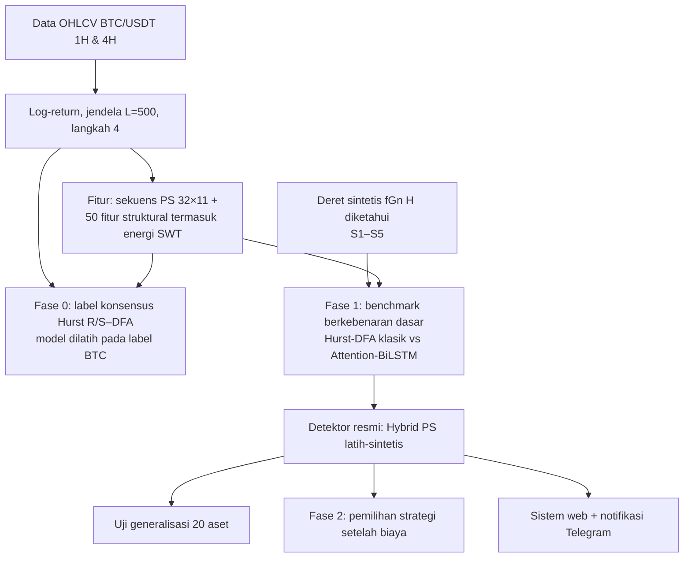
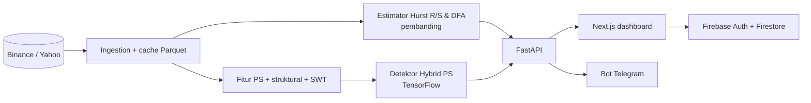

# DRAF REVISI SKRIPSI (BAB I – BAB IV)

**Judul (resmi, disetujui):**
**IDENTIFIKASI REGIME FRAKTAL DINAMIS BTC/USDT MULTI-TIMEFRAME MENGGUNAKAN SWT DAN ATTENTION-BiLSTM BERBASIS HURST-DFA**

> **Status dokumen:** draf revisi pengganti `rancangan_skripsi_bab1_bab4.md`.
> Semua angka diambil dari artefak di `ml/artifacts/` (protokol ambang
> `train_only`) dan dari praregistrasi di `docs/praregistrasi_*.md`. Setiap
> tabel mencantumkan berkas sumbernya agar dapat diperiksa ulang.
>
> **Perubahan utama dibanding draf lama**
> 1. Memakai judul resmi; setiap komponen judul dipetakan ke rumusan masalah (Tabel 1.1).
> 2. Angka diperbarui ke protokol `train_only` (konfigurasi utama). Akibatnya
>    **H5 (Hybrid PS > MLP) berubah dari "terbukti" menjadi "tidak terbukti"** (p Holm = 0,0575).
> 3. Ditambahkan Fase 1 (benchmark sintetis dengan kebenaran dasar), uji
>    generalisasi 20 aset, Fase 2 (pemilihan strategi setelah biaya), dan ablasi SWT.
> 4. Subbab "Setup Engine Mode A" diganti hasil Fase 2.
> 5. Tabel UAT, SUS, dan Jira di draf lama **dihapus** karena belum ada data
>    pengujian nyata. Bab III memuat rancangan pengujiannya; Bab IV menyediakan
>    tempat hasil yang diisi setelah pengujian benar-benar dilakukan.

---

# BAB I PENDAHULUAN

## 1.1 Latar Belakang

Perdagangan aset kripto kini banyak dijalankan oleh perangkat lunak otomatis.
Dua keluarga strategi yang paling umum bertumpu pada asumsi yang berlawanan
tentang sifat gerakan harga:

1. **Mean-reversion** (misalnya *grid bot*) mengasumsikan harga cenderung
   kembali ke nilai tengah.
2. **Trend-following / momentum** mengasumsikan gerakan harga cenderung berlanjut.

Strategi yang dijalankan pada kondisi pasar yang tidak sesuai dengan asumsinya
merugi secara sistematis: mean-reversion terseret saat harga terus bergerak
searah, momentum terkena sinyal palsu saat harga bolak-balik. Masalah ini
disebut *strategy mismatch*. Karena itu, pertanyaan praktis yang dihadapi
pengguna adalah: **kondisi pasar sekarang bersifat apa, dan strategi mana yang
sebaiknya tidak dijalankan?**

Dalam kerangka *Fractal Market Hypothesis* (Peters, 1994), sifat itu diukur
dengan **eksponen Hurst (H)**: H > 0,5 berarti persisten (gerakan cenderung
berlanjut), H < 0,5 anti-persisten (cenderung berbalik), dan H ≈ 0,5
menyerupai jalan acak. Dua estimator klasik yang paling banyak dipakai adalah
**Rescaled Range (R/S)** dan **Detrended Fluctuation Analysis (DFA)**. Penelitian
terdahulu menunjukkan bahwa eksponen ini pada Bitcoin berubah dari waktu ke
waktu (Bariviera, 2017), sehingga regime fraktal bersifat **dinamis** dan perlu
diidentifikasi pada jendela bergulir.

Penerapan langsung estimator klasik pada data intraday BTC/USDT menghadapi
empat hambatan yang ditemukan dalam penelitian ini:

1. **Estimator klasik tidak konsisten.** Pada 16.857 jendela BTC/USDT 1H
   (2019–2026), R/S dan DFA hanya sepakat pada **52,6%** jendela (korelasi
   Pearson 0,573), dan pada **7,3%** jendela keduanya menunjuk arah berlawanan
   (Tabel 4.1).
2. **Tidak ada kunci jawaban di data nyata.** Karena regime sebenarnya tidak
   teramati, model yang dilatih pada label R/S–DFA hanya belajar meniru
   estimator klasik beserta kesalahannya. Akurasi estimator itu sendiri tidak
   dapat diukur dari data BTC saja.
3. **Representasi wavelet mentah tidak cukup.** Pendekatan populer yang
   mengumpankan koefisien *Stationary Wavelet Transform* (SWT) langsung ke
   jaringan rekuren hanya mencapai *balanced accuracy* 0,38–0,42, nyaris setara
   tebakan acak (0,333) (Tabel 4.3).
4. **Evaluasi rawan kebocoran data.** Pembagian data acak antar-jendela yang
   saling tumpang tindih menggelembungkan akurasi sebesar +0,12 sampai +0,18
   (Tabel 4.9).

Penelitian ini menjawab hambatan tersebut dengan:
(a) mengukur ketidakkonsistenan Hurst-DFA secara terbuka;
(b) membandingkan representasi SWT mentah dengan sekuens statistik persistensi (PS);
(c) membangun model **Attention-BiLSTM** dengan masukan sekuens PS dan fitur
struktural yang memuat energi multi-skala SWT;
(d) melatih model pada deret sintetis yang eksponen Hurst-nya diketahui pasti,
sehingga akurasinya dapat dibandingkan langsung dengan estimator Hurst-DFA
klasik;
(e) menguji model pada dua timeframe (1H dan 4H), pada 19 aset lain sebagai uji
generalisasi, dan pada keputusan pemilihan strategi setelah biaya; serta
(f) mengimplementasikan hasilnya ke **sistem web pengawas regime** dengan
notifikasi Telegram.

## 1.2 Identifikasi Masalah

1. Estimator Hurst R/S dan DFA sering tidak sepakat pada BTC/USDT, sehingga
   label regime berbasis satu estimator tidak dapat dipercaya begitu saja.
2. Akurasi estimator Hurst-DFA dan model pembelajaran mesin tidak dapat diukur
   di data nyata karena regime sebenarnya tidak teramati.
3. Koefisien SWT mentah tidak memberi daya pembeda yang cukup untuk
   identifikasi regime.
4. Evaluasi model deret waktu finansial rentan terhadap kebocoran data.
5. Belum tersedia sistem yang menampilkan regime terkini beserta bukti
   kegunaannya bagi pemilihan strategi.

## 1.3 Batasan Masalah

1. **Objek utama** adalah BTC/USDT spot Binance, 1 Januari 2019 – Oktober 2026.
2. **Timeframe**: 1 jam (1H) dan 4 jam (4H).
3. **Uji generalisasi** memakai 19 aset tambahan (6 kripto utama, PAXGUSDT,
   emas berjangka GC=F, IHSG, dan 10 saham IDX) **tanpa pelatihan ulang**. Aset
   tersebut hanya dipakai untuk menguji, bukan untuk melatih atau menyetel model.
4. Data yang dipakai hanya harga OHLCV (log-return harga penutupan).
5. Panjang jendela L = 500 bar dengan langkah 4 bar.
6. Penelitian bersifat **identifikasi** kondisi saat ini, bukan prediksi harga
   atau prediksi regime di masa depan.
7. Sistem yang dibangun adalah sistem pendukung keputusan, bukan bot eksekusi
   transaksi.

## 1.4 Rumusan Masalah

**Tabel 1.1** Pemetaan komponen judul ke rumusan masalah

| Komponen judul | Rumusan masalah | Dijawab di |
|---|---|---|
| Berbasis Hurst-DFA | RM1 | 4.1, 4.6 |
| SWT | RM2 | 4.2 |
| Attention-BiLSTM | RM3 | 4.3, 4.6, 4.10 |
| Multi-timeframe | RM4 | 4.4, 4.7 |
| Regime fraktal dinamis BTC/USDT (kegunaan) | RM5 | 4.8, 4.9 |
| Sistem identifikasi | RM6 | 4.11 |

1. **RM1** Seberapa konsisten estimator Hurst R/S dan DFA dalam mengidentifikasi
   regime fraktal BTC/USDT, dan seberapa akurat keduanya bila kebenaran dasar diketahui?
2. **RM2** Apakah representasi SWT memberi daya pembeda bagi identifikasi regime,
   dan representasi apa yang lebih informatif?
3. **RM3** Apakah model Attention-BiLSTM lebih akurat daripada estimator
   Hurst-DFA klasik dan daripada model pembanding yang lebih sederhana?
4. **RM4** Bagaimana kinerja identifikasi pada timeframe 1H dibanding 4H, dan
   seberapa stabil antar-periode pasar?
5. **RM5** Apakah identifikasi regime tergeneralisasi ke aset lain dan berguna
   untuk memilih strategi trading setelah biaya transaksi?
6. **RM6** Bagaimana merancang dan mengimplementasikan sistem web yang menyajikan
   hasil identifikasi regime multi-timeframe beserta notifikasinya?

## 1.5 Tujuan Penelitian

1. Mengukur kesepakatan R/S dan DFA pada BTC/USDT 1H dan 4H serta akurasinya
   pada data sintetis berkebenaran dasar.
2. Membandingkan representasi SWT mentah dengan sekuens statistik persistensi
   dan mengukur kontribusi fitur energi SWT.
3. Membangun dan mengevaluasi model Hybrid PS (Attention-BiLSTM) terhadap
   estimator klasik dan model pembanding, dengan uji statistik yang
   memperhitungkan autokorelasi antar-jendela.
4. Membandingkan kinerja dan stabilitas pada 1H dan 4H melalui *walk-forward*.
5. Menguji generalisasi lintas aset dan kegunaan pemilihan strategi berbasis
   regime setelah biaya.
6. Mengimplementasikan sistem web (FastAPI + Next.js) dengan notifikasi Telegram.

## 1.6 Manfaat Penelitian

**Teoretis:**
- Bukti kuantitatif bahwa estimator Hurst-DFA klasik tidak konsisten dan kurang
  akurat pada data berkarakter kripto.
- Protokol evaluasi dengan kebenaran dasar sintetis untuk identifikasi regime,
  yang dapat dipakai ulang penelitian lain.
- Hasil negatif yang dilaporkan terbuka: SWT mentah gagal, mekanisme attention
  tidak menambah akurasi, dan pemilihan strategi berbasis regime tidak menambah
  Sharpe setelah biaya.

**Praktis:**
- Sistem web yang menampilkan regime BTC/USDT 1H dan 4H dari model AI, beserta
  keyakinan model dan pembanding estimator klasik.
- Informasi kapan sebaiknya **tidak** menjalankan strategi aktif. Kegunaan ini
  didukung data uji Fase 2.

## 1.7 Sistematika Penulisan

- **Bab I**: latar belakang, masalah, batasan, rumusan, tujuan, manfaat.
- **Bab II**: teori fraktal (Hurst, R/S, DFA, H(q)), SWT, variance ratio,
  BiLSTM dan attention, data sintetis fGn, evaluasi bebas kebocoran, dan
  penelitian terkait.
- **Bab III**: tahapan penelitian, data, pelabelan, fitur, arsitektur model,
  benchmark sintetis, uji generalisasi, uji pemilihan strategi, perancangan sistem,
  dan rancangan pengujian perangkat lunak.
- **Bab IV**: hasil dan pembahasan untuk RM1–RM6.
- **Bab V**: kesimpulan dan saran.

---

# BAB II TINJAUAN PUSTAKA DAN LANDASAN TEORI

## 2.1 Penelitian Terkait

> Catatan penulis: semua rujukan di bawah perlu dicocokkan dengan sumber aslinya
> sebelum naskah final. Klaim "70–84% pengguna bot rugi" dari draf lama
> dihapus karena sumbernya belum dapat diverifikasi.

**Efisiensi pasar dan fraktalitas kripto.** Urquhart (2016) menemukan pasar
Bitcoin awal tidak efisien. Bariviera (2017) memakai Hurst R/S dan DFA
bergulir dan menunjukkan derajat efisiensi Bitcoin berubah dari waktu ke waktu.
Takaishi (2018) dan Lahmiri & Bekiros (2018) melaporkan multifraktalitas pada
return Bitcoin intraday.

**Regime dan strategi.** Penggunaan Hurst bergulir untuk berpindah antara
strategi momentum dan mean-reversion telah dikaji pada berbagai pasar; bukti
kegunaannya setelah biaya transaksi masih beragam.

**Pembelajaran mesin untuk eksponen fraktal.** AnDi Challenge (Muñoz-Gil dkk.,
2021) dan Bo dkk. (2019) menunjukkan jaringan rekuren yang dilatih pada lintasan
sintetis dapat mengestimasi eksponen anomali lebih akurat daripada estimator
statistik. Penelitian ini memindahkan gagasan tersebut ke deret return
berkarakter kripto (ekor tebal, *volatility clustering*, lonjakan).

**Wavelet dan LSTM.** Bao, Yue, & Rao (2017) menggabungkan wavelet dengan LSTM
untuk deret finansial. Banyak penelitian menerapkan dekomposisi wavelet ke
seluruh deret sekaligus (non-kausal), yang membocorkan informasi masa depan.

**Evaluasi bebas kebocoran.** López de Prado (2018) memperkenalkan *purging*
dan *embargo*. Kapoor & Narayanan (2023) menunjukkan kebocoran data adalah
penyebab utama hasil ML terapan yang tidak dapat direproduksi.

## 2.2 Posisi Penelitian

| Celah | Penelitian terdahulu | Penelitian ini |
|---|---|---|
| Akurasi estimator Hurst-DFA pada data kripto | Diterapkan langsung, akurasi tidak diukur | Diukur pada deret sintetis berkebenaran dasar dengan karakter kripto (Fase 1) |
| Label untuk ML | Satu estimator sebagai label | Konsensus R/S–DFA dengan kelas tidak pasti, lalu pelatihan pada kebenaran dasar sintetis |
| Representasi SWT | Koefisien mentah ke jaringan rekuren | Diuji dan dibandingkan dengan sekuens persistensi; energi SWT dipakai sebagai fitur multi-skala |
| Evaluasi | Split acak, tanpa koreksi autokorelasi | Kronologis + purge, bootstrap blok, Holm, walk-forward, praregistrasi |
| Generalisasi | Satu aset | Satu model diuji pada 20 aset tanpa latih ulang |
| Kegunaan | Akurasi klasifikasi saja | Uji pemilihan strategi setelah biaya, dipraregistrasi |

## 2.3 Log-Return

Untuk harga penutupan P_t: r_t = ln P_t − ln P_{t−1}. Estimasi eksponen pada
harga mentah (bukan return) selalu mendekati 1 karena harga memiliki akar unit.

## 2.4 Eksponen Hurst dan Estimator Klasik

### 2.4.1 Rescaled Range (R/S)

E[R(n)/S(n)] = C · n^H, dengan R(n) rentang deviasi kumulatif dan S(n)
simpangan baku pada skala n. H adalah kemiringan regresi ln(R/S) terhadap ln n.
R/S diketahui bias ke atas pada sampel pendek; varian Lo (1991) mengoreksi
autokorelasi jangka pendek.

### 2.4.2 Detrended Fluctuation Analysis (DFA-1)

Profil Y(k) = Σ(r_i − r̄) dibagi segmen berukuran n, tren linear tiap segmen
dibuang, dan F(n) = √(mean (Y − y_n)²) ∝ n^α. Untuk return: α < 0,5
anti-persisten, α ≈ 0,5 acak, α > 0,5 persisten.

### 2.4.3 Generalized Hurst H(q)

K_q(τ) = ⟨|Y(t+τ) − Y(t)|^q⟩ / ⟨|Y(t)|^q⟩ ∝ τ^{qH(q)}. Bila H(q) bergantung
pada q, deret bersifat multifraktal; lebar ΔH = H(1) − H(4).

### 2.4.4 Variance Ratio

VR(q) = Var(r_t + … + r_{t−q+1}) / (q · Var(r_t)) (Lo & MacKinlay, 1988).
VR(q) > 1 menandakan autokorelasi positif (persisten), < 1 negatif. Untuk fGn,
VR(2) = 2^{2H−1}, sehingga H dapat diestimasi sebagai ½(1 + log₂ VR(2)).

## 2.5 Stationary Wavelet Transform (SWT)

SWT (*undecimated wavelet transform*) menguraikan sinyal menjadi koefisien
detail D_1 … D_J dan aproksimasi A_J tanpa *downsampling*, sehingga setiap
level memiliki panjang sama dengan sinyal asli dan invarian terhadap
pergeseran. Penelitian ini memakai wavelet Daubechies-4 (db4) dengan J = 4.

Untuk proses fraktal, energi detail pada level j berskala sebagai 2^{j(2H−1)}
(untuk fGn), sehingga **distribusi energi antar-skala** membawa informasi
tentang H. Agar kausal, SWT pada titik t hanya dihitung atas data r_{≤t}.

Dua cara pemakaian SWT diuji:
1. **Sekuens koefisien SWT** (32 langkah terakhir × 5 kanal) sebagai masukan BiLSTM.
2. **Rasio energi SWT** per level pada 3 sub-jendela (100%, 50%, 25% panjang
   jendela) sebagai 12 fitur struktural.

## 2.6 Data Sintetis Berkebenaran Dasar

*Fractional Gaussian noise* (fGn) adalah deret stasioner dengan autokovarians
γ(k) = ½σ²(|k+1|^{2H} − 2|k|^{2H} + |k−1|^{2H}). fGn dibangkitkan secara
eksak dengan metode Davies-Harte (1987). Karena H diketahui, label regime
deret sintetis adalah kebenaran dasar. Karakter kripto ditambahkan tanpa
mengubah H: marginal Student-t lewat copula, volatilitas stokastik AR(1), dan
lonjakan Poisson (Bab III).

## 2.7 BiLSTM dan Attention

LSTM (Hochreiter & Schmidhuber, 1997) memakai gerbang *forget*, *input*, dan
*output* untuk mempertahankan informasi jangka panjang. BiLSTM memproses
sekuens maju dan mundur. *Attention pooling* aditif (Bahdanau dkk., 2015)
merangkum keluaran BiLSTM: e_t = vᵀ tanh(W h_t + b), α_t = softmax(e_t),
c = Σ α_t h_t. Entropi ternormalisasi H(α) = −Σ α_t ln α_t / ln T mengukur
seberapa seragam bobot attention (1 = seragam sempurna).

## 2.8 Evaluasi Bebas Kebocoran dan Uji Statistik

- **Split kronologis + purge gap**: jendela yang berbagi bar tidak boleh
  berada di dua partisi berbeda.
- **Moving-block bootstrap** (Künsch, 1989): resampling blok berurutan untuk
  data berautokorelasi.
- **Holm-Bonferroni** (Holm, 1979): koreksi uji berganda untuk mengendalikan
  *family-wise error rate*.
- **Praregistrasi**: hipotesis, metrik, dan kriteria keputusan dikunci
  (di-commit) sebelum hasil dilihat.

## 2.9 Pengujian Perangkat Lunak

Verifikasi fungsional (unit test dan *black-box*), *User Acceptance Testing*
berbasis skenario tugas, dan *System Usability Scale* (Brooke, 1996; Bangor
dkk., 2008).

---

# BAB III METODOLOGI PENELITIAN DAN PERANCANGAN SISTEM

## 3.1 Tahapan Penelitian

Setiap fase memiliki dokumen praregistrasi yang dikunci sebelum hasilnya
dihitung:

| Fase | Praregistrasi |
|---|---|
| Fase 0 (BTC, label Hurst-DFA) | `docs/praregistrasi_addendum.md` |
| Fase 1 (sintetis) | `docs/praregistrasi_fase1_sintetis.md` + adendum 1–4 |
| Uji generalisasi | `docs/praregistrasi_generalisasi_aset.md` + adendum 1–2 |
| Fase 2 (strategi) | `docs/praregistrasi_fase2_strategi.md` |

## 3.2 Data

- BTC/USDT spot, mirror resmi Binance (`data-api.binance.vision`), 1H dan 4H,
  sejak 1 Januari 2019. Candle yang belum tutup selalu dibuang.
- Aset uji generalisasi: ETH, BNB, SOL, XRP, ADA, DOGE, PAXG (Binance, 1H); GC=F,
  IHSG dan 10 saham IDX (Yahoo Finance, 1D, karena data 1H gratis hanya ±730 hari).

## 3.3 Pelabelan Regime Berbasis Hurst-DFA (Fase 0)

1. Untuk tiap jendela 500 bar dihitung H (R/S) dan α (DFA-1).
2. Ambang kelas = kuantil 1/3 dan 2/3 masing-masing estimator, dihitung **hanya
   dari partisi latih** (`train_only`, konfigurasi utama). Ambang 1H: R/S
   0,5718 / 0,5985; DFA 0,4777 / 0,5206.
3. Bila kelas R/S = kelas DFA, label = kelas itu; bila berbeda, label
   `uncertain_rule` dan jendela tidak dipakai untuk latih/uji.

## 3.4 Fitur

### 3.4.1 Sekuens koefisien SWT (pembanding)
SWT kausal db4, J = 4, 32 langkah terakhir × 5 kanal (D1–D4, A4).

### 3.4.2 Sekuens Statistik Persistensi (PS)
Sub-jendela 128 bar digeser 12 bar sebanyak 32 langkah sehingga menutup seluruh
jendela 500 bar. Tiap langkah memuat 11 kanal: VR(2), VR(4), VR(8), VR(16);
autokorelasi return lag 1, 2, 3, 5; autokorelasi |r| lag 1; laju pergantian
tanda; dan ln σ.

### 3.4.3 Fitur struktural (50 dimensi)
Autokorelasi return (11), autokorelasi |r| (5), VR multi-lag dan kemiringannya
(11), **rasio energi SWT 4 level × 3 sub-jendela (12)**, statistik sebaran (5),
dan H(q) beserta lebar spektrum (6).

## 3.5 Arsitektur Model Usulan: Hybrid PS (Attention-BiLSTM)

1. **Cabang sekuens**: PS 32×11 → BiLSTM 64 unit (return sequences) →
   Dropout 0,25 → Attention pooling → vektor 128.
2. **Cabang fitur**: 50 fitur → Dense 64 ReLU → Dropout 0,25 → Dense 32 ReLU.
3. **Gabungan**: concat 160 → Dropout 0,25 → Dense 64 ReLU → Dense 3 softmax.

Pelatihan: Adam (lr 0,001), *categorical cross-entropy*, bobot kelas terbalik
frekuensi, batch 64, *early stopping* (patience 12) dan ReduceLROnPlateau.

**Model pembanding**: kelas mayoritas, acak proporsional, regresi logistik,
LightGBM, MLP fitur struktural, SWT + BiLSTM, SWT + Attention-BiLSTM,
Hybrid SWT, PS + BiLSTM (tanpa attention), PS + Attention-BiLSTM, dan PS dengan
urutan langkah diacak.

## 3.6 Protokol Evaluasi pada BTC (Fase 0)

- Split kronologis 70/15/15 dengan purge 500 bar di setiap batas.
- Normalisasi hanya dari partisi latih.
- Metrik utama *balanced accuracy* (BA) dan Macro-F1.
- Ensemble 3 seed (42, 43, 44); moving-block bootstrap blok 125 jendela,
  B = 2.000; koreksi Holm atas H1–H6.
- Walk-forward *expanding* 5 fold.
- Studi kebocoran 5 varian.

## 3.7 Benchmark Sintetis Berkebenaran Dasar (Fase 1)

**Skenario** (praregistrasi Fase 1 §3):

| Kode | Deret | Tujuan |
|---|---|---|
| S1 | fGn Gaussian | Kondisi bersih |
| S2 | fGn → marginal Student-t (ν = 3) via copula | Ekor tebal |
| S3 | fGn × volatilitas stokastik AR(1) | *Volatility clustering* |
| S4 | S2 + S3 + lonjakan Poisson | Paling mirip kripto (uji utama) |
| S5 | Seperti S4, H berganti di dalam jendela | Uji batas |

- H diambil acak, label: H < 0,47 anti-persisten, 0,47–0,53 acak, > 0,53
  persisten. Ambang 0,47/0,53 dipilih dari titik impas ekonomi
  (`ml/artifacts/threshold_criteria.md`); sensitivitas 0,45/0,55.
- Setiap deret dinormalisasi ke simpangan baku 0,0066 per bar (setara BTC 1H).
- 12.000 deret latih, 3.000 validasi, 3.000 uji per skenario.
- **Pembanding klasik**: R/S, DFA, R/S Lo, VR(2), kemiringan VR, konsensus
  R/S–DFA; masing-masing versi naif (ambang 0,47/0,53 langsung) dan
  terkalibrasi (ambang disetel di validasi).
- **Model**: M-fBm (dilatih S1 saja) dan M-kripto (dilatih S1–S4). Arsitektur
  dipilih dengan BA validasi.
- **Hipotesis**: H1 BA klasik terbaik S1 − S4 > 0; H2 BA M-kripto − BA klasik
  terbaik pada S4 > 0; H3 BA M-kripto − BA M-fBm pada S4 > 0. Bootstrap per
  deret, koreksi Holm.

Model M-kripto terpilih menjadi **detektor resmi sistem** (adendum 3).

## 3.8 Ablasi Fitur SWT pada Detektor Resmi

Sesuai adendum 4 praregistrasi Fase 1: detektor dilatih ulang tanpa 12 fitur
rasio energi SWT (A1) dan dibandingkan dengan detektor lengkap (A0), masing-masing
3 seed. ΔBA pada S4 dengan CI95 bootstrap berpasangan.

## 3.9 Uji Generalisasi Lintas Aset

Detektor yang sama diterapkan ke 20 aset tanpa latih ulang. Karena tidak ada
kunci jawaban, deteksi dinilai dari perilaku harga **sesudah** jendela:
Δ = rata-rata log VR(4) maju setelah label persisten − setelah label
anti-persisten (M = 200 bar untuk 1H, 60 untuk 1D). Detektor benar bila Δ > 0.
G1-kelompok terpenuhi bila CI95 Δ > 0 pada ≥ 2/3 aset kelompok.

## 3.10 Uji Pemilihan Strategi (Fase 2)

Strategi: MOM (tanda return 24 bar), MR (z-score 24 bar), SW (regime →
MOM/MR/tidak trading), BH, FLAT. Biaya per sisi: kripto 0,085%, GC=F 0,03%,
saham IDX 0,25% (long saja). Hipotesis utama F1: Sharpe SW > Sharpe strategi
tunggal terbaik, diuji dengan bootstrap blok sirkular berpasangan.

## 3.11 Perancangan Sistem

- **Backend** FastAPI: endpoint `/api/v1/analysis/ai-regime` (detektor AI,
  1H/4H, cache disk bertahap), `/hurst-dfa`, `/swt`, `/multifractal`, dan lainnya.
- **Frontend** Next.js 14: ringkasan pasar (regime 1H & 4H, probabilitas kelas,
  pembanding Hurst/DFA), grafik candlestick dengan pita regime, halaman strategi
  dengan bukti Fase 2, halaman analisis SWT/Hurst/H(q), analisis teknikal, dan
  order flow.
- **Autentikasi** Firebase (Google dan email); chat ID Telegram disimpan di Firestore.
- **Notifikasi** Telegram: regime baru diumumkan bila 3 jendela berturut-turut
  berlabel sama; setiap notifikasi dicatat sebagai catatan uji maju.

## 3.12 Rancangan Pengujian Perangkat Lunak

1. **Unit test otomatis** (pytest) untuk estimator, fitur, model, API, dan
   notifikasi.
2. **Black-box**: daftar kasus uji per fitur (login, ringkasan pasar, ganti
   timeframe, grafik, halaman strategi, tautkan Telegram, notifikasi).
3. **UAT**: minimal 10 responden (trader kripto aktif) menjalankan 5 skenario tugas.
4. **SUS**: 10 butir Likert 1–5, skor = [Σ(ganjil − 1) + Σ(5 − genap)] × 2,5,
   target rata-rata ≥ 68.

---

# BAB IV HASIL DAN PEMBAHASAN

## 4.1 Konsistensi Hurst-DFA pada BTC/USDT (RM1, bagian 1)

**Tabel 4.1** Kesepakatan R/S dan DFA (`ml/artifacts/label_consistency.md`)

| TF | Jendela | Pearson | Sepakat | Tidak sepakat | Berlawanan (P vs A) |
|---|---|---|---|---|---|
| 1H | 16.857 | 0,573 | 52,6% | 47,4% | 7,3% |
| 4H | 4.123 | 0,550 | 52,7% | 47,3% | 7,1% |

**Tabel 4.2** Distribusi label konsensus

| TF | Persisten | Acak | Anti-persisten | Tidak pasti |
|---|---|---|---|---|
| 1H | 19,0% | 13,2% | 20,4% | 47,4% |
| 4H | 18,6% | 13,3% | 20,8% | 47,3% |

Hampir separuh jendela tidak dapat diberi label karena kedua estimator tidak
sepakat. Pola ini sama pada 1H dan 4H.

## 4.2 Peran SWT (RM2)

### 4.2.1 Koefisien SWT mentah tidak cukup

**Tabel 4.3** BA uji, label Hurst-DFA BTC (`ml/artifacts/ps_study_*.md`)

| Model | Masukan | 1H | 4H |
|---|---|---|---|
| Tebakan acak | – | 0,333 | 0,333 |
| SWT + Attention-BiLSTM | koefisien SWT 32×5 | 0,382 ± 0,015 | 0,421 ± 0,054 |
| PS + Attention-BiLSTM | sekuens PS 32×11 | 0,678 ± 0,025 | 0,525 ± 0,044 |

Pada 1H, mengganti koefisien SWT dengan sekuens PS menaikkan Macro-F1 +0,277
[+0,173; +0,368], p Holm < 0,0005 (**H1 terbukti**). Pada 4H selisihnya tidak
signifikan (p Holm 0,159).

### 4.2.2 Kontribusi fitur energi SWT pada detektor resmi

**Tabel 4.4** Ablasi fitur energi SWT, BA uji sintetis (`ml/artifacts/swt_ablation.md`)

| Varian | S1 | S2 | S3 | **S4** | S4k |
|---|---|---|---|---|---|
| A0 Detektor resmi (50 fitur, dengan energi SWT) | 0,861 ± 0,001 | 0,847 ± 0,002 | 0,822 ± 0,001 | **0,815 ± 0,001** | 0,834 ± 0,003 |
| A1 Tanpa energi SWT (38 fitur) | 0,861 ± 0,002 | 0,846 ± 0,003 | 0,820 ± 0,002 | **0,812 ± 0,002** | 0,834 ± 0,003 |

Hipotesis S-SWT (S4, probabilitas rata-rata 3 seed): ΔBA (A0 − A1) = −0,0003,
CI95 [−0,0053; +0,0049]. **Kontribusi fitur energi SWT tidak terdeteksi.**

### 4.2.3 Sumber sinyal

**Tabel 4.5** Ablasi kelompok fitur pada Hybrid PS (`ml/artifacts/leakage_study_*_ps.md`)

| Varian | 1H BA | Δ | 4H BA | Δ |
|---|---|---|---|---|
| Lengkap | 0,698 | – | 0,593 | – |
| Tanpa H(q) | 0,694 | −0,004 | 0,600 | +0,007 |
| Tanpa VR | 0,660 | −0,039 | 0,532 | −0,061 |
| Tanpa VR + autokorelasi | 0,674 | −0,024 | 0,500 | −0,092 |

Daya pembeda terutama berasal dari struktur korelasi multi-skala (variance
ratio dan autokorelasi), bukan dari H(q).

**Pembahasan RM2.** SWT dalam bentuk koefisien mentah tidak memberi daya
pembeda. SWT tetap dipakai dalam bentuk rasio energi antar-skala di dalam fitur
struktural; kontribusinya diukur di Tabel 4.4. Hasilnya, membuang 12 fitur energi SWT tidak mengubah akurasi detektor (selisih < 0,005, CI95 memuat nol). Informasi multi-skala yang dibawa energi SWT sudah tertangkap oleh variance ratio dan autokorelasi multi-lag, yang juga mengukur struktur korelasi lintas skala. Dengan demikian, peran SWT dalam penelitian ini adalah sebagai representasi yang **diuji**: dua cara pemakaiannya (koefisien mentah dan energi antar-skala) tidak menambah daya pembeda dibanding statistik persistensi. Temuan ini dilaporkan apa adanya sesuai praregistrasi; detektor resmi tidak diubah.

## 4.3 Model pada Label Hurst-DFA BTC (RM3, bagian 1; Fase 0)

**Tabel 4.6** Kinerja uji 1H, rata-rata 3 seed (`ml/artifacts/ps_study_1h.md`)

| Model | BA | Macro-F1 | MCC |
|---|---|---|---|
| Kelas mayoritas | 0,333 | 0,216 | 0,000 |
| Regresi logistik | 0,665 | 0,648 | 0,573 |
| LightGBM | 0,622 ± 0,008 | 0,612 | 0,525 |
| MLP fitur | 0,632 ± 0,020 | 0,619 | 0,530 |
| Hybrid SWT | 0,653 ± 0,033 | 0,643 | 0,572 |
| PS + BiLSTM (tanpa attention) | 0,669 ± 0,009 | 0,662 | 0,621 |
| PS + Attention-BiLSTM | 0,678 ± 0,025 | 0,663 | 0,613 |
| **Hybrid PS (usulan)** | **0,698 ± 0,011** | **0,691** | **0,652** |

**Tabel 4.7** Kinerja uji 4H (`ml/artifacts/ps_study_4h.md`)

| Model | BA | Macro-F1 |
|---|---|---|
| Regresi logistik | 0,524 | 0,532 |
| LightGBM | 0,571 ± 0,004 | 0,549 |
| MLP fitur | 0,574 ± 0,024 | 0,576 |
| Hybrid SWT | 0,586 ± 0,031 | 0,584 |
| **Hybrid PS (usulan)** | **0,593 ± 0,013** | 0,580 |

**Tabel 4.8** Uji hipotesis, ΔMacro-F1 ensemble 3 seed, bootstrap blok 125,
Holm (`ml/artifacts/bootstrap_eval_*.md`)

| H | Pertanyaan | 1H Δ [CI95] | p Holm | 1H | 4H |
|---|---|---|---|---|---|
| H1 | PS > SWT | +0,277 [+0,173; +0,368] | < 0,0005 | **Terbukti** | Setara |
| H2 | Urutan waktu PS bermakna | +0,015 [−0,007; +0,034] | 0,366 | Setara | Berlawanan |
| H3 | Attention menambah nilai | −0,014 [−0,052; +0,021] | 0,767 | Setara | Setara |
| H4 | Hybrid PS > Hybrid SWT | +0,027 [−0,042; +0,086] | 0,420 | Setara | Setara |
| H5 | Hybrid PS > MLP | +0,067 [+0,008; +0,127] | 0,0575 | **Tidak terbukti** | Setara |
| H6 | PS + Attn ≥ MLP | +0,039 [−0,033; +0,107] | 0,378 | Setara | Berlawanan |

Pembanding tambahan (tanpa koreksi Holm): Hybrid PS > LightGBM terbukti di 1H
(+0,079 [+0,032; +0,129]) dan 4H; Hybrid PS vs regresi logistik setara di 1H
(+0,039 [−0,029; +0,104]) dan lebih baik di 4H.

**Pembahasan.** Pada label Hurst-DFA BTC, Hybrid PS memiliki BA tertinggi
(0,698), tetapi keunggulannya atas MLP tidak lolos koreksi uji berganda
(p Holm 0,0575) dan setara dengan regresi logistik. Attention tidak menambah
akurasi (H3). Keterbatasan mendasar fase ini: model hanya diukur terhadap label
Hurst-DFA yang hampir separuhnya tidak konsisten (4.1). Karena itu klaim utama
efektivitas model diuji pada Fase 1 dengan kebenaran dasar (4.6).

## 4.4 Stabilitas Antar-Periode (RM4, bagian 1)

**Tabel 4.9a** Walk-forward 5 fold, BA rata-rata (`ml/artifacts/walk_forward_neural_*_ps.md`)

| Model | 1H rata-rata ± std | 4H rata-rata ± std |
|---|---|---|
| MLP fitur | 0,546 ± 0,070 | 0,476 ± 0,090 |
| Regresi logistik | **0,576 ± 0,065** | 0,448 ± 0,081 |
| LightGBM | 0,540 ± 0,065 | 0,428 ± 0,137 |
| Hybrid SWT | 0,561 ± 0,059 | **0,478 ± 0,101** |
| Hybrid PS | 0,570 ± 0,072 | 0,443 ± 0,093 |

Di 1H, Hybrid PS mengungguli MLP pada 4 dari 5 fold, tetapi regresi logistik
memiliki rata-rata tertinggi. Di 4H tidak ada model yang konsisten unggul;
Hybrid PS di bawah MLP.

## 4.5 Kebocoran Data

**Tabel 4.9** Distorsi akibat kebocoran (`ml/artifacts/leakage_study_*.md`)

| Protokol | Hybrid PS 1H | Δ | Hybrid PS 4H | Δ |
|---|---|---|---|---|
| Bersih | 0,698 | – | 0,593 | – |
| Tanpa purge | 0,682 | −0,016 | 0,516 | −0,077 |
| Scaler global | 0,693 | −0,006 | 0,582 | −0,010 |
| **Split acak** | **0,822** | **+0,124** | **0,773** | **+0,180** |

Split acak menggelembungkan BA sebesar +0,12 (1H) dan +0,18 (4H) karena jendela
bertetangga berbagi hingga 496 bar. Pada Hybrid SWT, SWT non-kausal hanya
mengubah BA +0,005 (1H) dan −0,025 (4H).

## 4.5b Upaya Mengurangi Overfitting: Pralatih Sintetis + Fine-Tune (Fase 0b)

Fase 0 menunjukkan overfitting (selisih BA latih − uji ±0,20 di 4H). Mengikuti
saran literatur untuk data kecil dan label berderau (Ismail Fawaz dkk., 2018;
Müller dkk., 2019), dilakukan eksperimen terpraregistrasi
(`docs/praregistrasi_fase0b_transfer.md`). Split identik dengan Fase 0.

**Tabel 4.9b** Hasil uji, rata-rata 3 seed (`ml/artifacts/transfer_finetune_*.md`)

| Model | 1H BA latih | 1H BA uji | 4H BA latih | 4H BA uji | 4H selisih |
|---|---|---|---|---|---|
| B0 Hybrid PS dari nol | 0,759 | 0,711 | 0,811 | 0,607 | 0,204 |
| T1 pralatih sintetis + fine-tune | 0,712 | 0,633 | 0,735 | 0,541 | 0,193 |
| T2 T1 + label smoothing 0,1 | 0,777 | 0,651 | 0,755 | 0,510 | 0,245 |
| T0 detektor sintetis tanpa fine-tune | – | 0,372 | – | 0,343 | – |

| Hipotesis | 1H ΔMacro-F1 [CI95] | 4H ΔMacro-F1 [CI95] | Keputusan (Holm, 4 uji) |
|---|---|---|---|
| T-H1 pralatih > dari nol | −0,074 [−0,121; −0,032] | −0,048 [−0,274; +0,098] | 1H **berlawanan**, 4H tidak terbukti |
| T-H2 label smoothing > T1 | +0,019 [−0,017; +0,061] | −0,009 [−0,030; +0,010] | Tidak terbukti |

Walk-forward 5 fold: T1 mengungguli B0 pada 1/5 fold (1H) dan 2/5 fold (4H).

**Pembahasan.**
1. Sesuai tabel tafsir praregistrasi, di 1H terjadi ***negative transfer***:
   pengetahuan dari data sintetis tidak berpindah ke label Hurst-DFA BTC. Di 4H
   selisih latih − uji T1 sedikit lebih kecil, tetapi karena BA latih dan uji
   sama-sama turun; ini bukan perbaikan generalisasi.
2. Penjelasannya terlihat dari T0. Detektor sintetis tanpa fine-tune hanya
   mencapai BA 0,34–0,37 terhadap label BTC, nyaris tebakan acak. Label BTC
   (kuantil 1/3 dan 2/3 R/S–DFA, misalnya "persisten" = R/S > 0,60) dan label
   sintetis (H sebenarnya 0,47/0,53) **mengukur konsep yang berbeda**. Pralatih
   pada konsep yang satu menghambat pembelajaran konsep yang lain.
3. Temuan ini memperkuat 4.1 dan 4.6: label Hurst-DFA bukan ukuran persistensi
   yang sebenarnya. Overfitting Fase 0 tidak dapat diperbaiki lewat pralatih
   karena sumbernya adalah definisi label dan sedikitnya sampel efektif, bukan
   kurangnya pengetahuan awal model.
4. Detektor resmi sistem tidak diganti (praregistrasi §7).

## 4.6 Benchmark Sintetis: Hurst-DFA Klasik vs Attention-BiLSTM (RM1 bagian 2, RM3 bagian 2; Fase 1)

**Tabel 4.10** BA uji pada n = 500 (`ml/artifacts/synthetic_benchmark.md`)

| Metode | S1 bersih | S2 ekor tebal | S3 volatilitas | **S4 mirip kripto** | S5 berganti | S4k |
|---|---|---|---|---|---|---|
| R/S naif | 0,452 | 0,424 | 0,418 | 0,401 | 0,340 | 0,411 |
| DFA naif | 0,683 | 0,667 | 0,611 | 0,584 | 0,323 | 0,632 |
| **Konsensus R/S–DFA naif** | 0,369 | 0,330 | 0,302 | **0,268** | 0,120 | 0,305 |
| R/S terkalibrasi | 0,720 | 0,709 | 0,686 | 0,662 | 0,288 | 0,691 |
| DFA terkalibrasi | 0,711 | 0,675 | 0,635 | 0,581 | 0,313 | 0,647 |
| VR(2) terkalibrasi (klasik terbaik) | 0,795 | 0,748 | 0,662 | **0,654** | 0,338 | 0,703 |
| M-fBm (LightGBM, latih S1) | 0,866 | 0,827 | 0,767 | 0,735 | 0,309 | 0,795 |
| **M-kripto: Hybrid PS (Attention-BiLSTM)** | 0,863 | 0,848 | 0,819 | **0,813** | 0,276 | 0,836 |
| M-kripto: LightGBM | 0,864 | 0,842 | 0,798 | 0,805 | 0,274 | 0,812 |
| M-kripto: MLP | 0,863 | 0,838 | 0,803 | 0,801 | 0,279 | 0,808 |
| M-kripto: regresi logistik | 0,850 | 0,835 | 0,806 | 0,794 | 0,285 | 0,814 |

**Tabel 4.11** Hipotesis Fase 1 (ambang utama 0,47/0,53)

| H | Pernyataan | Selisih BA [CI95] | p Holm | Keputusan |
|---|---|---|---|---|
| H1 | Akurasi estimator klasik turun pada kondisi kripto (S1 − S4) | +0,141 [+0,119; +0,163] | < 0,0005 | **Terbukti** |
| H2 | Attention-BiLSTM (M-kripto) > klasik terbaik pada S4 | +0,159 [+0,141; +0,177] | < 0,0005 | **Terbukti** |
| H3 | Latih berkarakter kripto > latih fBm saja pada S4 | +0,078 [+0,063; +0,092] | < 0,0005 | **Terbukti** |

Ketiga hipotesis juga terbukti pada ambang sensitivitas 0,45/0,55.

**Pembahasan.**
1. Estimator Hurst-DFA naif sangat tidak akurat pada deret berkarakter kripto:
   konsensus R/S–DFA hanya 0,268 pada S4, di bawah tebakan acak, karena banyak
   jendela jatuh ke "tidak pasti" dan R/S bias ke atas. Ini menjelaskan temuan
   4.1 dengan kebenaran dasar.
2. Model Attention-BiLSTM yang dilatih pada data berkarakter kripto lebih akurat
   0,159 daripada estimator klasik terbaik.
3. Keunggulan atas model ML lain yang dilatih pada data yang sama kecil
   (LightGBM 0,805; MLP 0,801; regresi logistik 0,794) dan tidak diuji formal.
   Kontribusi utama berasal dari **cara melatih** (data sintetis berkarakter
   kripto), bukan semata-mata dari arsitektur.
4. Semua metode gagal pada S5 (regime berganti di dalam jendela, BA ±0,3).
   Identifikasi tepat setelah pergantian regime belum dapat diandalkan.

## 4.6b Kecepatan dan Ketepatan Identifikasi (Fase 1 §8 dan adendum 5)

**Deteksi pergantian regime.** 40 deret sintetis S4 × 20.000 bar, 392 titik
ganti, detektor bergulir (jendela 500, langkah 4) dengan konfirmasi 3 jendela
berturut-turut, sama dengan aturan notifikasi sistem
(`ml/artifacts/regime_change_study.md`).

**Tabel 4.11b** Kecepatan dan salah alarm

| Metode | Median keterlambatan (bar) | Salah alarm / 1.000 bar | Pergantian terlewat |
|---|---|---|---|
| **D-sintetis (Attention-BiLSTM)** | **296** | 0,91 | **5,9%** |
| Konsensus R/S–DFA naif | 604 | 0,24 | 67,9% |
| Konsensus R/S–DFA terkalibrasi | 388 | 1,41 | 5,9% |
| VR(2) terkalibrasi | 302 | 2,41 | 2,3% |
| D-sintetis + abstain (τ = 0,75) | 368 | 0,30 | 12,5% |

H5 (lebih cepat **dan** salah alarm tidak lebih banyak daripada konsensus naif):
**tidak terbukti**. Detektor AI dua kali lebih cepat (selisih median
keterlambatan CI95 [−463; −192] bar) dan jauh lebih jarang melewatkan
pergantian (5,9% vs 67,9%), tetapi salah alarmnya lebih banyak (+0,58 sampai
+0,76 per 1.000 bar). Salah alarm konsensus naif rendah karena konsensus jarang
mengonfirmasi apa pun: dua pertiga pergantian tidak pernah terdeteksi.

Secara deskriptif, dibanding konsensus terkalibrasi, detektor AI lebih cepat
(296 vs 388 bar) dan lebih jarang salah alarm (0,91 vs 1,41) dengan proporsi
terlewat sama. Dengan abstain, salah alarm turun ke 0,30 per 1.000 bar
(setara konsensus naif) dan keterlambatan tetap jauh lebih kecil (368 vs 604).

**Abstain berdasarkan keyakinan.** Ambang τ dipilih di validasi (τ terkecil dengan
BA tercakup ≥ 0,90): **τ = 0,75**. Pada uji S4: BA tercakup 0,905 pada 67,9%
jendela (tanpa abstain 0,813 pada 100%). Pada BTC, 56,6% jendela 1H dan 48,7%
jendela 4H akan berlabel tidak pasti. Pada τ ≥ 0,90 BA tercakup justru turun
(0,667) karena kelas random-like hampir tidak pernah diprediksi dengan keyakinan
setinggi itu.

**Pembahasan.** Keterlambatan ±300 bar (±12 hari pada 1H) adalah harga dari
jendela 500 bar; jendela lebih pendek lebih cepat tetapi kurang akurat (BA S4
0,732 pada 256 bar). Abstain memberi pilihan rancangan yang jelas: label lebih
tepat dan salah alarm lebih jarang, dibayar dengan lebih banyak jendela "tidak
pasti" dan deteksi sedikit lebih lambat.

## 4.7 Multi-Timeframe (RM4, bagian 2)

| Aspek | 1H | 4H |
|---|---|---|
| Jendela 500 bar setara | ±3 minggu | ±12 minggu |
| Sampel uji Fase 0 | 1.610 jendela | 261 jendela |
| Hybrid PS vs MLP (uji tunggal) | +0,067 F1, p Holm 0,0575 | setara |
| Walk-forward Hybrid PS | 0,570 | 0,443 |
| Proporsi label detektor AI di BTC | acak 76%, anti 23%, persisten 1% | acak 85%, anti 15%, persisten 0,6% |

Kinerja dan stabilitas 4H lebih rendah karena jumlah sampel efektif jauh lebih
kecil (≈3 blok independen di partisi uji). Detektor resmi dilatih pada data
sintetis tanpa satuan waktu, sehingga dapat diterapkan ke kedua timeframe; uji
validitas ke depan hanya dilakukan pada 1H dan 1D (4.8).

## 4.8 Generalisasi Lintas Aset (RM5, bagian 1)

**Tabel 4.12** Ringkasan uji validitas ke depan (`ml/artifacts/generalization.md`)

| Kelompok | Aset | CI95 Δ > 0 | Tergeneralisasi (≥ 2/3) |
|---|---|---|---|
| Kripto 1H | 7 | 2 (ETH, DOGE) | Tidak |
| Emas | 2 | 0 | Tidak |
| Saham IDX 1D | 11 | 0 | Tidak |

Perbandingan detektor (jumlah aset lebih baik / lebih buruk dari 20):
vs D-BTC 0/0, vs konsensus Hurst-DFA 2/0, vs VR(2) terkalibrasi 1/0.

**Pembahasan.** Kriteria generalisasi kelompok tidak terpenuhi. Penyebab
utamanya: di kripto 1H detektor memberi label persisten hanya pada ±1% waktu,
sehingga perbandingan persisten vs anti-persisten berdasar sampel sangat kecil.
Detektor latih-sintetis tidak pernah lebih buruk daripada detektor lain di aset
mana pun.

## 4.9 Pemilihan Strategi Setelah Biaya (RM5, bagian 2; Fase 2)

**Tabel 4.13** BTC/USDT 1H, Sharpe tahunan bersih (`ml/artifacts/strategy_selection.md`)

| Strategi | Sharpe | Drawdown maks. | Waktu di pasar |
|---|---|---|---|
| Switching berbasis regime (detektor AI) | −2,18 | −99% | 19% |
| Momentum 24 bar | −2,39 | −100% | 100% |
| Mean-reversion 24 bar | −2,04 | −100% | 78% |
| Beli dan tahan | +0,97 | −77% | 100% |

**Tabel 4.14** Ringkasan per kelompok (jumlah aset lebih baik / lebih buruk)

| Kelompok | F1 vs strategi tunggal terbaik | F2 vs beli-tahan | Drawdown SW lebih kecil |
|---|---|---|---|
| Kripto (7) | 0 / 0 | 0 / 7 | 7 |
| Emas (2) | 0 / 0 | 0 / 2 | 2 |
| Saham IDX (11) | 0 / 0 | 0 / 1 | 8 |

**Analisis eksploratif.** Saat detektor memberi label acak, momentum dan
mean-reversion di BTC 1H sama-sama rugi besar (Sharpe −2,46 dan −1,47). Setelah
label anti-persisten, harga lebih sering berbalik daripada setelah label acak
pada 7 dari 7 aset kripto.

**Pembahasan.** Hipotesis utama F1 tidak berlaku di kelompok mana pun: memilih
strategi berdasarkan regime tidak menambah Sharpe dibanding strategi tunggal
terbaik. Di kripto 1H semua strategi aktif sederhana rugi setelah biaya
0,085% per sisi. Nilai praktis yang didukung data adalah sebagai **filter
"jangan trading"** saat kondisi acak. Di saham IDX, switching menghasilkan
Sharpe setara dengan drawdown lebih kecil pada 8 dari 11 saham (IHSG: Sharpe
+0,81, drawdown −20% vs beli-tahan +0,65 dan −61%).

## 4.10 Attention dan Persistensi ke Depan

- Entropi ternormalisasi bobot attention: 0,92 (Hybrid PS 1H), 0,81 (4H).
  Bobot hampir seragam, sejalan dengan H3 (attention tidak menambah akurasi).
- Retensi regime label Hurst-DFA 1H setelah 128 bar tetap di atas tingkat
  dasar (persisten 0,577 vs 0,35; anti-persisten 0,747 vs 0,39).
- Untuk memprediksi label k bar ke depan, baseline naif "label sekarang"
  mengungguli model pada k ≤ 8 bar dan setara pada k ≥ 16 bar. Model berfungsi
  sebagai alat **identifikasi** kondisi saat ini, bukan peramal regime.

## 4.11 Implementasi dan Pengujian Sistem (RM6)

### 4.11.1 Implementasi
[Isi dengan tangkapan layar: login, ringkasan pasar (regime 1H & 4H, probabilitas,
pembanding Hurst/DFA), grafik regime, halaman Strategi dengan tabel Fase 2,
halaman SWT, halaman notifikasi Telegram.]

### 4.11.2 Unit test
Seluruh 329 unit test backend lulus (pytest, 22 Oktober 2026).

### 4.11.3 Black-box, UAT, dan SUS
**Belum dilaksanakan.** Tabel hasil diisi setelah pengujian dengan responden
nyata (rancangan di 3.12). Jangan memakai angka contoh dari draf lama.

## 4.12 Keterbatasan

1. Di data nyata tidak ada kebenaran dasar; akurasi model hanya diukur pada
   data sintetis, sedangkan di data nyata dinilai secara tidak langsung (VR maju).
2. Data sintetis belum menangkap pergantian regime di dalam jendela (S5 gagal).
3. Keunggulan Attention-BiLSTM atas model ML yang lebih sederhana kecil dan
   tidak signifikan; attention tidak terbukti menambah nilai.
4. Klaim di 4H lebih lemah karena sampel efektif kecil.
5. Generalisasi lintas aset tidak terpenuhi menurut kriteria praregistrasi.
6. Strategi yang diuji di Fase 2 sederhana (lookback 24 bar); strategi lain
   dapat memberi hasil berbeda.

## 4.13 Rangkuman Jawaban Rumusan Masalah

| RM | Jawaban |
|---|---|
| RM1 Hurst-DFA | R/S dan DFA hanya sepakat 52,6% (1H). Dengan kebenaran dasar, konsensus R/S–DFA naif hanya mencapai BA 0,268 pada deret mirip kripto; estimator klasik terbaik 0,654. |
| RM2 SWT | Koefisien SWT mentah gagal (BA 0,38). Sekuens PS jauh lebih informatif (H1 terbukti di 1H). Kontribusi energi SWT pada detektor: tidak terdeteksi (ΔBA −0,0003, CI95 [−0,005; +0,005]); informasinya sudah tercakup oleh variance ratio dan autokorelasi. |
| RM3 Attention-BiLSTM | Pada kebenaran dasar, Attention-BiLSTM lebih akurat +0,159 daripada estimator Hurst-DFA klasik terbaik (H2 terbukti). Pada label BTC, keunggulan atas MLP tidak terbukti; attention tidak menambah akurasi. |
| RM4 Multi-timeframe | 1H lebih kuat dan stabil daripada 4H; klaim keunggulan hanya berlaku di 1H. |
| RM5 Kegunaan | Generalisasi kelompok tidak terpenuhi. Pemilihan strategi tidak menambah Sharpe setelah biaya; detektor berguna sebagai filter "jangan trading" dan, di saham IDX, sebagai pengurang drawdown. |
| RM6 Sistem | Dashboard web dan bot Telegram berjalan dengan detektor AI untuk 1H dan 4H; 329 unit test lulus. UAT dan SUS belum dilaksanakan. |

---

*Akhir draf revisi Bab I – Bab IV.*
